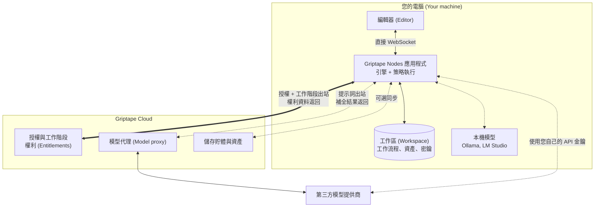
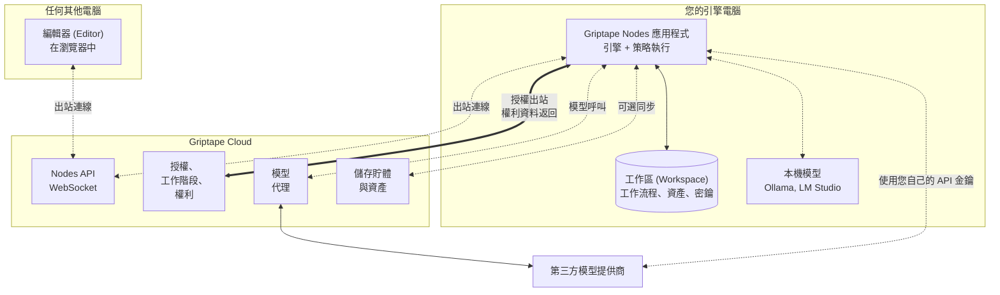
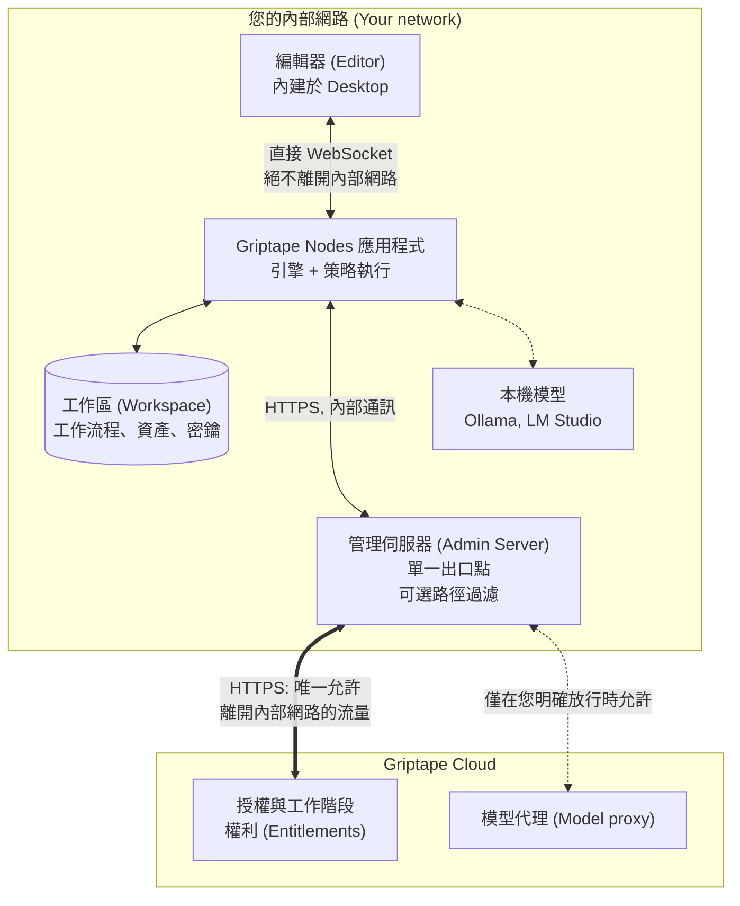

# 架構 (Architecture) {: #architecture }

Griptape Nodes 由兩個程式組成：用於構建工作流程的**編輯器 (Editor)**，以及在您控制的裝置上執行工作流程的**應用程式 (Application)**。應用程式負責執行具體工作、儲存資料，並僅在少數自身無法處理的事項上向 Griptape Cloud 發起外部呼叫。

無論哪種部署形態，這種架構均保持一致。唯一改變的是從您的裝置連接至 Griptape Cloud 的網路路徑：

- **[SaaS 設定](#saas-configuration)** 為預設模式。您的裝置直接連線至 Griptape Cloud。
- **[地端私有化設定 (On-premises configuration)](#on-premises-configuration)** 讓您的裝置與公網完全隔離。它們僅透過您自行運行的單一[管理伺服器 (Admin Server)](enterprise/admin_server.md)連線至 Griptape Cloud。

兩種模式運行完全相同的軟體。在兩者之間切換僅改變路由方式，而不改變產品本質。

## 核心組件 {: #the-pieces }

| 組件 | 說明 | 運行位置 |
| --- | --- | --- |
| **編輯器 (Editor)** | 構建工作流程的視覺化畫布。 | 在您的網頁瀏覽器中，或內建於 Griptape Nodes Desktop。 |
| **應用程式 (Application)** | 運行工作流程的主程式，以 [`griptape-nodes`](https://pypi.org/project/griptape-nodes/) 發行。負責執行圖 (Graph)、管理工作區，並強制實施授權所賦予的權限。 | 在您的本機裝置上。 |
| **引擎 (Engine)** | 開源的工作流程運行時 (Runtime)，以 [`griptape-nodes-engine`](https://pypi.org/project/griptape-nodes-engine/) 發行，原始碼託管於 [griptape-nodes-engine](https://github.com/griptape-ai/griptape-nodes-engine)。負責載入節點程式庫並執行計算圖。 | 在應用程式內部。 |

引擎是工作流程實際執行的核心場所，且完全開源，因此您可以隨時審計工作流程如何運行或在何處寫入檔案。它不是獨立的部署目標：編輯器始終連線至應用程式，絕不會直接連線至引擎。

[Griptape Nodes Desktop](installation.md#griptape-nodes-desktop-recommended) 內建了編輯器，並附帶鎖定版本的 Python 直譯器與應用程式，因此無需單獨安裝任何額外環境。

## 您的資料存放在哪裡 {: #where-your-data-lives }

您建立的幾乎所有內容都會寫入您的**工作區 (Workspace)**：這是應用程式進行讀寫操作的單一根目錄，所有相對路徑均從該目錄解析。其存放位置完全由您自行決定。預設為應用程式旁的資料夾，但您可以將其指向裝置可存取的任何位置，包括 NAS 掛載或 LucidLink 等網路儲存系統 — 這是許多將專案資料集中託管在共享基礎設施中的工作室的常見配置。詳見[工作區 (Workspace)](guides/projects/workspace.md)。

因此，當您關心資料走向時，請首先檢視工作區。應用程式只會寫入您設定的路徑，下表中的所有內容在預設情況下**絕不會**傳送至 Griptape Cloud：

| 內容 | 存放位置 | 是否傳送至 Griptape Cloud？ |
| --- | --- | --- |
| 工作流程與專案檔案 | 您的工作區 | 否 |
| 生成資產：圖像、影片、音訊 | 您的工作區 | 否，除非您將儲存後端切換為 Griptape Cloud |
| 機密資訊與 API 金鑰 | 環境變數，其次是工作區中的 `.env` 檔案，再者是用戶設定目錄中的檔案 | 否 |
| 對話歷史記錄 | 您的工作區 | 否 |
| 節點程式庫 | 安裝在運行應用程式的裝置上，每個程式庫均位於獨立的虛擬環境中 | 否 |

有兩個設定選項可以改變上述行為，預設均處於關閉狀態，並在[引擎設定 (Configuration)](guides/configuration.md)中有詳細記載：

- **儲存後端 (Storage backend)。** 預設為 `local`，即將資產寫入本機工作區。如果設定為 `gtc`，生成的資產將改為傳送至 Griptape Cloud 儲存貯體 (Bucket)。
- **同步工作流程 (Synced workflows)。** 選擇開啟透過 Griptape Cloud 儲存貯體同步工作流程，以便跨裝置共享。

除上述情況外，資料只有在工作流程主動發送時才會離開工作區：例如呼叫模型提供商的節點會將該節點的輸入傳送至對應的提供商。下一小節將詳細介紹。

## 哪些內容會與 Griptape Cloud 通訊 {: #what-talks-to-griptape-cloud }

應用程式僅在極少數關鍵功能上依賴 Griptape Cloud。以下是完整清單：

| 功能 | 是否必需？ | 跨越邊界的內容 |
| --- | --- | --- |
| **授權與工作階段 (Licensing and sessions)** | **必需。** 沒有它應用程式將無法運行。 | 您的授權金鑰，以及工作階段的分配 (Allocate)、續約 (Renew) 與釋放 (Release) 呼叫。不含任何工作流程內容。 |
| **權利 (Entitlements)** | 必需，與工作階段一同解析 | 授權所賦予的權限集，返回給應用程式後在本機強制實施 |
| **模型代理 (Model proxy)** | 否 | 您指向該代理的節點的提示詞與輸入，將轉發給模型提供商 |
| **儲存貯體與資產 (Buckets and Assets)** | 否，需主動開啟 | 您選擇同步的資產與工作流程 |
| **Nodes API WebSocket** | 否 | 當編輯器與應用程式不在同一台裝置上時傳輸事件 |
| **管理員儀表板 (Admin Dashboard)** | 否，僅限管理員 | 透過瀏覽器進行授權與權限管理。參閱[管理員儀表板](enterprise/admin_dashboard.md)。 |

**授權是唯一的硬性依賴項。** 授權是允許應用程式運行的憑據：應用程式驗證該授權，請求 Griptape Cloud 分配工作階段，接收關聯的權限，並在運行時於本機實施這些權限。工作流程內容絕不會參與此通訊。啟用流程請參閱[使用管理伺服器 (Using the Admin Server)](enterprise/using_the_admin_server.md)。

模型呼叫完全不必涉及 Griptape Cloud。您可以設定節點使用自己的 API 金鑰直接連線第三方提供商，或指向在 Ollama / LM Studio 下本機運行的模型，在此情況下提示詞絕不會離開您的裝置。參閱 [AI 提供商 (AI Providers)](guides/agent/providers/index.md)。

### 編輯器如何與應用程式通訊 {: #how-the-editor-reaches-the-application }

編輯器和應用程式是各自獨立的程式，因此它們之間的事件互動需要傳輸通道：

- **直接 WebSocket (Direct WebSocket)。** 應用程式在本機監聽，編輯器直接與其連線。事件絕不會離開電腦本機。這正是 Griptape Nodes Desktop 在透過授權啟用時所採用的傳輸方式。
- **Nodes API WebSocket。** 編輯器與應用程式各自向 Griptape Cloud 建立出站連線，由雲端在兩者之間中繼轉發事件。這使得瀏覽器中的網頁版編輯器能夠遠端控制運行在其他電腦上的應用程式。

這種差異對於資料隱私至關重要，因為編輯器流量承載了工作流程的實體內容：節點圖、參數值以及生成資產的預覽圖。在直接 WebSocket 模式下，這些資料完全不會暴露在網路上。無論哪種方式，您的工作區始終保留在運行工作流程的實體電腦上。下方的 [SaaS 設定](#saas-configuration) 小節為兩種拓撲分別繪製了架構圖。

## SaaS 設定 {: #saas-configuration }

預設部署模式。您的電腦直接連線 Griptape Cloud，因此無需在您的基礎架構側部署任何伺服器。此設定有兩種變體，僅在編輯器連線應用程式的方式上有所不同。

本頁中的三個架構圖中，實線代表必需的連線，虛線代表可選連線，雙向箭頭表示資料沿原路徑返回。Griptape Nodes 唯一無法缺少的網路流量就是授權通訊。

### 編輯器與引擎在同一台電腦上 {: #editor-and-engine-on-the-same-machine }

這是使用 Griptape Nodes Desktop 時獲得的標準架構。編輯器直接連線至代管引擎的應用程式，因此工作流程內容不會接觸外部網路。

### 編輯器與引擎在不同電腦上 {: #editor-and-engine-on-different-machines }

當您希望在比筆記型電腦效能更強大的工作站/伺服器上運行引擎，或者從輕量級筆電的瀏覽器中使用編輯器時，適用此架構。編輯器與應用程式各自向 Nodes API WebSocket 發起**出站 (Outbound)** 連線，由其在兩端中繼轉發事件。

由於雙方均向外撥號連線，此架構無需在伺服器端開啟任何傳入 (Inbound) 連接埠，且兩台電腦無需知道對方的 IP 位址。代價在於編輯器流量現在需要跨越公網：節點圖、參數值和資產預覽會經過 Griptape Cloud。但您的工作區依然保留在運行引擎的電腦上，工作流程也依然在該本機執行。

**這兩種變體均不適用於地端私有化環境。** Nodes API WebSocket 是一項 Griptape Cloud 雲端託管服務，因此地端部署始終使用直接 WebSocket 連線，以確保所有工作流程事件完全保留在您的內部網路中。

## 地端私有化設定 (On-premises configuration) {: #on-premises-configuration }

您的內部電腦無法直接存取公共網際網路。它們透過您在內部網路中運行的[管理伺服器 (Admin Server)](enterprise/admin_server.md)連線至 Griptape Cloud，因此您只需在防火牆上放行單一主機，而無需為每台終端電腦逐一設定規則。

該設定具備以下三大特性：

**構建或運行工作流程的任何環節都不會跨越網路邊界。** Griptape Nodes Desktop 內建了編輯器，無需透過網際網路從瀏覽器載入前端，且它透過直接 WebSocket 與應用程式通訊。工作流程、資產和機密金鑰全部存放在電腦本機的工作區中。結合本機模型運行時，工作流程從開始到結束可以在無任何封包離開內部網路的情況下完整執行。

**單一主機出口，且傳輸內容完全由您管控。** 所有的應用程式客戶端都指向內部管理伺服器，而非 `cloud.griptape.ai`，這為您提供了一個集中的防火牆規則以及唯一的出站流量審計點。管理伺服器還可以限制放行哪些 Cloud 路徑，使您能夠在允許授權驗證的同時將模型呼叫嚴格限制在內網。請參閱[轉發規則 (Forwarding rules)](enterprise/admin_server.md#forwarding)。它扮演轉發代理而非決策者的角色：它不驗證授權、不分配工作階段，也不快取任何內容，每個應用程式自身的認證資訊都會原封不動地穿透傳輸，交由 Griptape Cloud 進行驗收或拒絕。

**必須出站的流量是一份固定的、可嚴格檢查的清單。** 授權驗證僅需要存取以下路由，其餘一律非必需。如果您的網路設定阻斷了這些路由，管理伺服器將拒絕啟動：

| 路由路徑 | 必需原因 |
| --- | --- |
| `/api/sessions/*` | 分配並管理允許應用程式運行的工作階段。 |
| `/api/session-renew` | 保持該工作階段活躍（續約）。 |
| `/api/session-release` | 乾淨地結束工作階段並釋放基座授權 (Seat)。 |
| `/api/users` | 在啟動時以及每次活動訊號 (Heartbeat) 時識別授權持有者。 |
| `/api/organizations` | 在啟動時以及每次活動訊號時解析歸屬組織。 |

!!! note "為什麼維持 Cloud 連線至關重要"

    該連線的作用不僅僅是分配工作階段。它還是應用程式取得其授權當前最新內容的管道，因此當管理員在後台變更某個授權的權限設定時，正在運行的客戶端部署將在其下一次工作階段中立即獲得新權限，而無需等待重新核發授權或重新部署軟體。集中管理權利並讓其即時生效，是維持該路徑暢通的實際好處。

    這意味著地端私有化並非完全斷網模式 (Disconnected mode)。地端部署意味著您的電腦、工作流程和資產嚴格保留在內網中；這並不代表 Griptape Nodes 可以在完全無外聯路由的情況下運行。工作階段由 Griptape Cloud 分配，因此管理伺服器必須能夠連線至雲端。如果該路由不可用，管理伺服器將返回錯誤，而不會提供過期的陳舊核准，應用程式也將無法啟動新的工作階段。

## 相關頁面 {: #related-pages }

- [安裝 (Installation)](installation.md) 涵蓋安裝 Desktop 或手動安裝應用程式。
- [設定 (Configuration)](guides/configuration.md) 涵蓋工作區、儲存後端以及靜態伺服器設定。
- [資產與輸出 (Assets and Outputs)](guides/assets.md) 說明生成檔案的存放位置以及編輯器如何預覽它們。
- [使用管理伺服器 (Using the Admin Server)](enterprise/using_the_admin_server.md) 介紹透過授權金鑰啟用的具體步驟。
- [管理伺服器 (Admin Server)](enterprise/admin_server.md) 介紹如何部署和設定地端代理伺服器。
- [管理員儀表板 (Admin Dashboard)](enterprise/admin_dashboard.md) 介紹如何核發授權金鑰以及構建權限範本。
