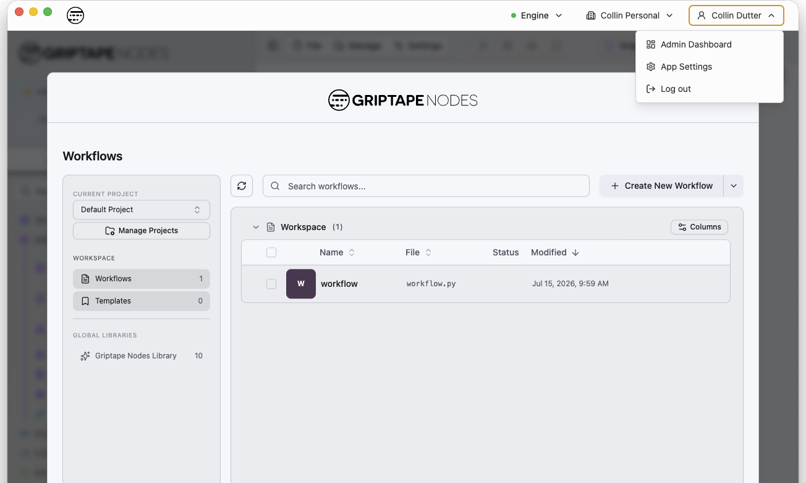
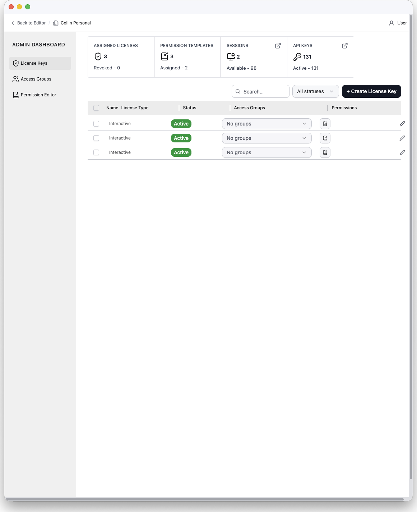
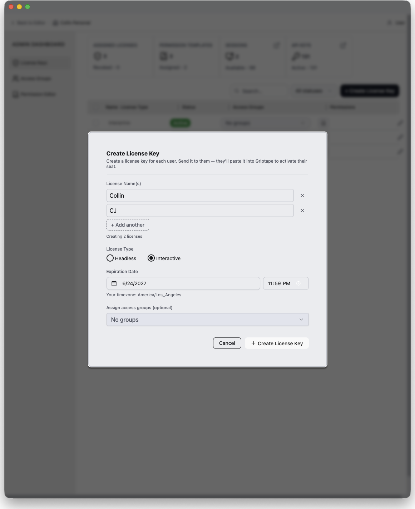
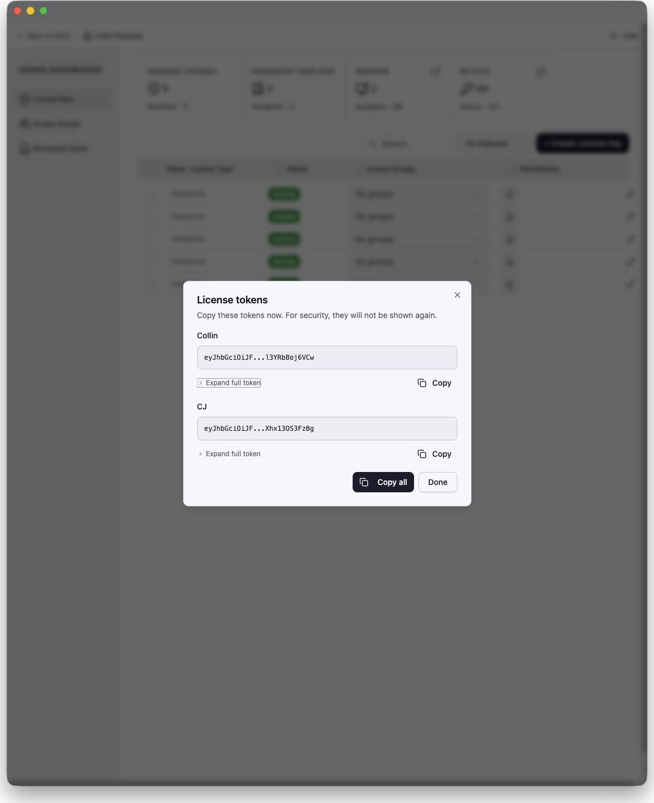
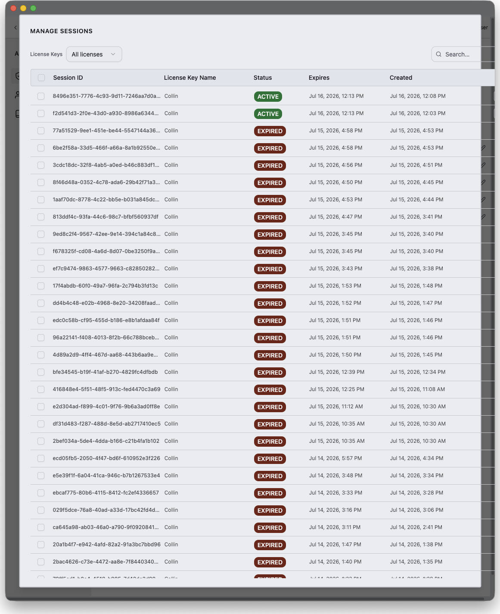
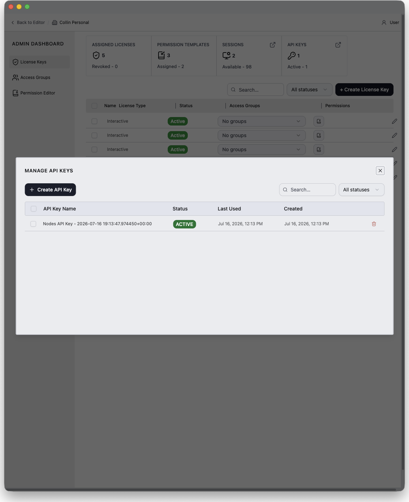
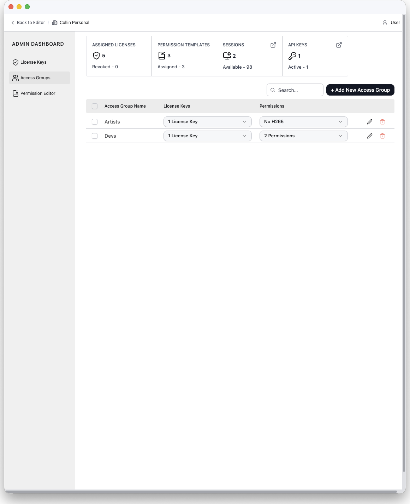
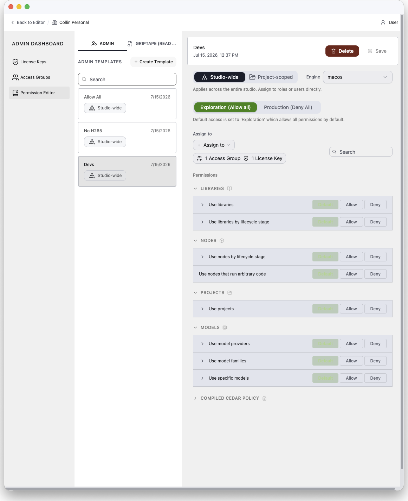
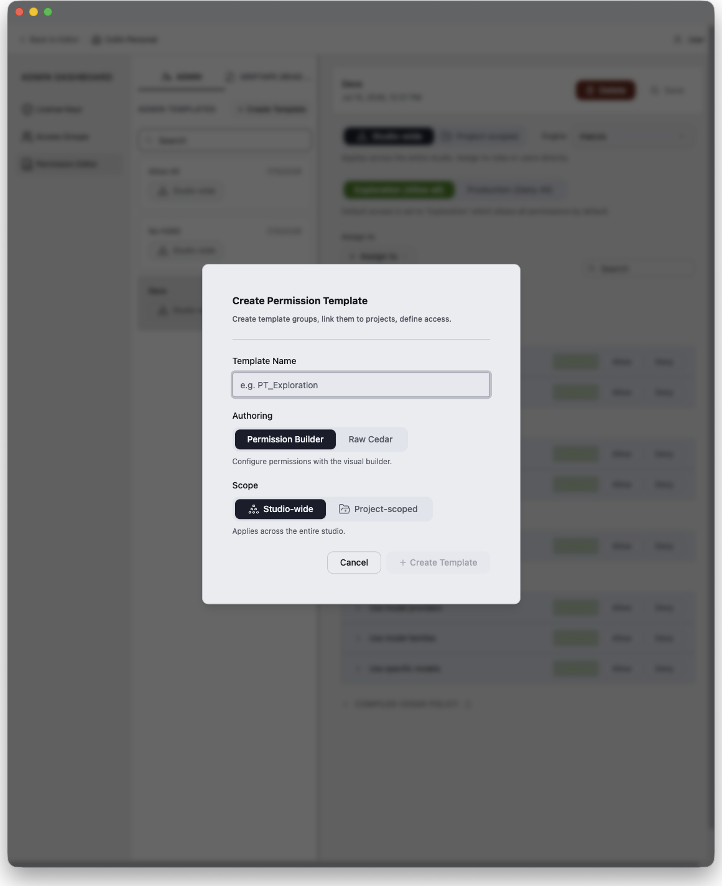
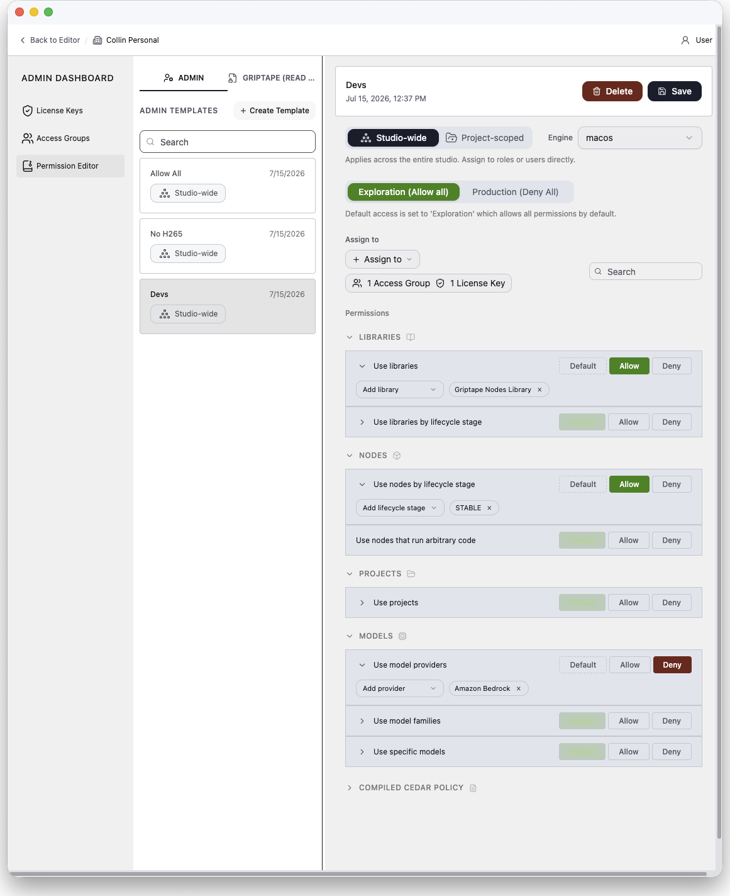

# 管理儀表板 (Admin Dashboard) {: #admin-dashboard }

管理儀表板是內建於 Griptape Nodes 編輯器中的企業管理介面。組織擁有者可透過此介面發行與管理授權金鑰、將使用者編排至存取群組中，並精細控管每位使用者可存取的程式庫、節點、模型與專案。

## 適用對象 {: #who-can-use-it }

管理儀表板用於管理您透過 Griptape Cloud **所擁有的組織**。它僅在您**使用 Griptape Cloud 帳號登入**時可用。

在桌面應用程式中，這意味著儀表板僅會對透過 **Login or Sign-Up** 登入的使用者顯示，而不會對透過授權金鑰啟用的席位顯示。授權啟用（請參閱 [使用管理伺服器 (Using the Admin Server)](using_the_admin_server.md)）所建立的工作階段背後並不具備雲端帳號：這些使用者是被管理的席位端，且 **Admin Dashboard** 選單項目絕不會對他們顯示。當您當前活動的組織非您所擁有時，該項目亦會自動隱藏。

若您擁有多個組織，儀表板頂端列的組織切換器可讓您在各組織間自由切換；您絕無法切換至非您所擁有的組織。

## 開啟管理儀表板 {: #opening-the-admin-dashboard }

在桌面應用程式中，點擊右上角的個人設定選單（顯示您姓名的按鈕），並選擇 **Admin Dashboard**。

儀表板會在獨立於編輯器的專屬視窗中開啟，以便您在進行日常創作的同時並行管理授權。再次選擇 **Admin Dashboard** 會聚焦至既有視窗。關閉該視窗不會影響編輯器的運作。

!!! note "網頁版編輯器亦同步提供"

    Griptape Nodes 網頁版編輯器亦提供相同的儀表板：開啟左下角的使用者選單並選擇 **Admin Dashboard**。在網頁版中，儀表板會直接取代編輯器檢視畫面，頂端列的 **Back to Editor** 連結可隨時帶您返回工作流程畫布。

儀表板主要包含：

- **頂端列**：包含 **Back to Editor** 連結、活動組織（或組織切換器）以及當前登入的使用者資訊。
- **側邊欄**：包含三個核心功能區塊：**License Keys**、**Access Groups** 與 **Permission Editor**。
- **儀表板設定 (Dashboard Settings)** 選單：固定於側邊欄底部，隨附新手入門指南與本文件的連結。

### 歡迎對話方塊 {: #the-welcome-dialog }

當您初次造訪時，歡迎對話方塊會簡要概述已指派的授權、權限範本以及活動工作階段。它同時提供了三項「快速上手」捷徑：

1. **為每位使用者建立授權金鑰**：為每個席位產生唯一金鑰並發送給使用者；使用者將其貼入 Griptape 中即可啟用存取權限。
1. **將授權金鑰集合建立為存取群組**：依部門或專案將金鑰分組，並針對整個群組統一指派權限範本。
1. **依專案自訂細部權限**：構建可在工作室全域或個別專案層級控管存取權限的權限範本。

勾選 **Don't show this again** 可永久關閉此對話方塊；您可隨時透過 **Dashboard Settings → Onboarding Guide** 重新開啟它。

## 授權金鑰 (License Keys) {: #license-keys }

**License Keys** 區塊是儀表板的首頁。這是您發行席位之處：為每位使用者分配一把授權金鑰，並以權杖 (Token) 形式交付給他們貼入桌面應用程式（使用者端的啟用流程請參閱 [使用管理伺服器 (Using the Admin Server)](using_the_admin_server.md)）。

### 統計資訊列 {: #the-stats-bar }

頂端的四個區塊磚概述了組織的整體狀況：

| 區塊磚 (Tile) | 顯示內容 | 點擊動作 |
| :--- | :--- | :--- |
| **Assigned Licenses** | 授權金鑰總數，以及其中已撤銷的數量。 | 無動作 |
| **Permission Templates** | 範本總數，以及其中已指派的數量。 | 無動作 |
| **Sessions** | 活動工作階段數量，以及剩餘可用數量。 | 開啟 Sessions 彈出視窗。 |
| **API Keys** | API 金鑰總數，以及其中處於活動狀態的數量。 | 開啟 API Keys 彈出視窗。 |

### 授權表格 {: #the-license-table }

表格中的每一列代表一把授權金鑰，包含：

- **Name**：通常為所屬的使用者姓名或席位名稱。
- **License Type**：`Interactive`（真人使用編輯器）或 `Headless`（自動化或無人值守運作）。
- **Status**：`Active`（活動中）、`Revoked`（已撤銷）或 `Expired`（已過期）。
- **Access Groups**：該金鑰所屬群組的行內多選下拉選單。當選取多列時，變更此設定會一次套用至所有已選取列。
- **Permissions**：彈出視窗列出適用於該金鑰的所有權限範本，包含直接指派與透過存取群組繼承的範本。繼承的項目會註明來源群組。範本可直接在此處移除。
- **Actions**：編輯 (Edit)、重新發行權杖 (Reissue token)、撤銷 (Revoke) 與刪除 (Delete)。

表格上方的工具列提供搜尋、狀態篩選以及 **+ Create License Key** 按鈕。點擊欄位標題可排序；欄寬可自由調整。

### 建立授權金鑰 {: #creating-license-keys }

點擊 **+ Create License Key**。對話方塊包含以下欄位：

- **License Name(s)**：一個或多個名稱。輸入多個名稱可單一步驟批次建立多把金鑰（每個名稱一把）。
- **License Type**：`Interactive` 或 `Headless`。此項在建立後**無法變更**。
- **Expiration Date**：必填；必須介於當前時間起算 1 至 730 天之間。
- **Access Groups**：選填，將新建立的金鑰直接新增至既有群組。

建立成功後，對話方塊會揭示每個授權權杖**精確一次**。請複製權杖並交付給使用者。日後將無法再次檢視該數值。若權杖遺失，請使用 **Reissue** 重新產生新權杖。

### 管理授權金鑰 {: #managing-license-keys }

- **Edit**：重新命名金鑰並變更其存取群組歸屬。
- **Reissue token**：為同一授權重新產生替換權杖。該數值僅顯示一次。
- **Revoke**：釋放該金鑰既有的所有工作階段，並阻止該權杖分配新的工作階段。僅有活動中的金鑰可被撤銷或重新發行。
- **Delete**：永久刪除該金鑰。此操作無法復原。

### 工作階段 (Sessions) {: #sessions }

點擊 **Sessions** 區塊磚可開啟工作階段彈出視窗。此處列出您組織的所有工作階段，包含工作階段 ID、持有該工作階段的授權金鑰、狀態、到期時間與建立時間，並可依狀態篩選。在此處您可以：

- **釋放 (Release)** 工作階段（支援可配置的寬限期），將席位釋出給其他使用者使用。
- **刪除 (Delete)** 工作階段記錄。

### API 金鑰 (API Keys) {: #api-keys }

點擊 **API Keys** 區塊磚可開啟 API 金鑰彈出視窗，用於管理您組織的 Griptape Cloud API 金鑰。例如 [管理伺服器 (Admin Server)](admin_server.md) 即需使用一組金鑰。金鑰數值僅會揭示一次，請務必立即複製。您亦可在此刪除不再需要的金鑰。

## 存取群組 (Access Groups) {: #access-groups }

存取群組可依部門、團隊或專案專案集中管理授權金鑰，以便針對整個集合統一管控權限。指派給群組的權限範本會自動套用至該群組內部的每把授權金鑰。

表格中的每一列代表一個群組，包含：

- **Access Group Name**
- **License Keys**：群組內金鑰的行內多選下拉選單。
- **Permissions**：指派給該群組的自訂範本與 Griptape 受管範本的行內多選下拉選單。Griptape 受管範本會帶有 Managed 標章。

透過 **+ Add New Access Group** 建立群組，提供群組名稱並選填初始授權金鑰與權限範本。群組可直接從該列進行編輯或刪除；刪除群組不會刪除其所包含的授權金鑰。

## 權限編輯器 (Permission Editor) {: #permission-editor }

權限編輯器是您編寫 **權限範本 (Permission Templates)** 的場所：權限範本是決定授權金鑰允許執行哪些操作的具名政策規章。範本可指派給存取群組或直接指派給個別授權金鑰；金鑰的有效權限是所有指派給它的規則集合，且**明確拒絕 (Deny) 永遠優先於允許 (Allow)**。

### 範本清單 {: #template-list }

左側面板透過兩個分頁列出範本：

- **Admin**：由您組織的管理員所編寫的範本。具備完整編輯權限。
- **Griptape (read-only)**：由 Griptape 原廠編寫與維護的範本。您可將其掛載至存取群組或授權金鑰並審查其內容，但無法直接修改。

搜尋欄可同時篩選兩個分頁。**+ Create Template** 可開啟建立對話方塊。

### 建立範本 {: #creating-a-template }

建立對話方塊包含以下欄位：

- **Template Name**
- **Authoring mode**（編寫模式）：
    - **Permission Builder**：透過下述的可視化建構器配置權限。這是推薦的模式。
    - **Raw Cedar**：建立後在 [Cedar](https://www.cedarpolicy.com/) 編輯器中手動撰寫政策。原始 Cedar 範本不支援視覺化建構器。
- **Scope**（僅適用於建構器模式）：**Studio-wide**（工作室全域）或 **Project-scoped**（專案範疇）（詳見下文）。

### 可視化權限建構器 (Permission Builder) {: #the-permission-builder }

選取建構器範本後會開啟其詳細面板，面板由上至下組織如下：

#### 範疇 (Scope) {: #scope }

範本分為兩種範疇：

- **Studio-wide**：套用至整個工作室全域，在該授權使用的所有情境下皆生效。
- **Project-scoped**：連結至引擎上的特定專案範本。其規章僅在引擎於該專案或其專案祖先鏈中工作時生效。

範疇設定列亦可選擇 **Engine**。連線引擎會載入包含其已安裝程式庫、專案範本、模型與模型提供者的資訊清單。該資訊清單會填入建構器的選單中，使您能直接依名稱選取資源。專案範疇範本亦需從引擎的專案範本中選擇一個 **Linked project**。

#### 預設存取權限 (Default access) {: #default-access }

範本的基準態勢 (Posture)，決定未經明確配置的項目的預設行為：

- **Exploration (Allow all)**：預設允許所有操作；僅明確拒絕特定項目。適合外觀開發 (Look-development) 與研發探索。
- **Production (Deny All)**：預設拒絕所有操作；僅明確允許特定項目。適合進入正式製作階段的專案鎖定態勢。

若日後切換態勢，個別權限的明確設定值仍會保留其設定意涵。

#### 指派對象 (Assign to) {: #assign-to }

將範本掛載至 **存取群組 (Access Groups)** 及/或直接指派給個別 **授權金鑰 (License Keys)**。透過群組進行的指派會涵蓋群組中的每把金鑰。

#### 權限清單 (Permissions) {: #permissions }

權限清單是按分類分組的功能能力目錄。每一列可設定為 **Allow**（允許）或 **Deny**（拒絕），或維持 **Default** 以遵循基準態勢；且多數項目可**限定於特定資源範疇**（例如僅拒絕特定程式庫而非全部）：

| 分類 (Category) | 功能能力 (Capability) | 控制範圍 | 可限定範疇之對象 |
| :--- | :--- | :--- | :--- |
| **Libraries** | 使用程式庫 | 載入節點程式庫。 | 特定程式庫 |
| **Libraries** | 依生命週期階段使用程式庫 | 載入特定生命週期階段（`STABLE`、`BETA`、`ALPHA`、`LABS`、`DEPRECATED`）的程式庫。 | 生命週期階段 |
| **Nodes** | 依生命週期階段使用節點 | 使用特定生命週期階段的節點。 | 生命週期階段 |
| **Nodes** | 使用執行任意程式碼的節點 | 資訊清單宣告為執行任意 Python 的節點。 | 無法限定範疇 |
| **Projects** | 使用專案 | 載入與啟用專案。 | 特定專案 |
| **Models** | 使用模型提供者 | 該提供者旗下的所有模型。被拒絕的模型會從模型選擇器中過濾隱藏並阻止調用；節點仍可建立。 | 特定提供者 |
| **Models** | 使用模型家族 | 特定家族中的模型（例如 Claude 4、GPT-4）。選擇器過濾與阻止調用機制同上。 | 特定家族 |
| **Models** | 使用特定模型 | 依 ID 指定的個別模型。選擇器過濾與阻止調用機制同上。 | 特定模型 |
| **Video** | 使用視訊轉碼器 | 依轉碼器讀寫視訊影片（例如 `h264`、`hevc`、`prores`）。 | 特定轉碼器 |

當同一個授權金鑰所套用的不同範本或存取群組之間發生衝突時，受影響的列會顯示警告訊息並標記衝突的範本與金鑰名稱。例如一個範本允許某項能力，但指派群組中的另一個範本卻加以拒絕。**拒絕 (Deny) 永遠勝出**。

#### 已編譯的 Cedar 政策 (Compiled Cedar) {: #compiled-cedar }

建構器會將您的設定編譯為 [Cedar](https://www.cedarpolicy.com/) 政策語句。Griptape Nodes 會在授權檢查點評估這些語句。**Compiled Cedar Policy** 區塊預設折疊，展開後會顯示上次儲存編譯出的 Cedar 政策碼。詳情請參閱 [Cedar 政策參考手冊 (Cedar Policies)](cedar_policies.md)。

### 原始 Cedar 範本 (Raw Cedar Templates) {: #raw-cedar-templates }

在 **Raw Cedar** 模式下建立的範本會略過視覺化建構器，直接提供帶有語法驗證功能的 Cedar 程式碼編輯器。包含語法錯誤的範本將無法儲存。語法驗證不會檢查動作或屬性名稱是否符合引擎的 Cedar 結構綱要，因此請仔細審查。編輯器上方的唯讀語句摘要會逐句解析該政策，且具備相同的 **Assign to** 控制面板。全新建立的原始範本預設填入 `permit(principal, action, resource);`（允許所有操作），鏡像對齊建構器的 Exploration 探索態勢。

當功能能力目錄無法涵蓋您所需的細部規則時，請撰寫原始 Cedar 範本。[Cedar 政策參考手冊 (Cedar Policies)](cedar_policies.md) 記載了可比對的檢查點、資源屬性與情境事實，並隨附豐富的實作範例。

### Griptape 原廠受管範本 {: #griptape-managed-templates }

在 **Griptape (read-only)** 分頁中選取範本會顯示其描述說明、逐句權限解析以及完整的 Cedar 原始碼。受管範本無法被編輯或刪除。您僅能將其掛載至存取群組與授權金鑰，或自其卸載解除綁定。

## 典型整合部署架構 {: #how-it-fits-together }

典型的企業推廣流程如下：

1. 在權限編輯器中**建立權限範本**。例如為研發人員建立「Exploration」範本，並為進入正式製作的專案建立僅允許核准程式庫與模型提供者的「Production」鎖定範本。
1. 為各個團隊或專案專案**建立存取群組**，並為每個群組指派適當的權限範本。
1. **為每位使用者建立授權金鑰**，將各金鑰新增至對應的存取群組，並將授權權杖發送給使用者。
1. 使用者在桌面應用程式中貼入權杖以**啟用**席位。內部部署環境請搭配使用 [管理伺服器 (Admin Server)](admin_server.md)。透過授權啟用的使用者僅能操作編輯器；管理儀表板絕不會對他們顯示。
1. 在 License Keys 區塊監控與管理席位。觀察活動中的**工作階段 (Sessions)**、**釋放 (Release)** 卡死的工作階段、針對遺失的權杖**重新發行 (Reissue)**，並在成員離職時**撤銷 (Revoke)** 金鑰。
