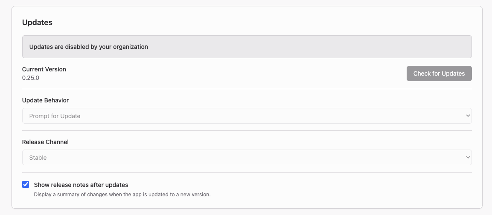

# 停用應用程式自動更新 (Disabling App Updates) {: #disabling-app-updates }

管理員可透過機器層級的 `policy.json` 檔案停用 Griptape Nodes Desktop 的自動更新。當您的組織統一分發經過核准的軟體版本，而非讓每台電腦自行連網更新時，請使用此功能。

此功能需要 Griptape Nodes Desktop 0.24.0 或更新版本。舊版本會直接忽略此檔案。

## 建立政策設定檔 {: #create-the-policy-file }

建立包含以下內容的 `policy.json` 檔案：

```json
{ "disableUpdates": true }
```

將該檔案放置於對應作業系統的指定路徑：

| 作業系統平台 | 檔案路徑 |
| :--- | :--- |
| macOS | `/Library/Application Support/ai.griptape.nodes.desktop/policy.json` |
| Windows | `%ProgramData%\GriptapeNodes\policy.json` |
| Linux | `/etc/griptape-nodes-desktop/policy.json` |

應用程式本身不會主動建立該目錄或檔案。請在使用者初次啟動應用程式前，手動或透過系統映像檔部署/裝置管理系統 (MDM) 建立好目錄與檔案。若應用程式目前正在執行，請先將其退出關閉。

應用程式在啟動開機時會讀取該政策一次。對該檔案的任何變更將於下次啟動應用程式時生效。

## 使用者所見之介面變化 {: #what-users-see }



App Settings（應用程式設定）會顯示 **Updates are disabled by your organization**（更新功能已由您的組織停用）。以下控制元件將被停用：

- **Check for Updates**（檢查更新）
- **Update Behavior**（更新行為）
- **Release Channel**（發布通道）

**Show release notes after updates**（更新後顯示版本資訊）仍維持可用，並會在管理員安裝新版本後正常展示更新日誌。

若使用者自 macOS 的應用程式選單或 Windows 與 Linux 的 **Help** 選單點選 **Check for Updates…**，應用程式會顯示 **Updates are managed by your organization**（更新由您的組織統籌管理）。

當此政策生效時，應用程式不會執行自動或由使用者觸發的更新檢查，且不會向上游發送任何更新摘要源 (Update Feed) 請求。

## 安裝應用程式更新 {: #install-app-updates }

在停用內建更新器後，請將通過核准的安裝程式分發至各受管機器進行安裝。政策檔案獨立於應用程式安裝目錄之外，因此直接覆蓋安裝新版本不會移除該政策檔。安裝後更新功能依然維持停用狀態。

使用者仍可正常在應用程式內部安裝與更新節點程式庫和 AI 模型。每個應用程式版本會持續使用隨該版本隨附打包的引擎。

## 重新啟用應用程式更新 {: #re-enable-app-updates }

刪除 `policy.json` 或將 `disableUpdates` 改為 `false`，接著重新啟動應用程式即可。Updates 區塊將回復使用該機器先前的 **Update Behavior** 與 **Release Channel** 設定。

唯有字面值的 `true` 才會停用更新。缺少檔案、無效的 JSON 或任何其他數值皆會使更新維持由使用者自主控制。非受管的一般機器無需放置政策檔案。

## 相關文件 {: #related }

- [應用程式設定：更新 (App Settings: Updates)](../guides/desktop/app_settings.md#updates)：更新行為與發布通道
- [管理伺服器 (Admin Server)](admin_server.md)：讓受管機器與公用網際網路隔離
