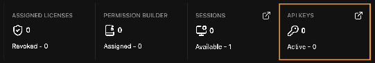

# 內部部署快速上手指南 (On-Premises Quick Start) {: #on-premises-quick-start }

這是從零開始建立正常運作的內部部署 (On-Premises) 環境的最短路徑：在您的內部網路中部署一台 [管理伺服器 (Admin Server)](admin_server.md)、從 [管理儀表板 (Admin Dashboard)](admin_dashboard.md) 發行已授權的席位授權金鑰，並讓桌面應用程式僅透過該伺服器與 Griptape Cloud 通訊。各個執行個體指向 Admin Server 而非直接連線至 `cloud.griptape.ai`，因此您只需管理一條輸出防火牆規則，並擁有集中審計對外流量的單一端點。

若您的各個執行個體本就可以直接連線至 `cloud.griptape.ai` 且這在您的企業環境中是可以接受的，則您完全不需要進行此部署。

步驟 1 至 4 由管理員執行一次。步驟 5 至 7 則是針對每位使用者的推廣部署步驟。

## 開始之前 {: #before-you-start }

您需要具備：

- **Admin Server 二進位執行檔**。該檔案僅提供給企業客戶——請 [聯絡 Foundry](https://www.foundry.com/products/griptape/request-demo) 取得。
- **擁有欲部署組織權限的 Griptape Cloud 帳號**。管理儀表板僅會對組織擁有者 (Organization Owner) 顯示。
- **內部網路中的一台主機**，允許向外發起至 `cloud.griptape.ai` 的 HTTPS 連線，且您的工作站能在其監聽連接埠（預設為 `8080`）上連線至該主機。其他 Griptape Nodes 執行個體皆不需要網際網路存取權限。
- **一台連接網際網路的機器用於管理操作**。管理儀表板需直接與 Griptape Cloud 通訊，因此無法在完全封閉的內部部署機器上直接操作——詳見步驟 1。

## 1. 建立 Griptape Cloud API 金鑰 {: #1-create-a-griptape-cloud-api-key }

Admin Server 需要 **Griptape Cloud API 金鑰** 才能啟動。這與您在步驟 5 中發行給使用者的 **授權金鑰 (License Keys)** 不同：API 金鑰用於向 Griptape Cloud 驗證 Admin Server 本身的身份，只需建立一次，且歸屬於您而非個別授權席位。

此金鑰取自 **管理儀表板 (Admin Dashboard)**，因此目前尚無需安裝任何軟體——從任何可連接網際網路的瀏覽器登入網頁版編輯器即可。若您已安裝桌面應用程式，其運作方式完全相同；兩者使用同一介面。

1. 透過 **Login or Sign-Up** 登入。您必須是欲部署組織的擁有者。
1. 開啟 **管理儀表板 (Admin Dashboard)**：
    - **網頁版編輯器** — 左下角的使用者選單。儀表板將取代編輯器畫面；點擊 **Back to Editor** 可返回。
    - **桌面應用程式** — 右上角的個人設定選單。儀表板會在獨立視窗中開啟。
1. 儀表板預設開啟於 **License Keys** 頁面。您目前尚無需發行席位，請忽略授權表格並點擊統計列中的 **API Keys** 區塊磚。
1. 建立金鑰。其金鑰數值僅會顯示**一次**——請務必立即複製保存。



該金鑰不會用於請求路徑的轉發驗證。它僅用於向雲端確認操作人員確實擁有一組 Griptape 組織——使用者應用程式依然會發送其自有的 `Authorization` 標頭，Admin Server 會原封不動地轉發該標頭。

## 2. 安裝 Admin Server {: #2-install-the-admin-server }

在您選擇的主機上解壓縮檔案套件。其包含：

- `server` — 二進位執行檔
- `config.example.yaml` — 可供複製、編輯與使用的範本檔
- `README` 與 `LICENSE`

## 3. 設定 Admin Server {: #3-configure-the-admin-server }

您唯一必須設定的是 API 金鑰環境變數：

```bash
export GT_CLOUD_API_KEY="gt-..."
```

伺服器會在啟動時驗證該金鑰，若缺少該金鑰將無法開機。組態檔案僅用於指定讀取金鑰的變數名稱；金鑰本體絕不應寫入檔案中。

組態檔案是**選填**的。直接執行 `./server` 即可正常啟動——缺少 `config.yaml` 並非錯誤，伺服器會自動採用內建預設值以及任何環境變數覆寫。若預設值符合您的需求，可直接跳至步驟 4 進行啟動。

!!! note "在信任預設值之前請先檢查您的版本"

    執行 `./server -version`。未配置的預設值僅在 Admin Server 0.3.0 及更新版本中是安全的。舊版本預設將 `read_timeout` 與 `write_timeout` 設為 `30s`，這會在串流回覆中途強制切斷——有關具體應設定的數值，請參閱 [Admin Server：組態設定](admin_server.md#configuration)。

若欲修改設定，建議複製套件隨附的範本而非從零編寫：

```bash
cp config.example.yaml config.yaml
```

設定項目的解析順序為：內建預設值，接著是組態檔案，最後是環境變數。環境變數永遠具備最高優先權。

設定檔包含四個區塊 — `server`、`upstream`、`logging` 與 `forwarding`。有關逐鍵參考手冊、預設值與對應的環境變數，請參閱 [Admin Server：組態設定 (Admin Server: Configuration)](admin_server.md#configuration)。

## 4. 啟動與驗證 {: #4-start-and-verify }

```bash
./server                      # 使用預設值加上環境變數覆寫
./server -config config.yaml  # 若您建立了組態檔案
```

伺服器會將日誌輸出至 stdout 與 stderr。它本身不會寫入實體日誌檔——若您需要日誌檔請重導向串流，或交由您的服務管理工具 (Service Manager / systemd) 收集。

檢查伺服器是否正常上線運作：

```bash
curl http://<admin-server-address>:8080/health
# {"status":"ok"}
```

若 API 金鑰遺失或無效，或是上游服務無法連線，伺服器會記錄具體原因並直接退出而非對外提供服務。任何組態問題皆會在開機時立即浮現。

## 5. 發行授權金鑰 (License Keys) {: #5-issue-license-keys }

回到 **管理儀表板 (Admin Dashboard)**，前往 **License Keys → + Create License Key**：

- **License Name(s)** — 每個席位一個名稱。可輸入多個名稱以單一步驟批次建立。
- **License Type** — 編輯器真人使用者請選 `Interactive`；自動化運作請選 `Headless`。此項在建立後**無法變更**。
- **Expiration Date** — 必填，介於 1 至 730 天之間。
- **Access Groups** — 立即將該金鑰新增至對應的存取群組中。

每個權杖 (Token) 僅會揭示**精確一次**。請將其複製並交付給使用者。若權杖遺失，可針對該授權使用 **Reissue** 重新產生新權杖。

若您打算限制席位可執行的操作——例如限制其可使用的程式庫、節點、專案與模型——請先在側邊欄同名區塊中構建您的 **權限範本 (Permission Templates)** 與 **存取群組 (Access Groups)**。兩者皆可在建立金鑰時直接指派，這比事後補救更為省力。Griptape 亦提供了開箱即用的唯讀受管範本，您可以直接掛載。請參閱 [管理儀表板：權限編輯器 (Admin Dashboard: Permission Editor)](admin_dashboard.md#permission-editor)。

## 6. 將 Griptape Nodes 推廣部署至各工作站 {: #6-roll-out-griptape-nodes-to-workstations }

在每位使用者的電腦上安裝 **桌面應用程式 (Desktop Application)** — 詳見 [安裝指南 (Installation)](../installation.md)。

在此部署架構下，桌面應用程式是必要的，而非選填。網頁版編輯器是由雲端託管，並透過 Cloud 中繼通道與其引擎通訊，這不屬於內部部署路徑；內部部署採用的是透過本機直接 WebSocket 連線至引擎的桌面應用程式。網頁版編輯器作為管理員發行金鑰的工具非常合適，但在本部署架構中並非美術創作人員使用的編輯器。

這些工作站電腦**不需要**網際網路存取權限。它們僅需能夠連線至 Admin Server。

傳送給每位使用者兩項資訊：

1. 他們的授權權杖 (License Token)。
1. Admin Server 的連線位址，例如 `http://admin.internal.example.com:8080`。

## 7. 在各工作站上進行啟用 {: #7-activate-on-each-workstation }

1. 啟動桌面應用程式。
1. 在登入畫面上，點擊 **Activate with a License** 而非傳統登入。
1. 將權杖貼入 **License Key** 欄位。
1. 在 **Griptape Server Endpoint** 欄位中，將 `https://cloud.griptape.ai` 替換為您的 Admin Server 位址。此步驟正是將部署架構轉為內部部署的核心關鍵。
1. 點擊 **Activate License**。

端點位址與授權金鑰皆會被自動記憶。在日後的登入中，使用者可從 **Saved licenses** 中直接選取金鑰。有關此流程的螢幕截圖，請參閱 [使用管理伺服器 (Using the Admin Server)](using_the_admin_server.md)。

透過授權啟用的使用者僅能使用編輯器。管理儀表板絕不會對他們顯示，因為此啟用方式所建立的工作階段背後並不具備雲端帳號。

## 疑難排解 (Troubleshooting) {: #troubleshooting }

**管理儀表板選單項目消失**：您可能是使用授權金鑰登入而非雲端帳號，或者當前活動的組織並非您所擁有。請透過 **Login or Sign-Up** 登入並檢查組織切換選單。

其他所有問題——包含 `502` 回應、`403 {"error":"path not permitted"}`、啟動失敗、上傳失敗與啟用異常——皆記載於：

- [Admin Server：疑難排解 (Admin Server: Troubleshooting)](admin_server.md#troubleshooting)：維運人員端
- [使用 Admin Server：疑難排解 (Using the Admin Server: Troubleshooting)](using_the_admin_server.md#troubleshooting)：使用者端啟用

## 相關文件 {: #related }

- [安裝指南 (Installation)](../installation.md)：安裝 Griptape Nodes
- [管理伺服器 (Admin Server)](admin_server.md)：組態設定、環境變數與疑難排解
- [管理儀表板 (Admin Dashboard)](admin_dashboard.md)：授權金鑰、存取群組與權限範本
- [使用管理伺服器 (Using the Admin Server)](using_the_admin_server.md)：使用者端啟用流程
- [架構：內部部署組態](../architecture.md#on-premises-configuration)：Admin Server 的整體網路拓撲定位
