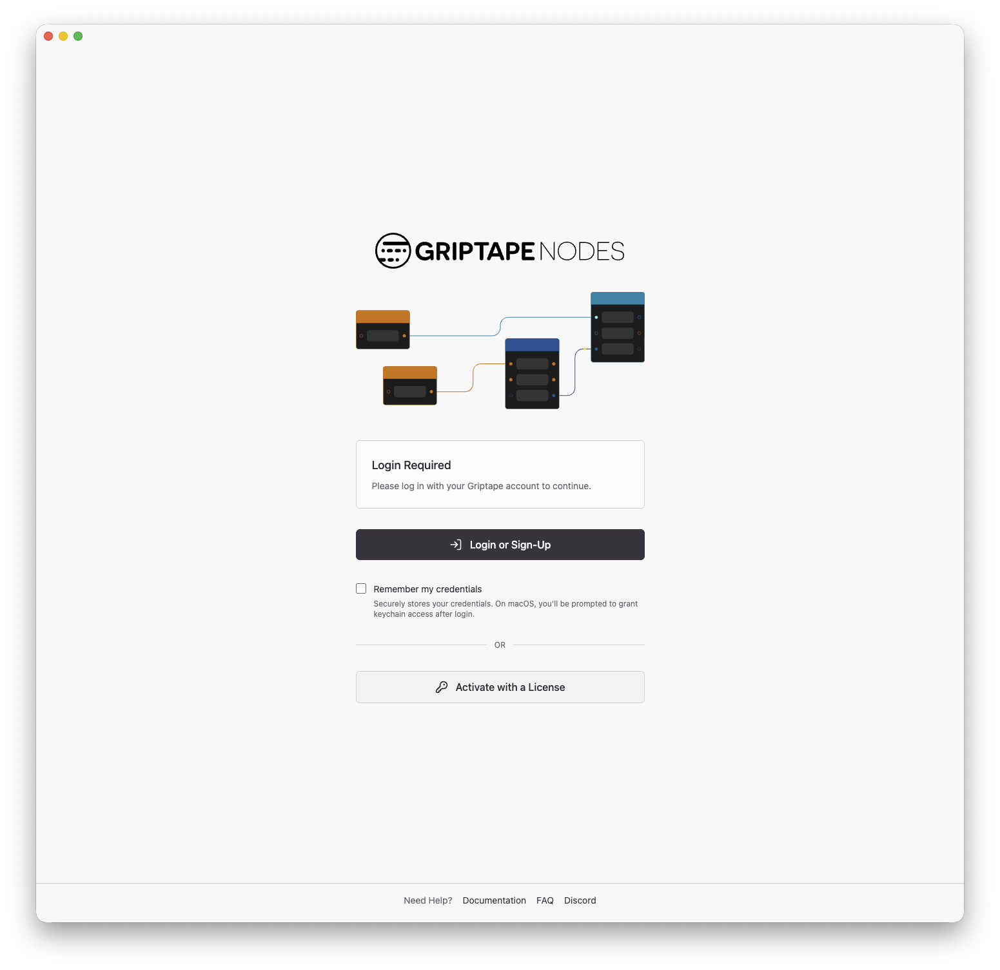
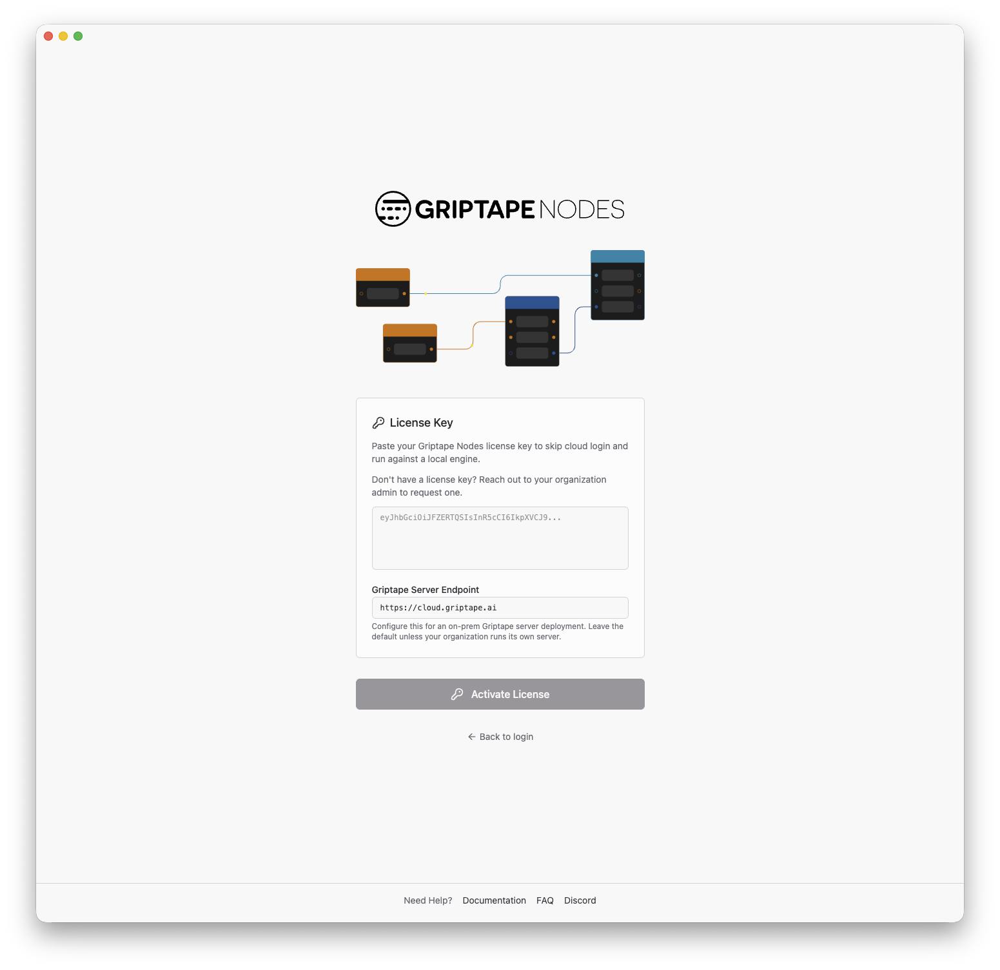
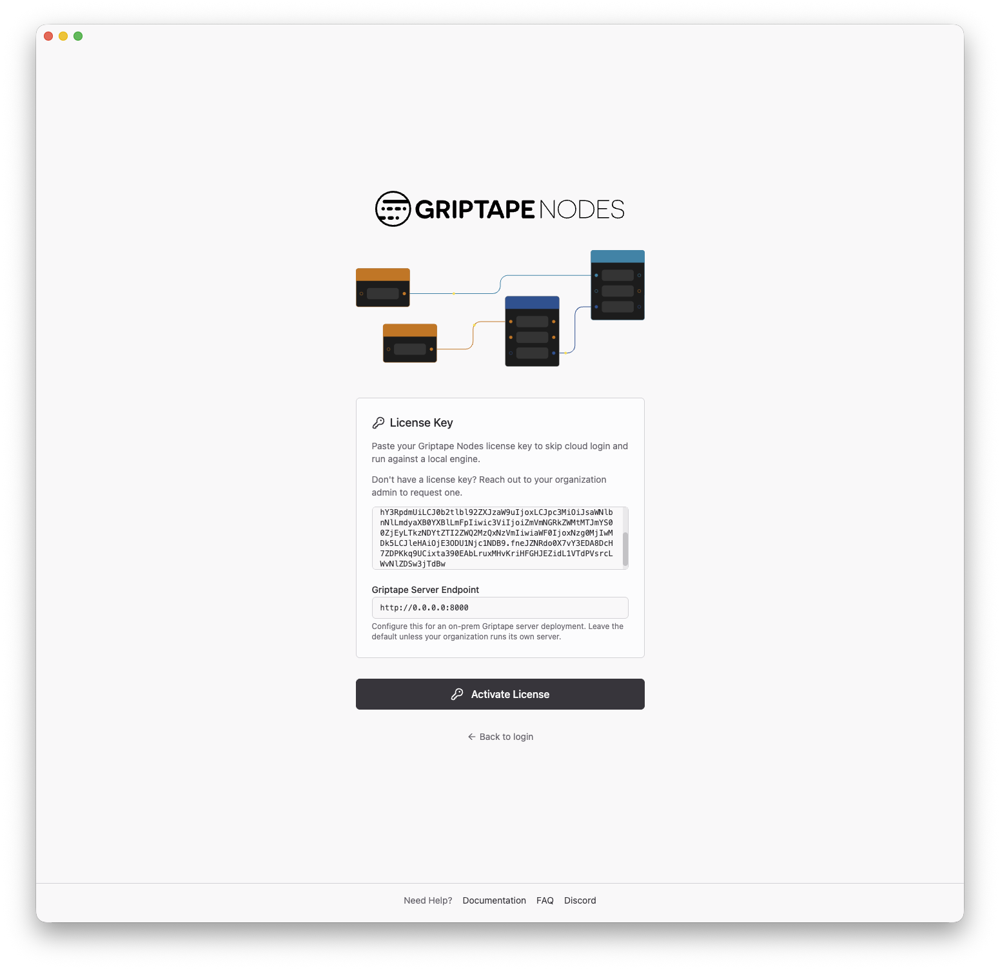

# 使用管理伺服器 (Using the Admin Server) {: #using-the-admin-server }

當您的 [管理伺服器 (Admin Server)](admin_server.md) 啟動並正常運行後，使用者可透過桌面應用程式使用授權啟用，而非透過 Griptape Cloud 登入，藉此連線至該管理伺服器。本頁面將從終端使用者的視角引導您完成該操作流程。

## 開始之前 {: #before-you-start }

每位使用者皆需要：

- 已安裝 **Griptape Nodes 桌面應用程式**。
- 一組 **授權金鑰 (License Key)**。金鑰由您的組織所發行；使用者應向其組織管理員申請。
- **Admin Server 連線位址**。Admin Server 在您內部網路中可被存取的 URL，例如 `http://admin.internal.example.com:8080`。您的 Admin Server 維運人員可提供該資訊。

## 透過授權啟用 (Activate with a license) {: #activate-with-a-license }

### 1. 開啟授權啟用表單 {: #1-open-the-license-form }

啟動桌面應用程式。在登入畫面上，不點選 Griptape Cloud 登入，而是點擊 **Activate with a License**。



### 2. 貼入您的授權金鑰 {: #2-paste-your-license-key }

在 **License Key** 欄位中，貼入您自組織管理員處收到的授權金鑰。



### 3. 指向 Admin Server 端點 {: #3-point-at-the-admin-server }

在 **Griptape Server Endpoint** 欄位中，將預設的 Griptape Cloud 位址 (`https://cloud.griptape.ai`) 替換為您內部 Admin Server 的連線位址：

```text
http://admin.internal.example.com:8080
```

這是內部部署的關鍵步驟：透過設定該端點，應用程式會將其所有的 Griptape Cloud 網路流量導向 Admin Server，而非直接存取公用網際網路。



### 4. 執行啟用 {: #4-activate }

點擊 **Activate License**。應用程式會驗證授權並如常啟動引擎，帶領您進入畫布編輯器。自此之後，包含授權驗證、工作階段管理以及您組織所允許的任何 Cloud 功能，皆會全數透過 Admin Server 進行轉發。

## 複用已儲存的授權 (Reusing a saved license) {: #reusing-a-saved-license }

您先前啟動過的授權會被系統自動記憶。若您登出（或授權被停用），在點擊 **Activate with a License** 後，登入畫面會顯示 **Saved licenses** 區塊。點擊已儲存授權旁的 **Use** 即可重新啟用，無需再次貼入金鑰。已設定的伺服器端點亦會被記憶，因此您僅需輸入一次 Admin Server 位址。

## 疑難排解 (Troubleshooting) {: #troubleshooting }

- **啟用立即失敗**：檢查授權金鑰是否完整貼入且尚未過期。若金鑰無誤，請確認 **Griptape Server Endpoint** 是否正確且本機能否連線至該主機——嘗試在瀏覽器中開啟 `http://<admin-server-address>/health`；健全的伺服器會回傳 `{"status":"ok"}`。
- **先前可以啟用但現在失敗**：授權可能已經過期。請向您的組織管理員申請新授權。
- **啟用後部分功能回傳錯誤**：若 Admin Server 配置了 [轉發規則 (forwarding rules)](admin_server.md#forwarding)，未獲准的路徑會被伺服器以 `403 {"error":"path not permitted"}` 拒絕。請詢問您的 Admin Server 維運人員該功能所涉及的路由是否允許輸出。
- **所有操作皆回傳錯誤**：若每個請求皆失敗，可能是 Admin Server 本身無法連線至 Griptape Cloud。這是維運人員端的問題——請參閱 [Admin Server 疑難排解章節](admin_server.md#troubleshooting)。
