# 應用程式設定 (App Settings) {: #app-settings }

Griptape Nodes Desktop 擁有專屬的設定畫面，獨立於您從編輯器 **Settings (設定)** 功能表中存取的引擎與編輯器設定。應用程式設定涵蓋了應用程式本體所掌管的各項配置：關閉行為、外觀佈景主題、傳遞給引擎的工作區、軟體授權、日誌檔案以及應用程式自身的更新方式。

## 開啟應用程式設定 {: #opening-app-settings }

點擊視窗右上角的使用者名稱，然後選擇 **App Settings (應用程式設定)**。如果您是使用授權金鑰啟用而非登入 Griptape 帳戶，該按鈕將顯示為 **Interactive license**（或您的授權類型名稱），而非個人姓名。

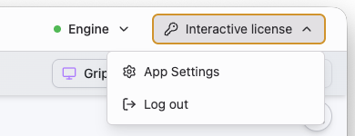

完成設定後，點擊左上角的 **Back to editor (返回編輯器)**。大部分變更在修改時會立即生效；少數例外情況將在下文中特別說明。

!!! note "說明"

    應用程式設定 (App Settings) 與編輯器的 **Settings (設定)** 功能表不同。後者用於設定引擎與編輯器 — 包含畫布佈景主題、自動儲存、API 金鑰與密鑰、MCP 伺服器、節點程式庫設定等 — 具體說明請參閱[編輯器概述](../editor/index.md#settings)。只有 Griptape Nodes Desktop 具備應用程式設定；若您是自行運行引擎並在瀏覽器中使用編輯器，請參閱[組態配置 (Configuration)](../configuration.md)。

## 一般設定 (General) {: #general }

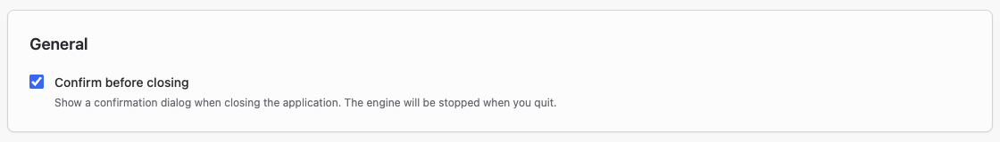

**Confirm before closing (關閉前確認)**：在您結束應用程式時顯示確認對話方塊。結束應用程式會同步停止引擎並中止所有執行中的任務，因此如果您經常運行耗時較長的工作流程，建議保持此選項開啟。

## 外觀 (Appearance) {: #appearance }

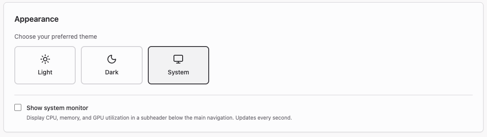

**Theme (佈景主題)**：將應用程式邊框外觀設定為 **Light (淺色)**、**Dark (深色)** 或 **System (隨系統)**。

**Show system monitor (顯示系統監視器)**：在主巡覽列下方添加一條狀態列，每秒即時更新 CPU、記憶體 (RAM) 與 GPU 的使用率。當您在本地運行本機模型並想確認硬體餘裕是否充裕時非常實用。

## 工作區與節點程式庫 (Workspace & Libraries) {: #workspace-libraries }

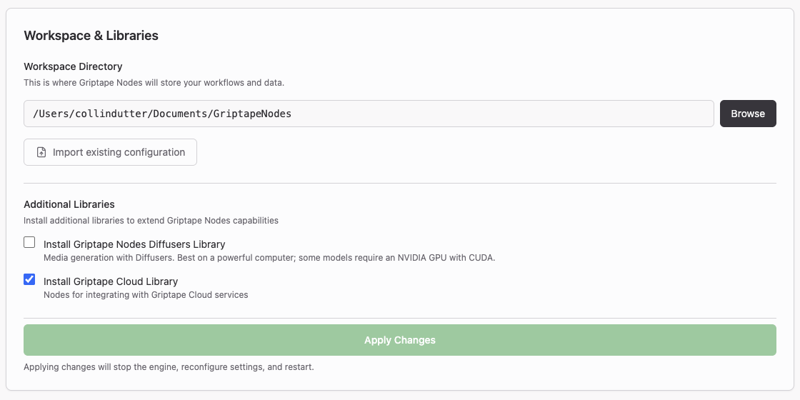

**Workspace Directory (工作區目錄)**：Griptape Nodes 存放您的[專案檔案](../../glossary.md#project-files)與[已生成資產](../../glossary.md#generated-assets)的位置。使用 **Browse (瀏覽)** 可以選取其他資料夾。變更目錄不會移動現有檔案，因此請指定至您容易查找的資料夾。引擎如何使用工作區的詳情請參閱[工作區 (Workspace)](../projects/workspace.md)。

**Import existing configuration (匯入現有組態)**：開啟 **Import Configuration** 對話方塊，自動在常見路徑中尋找您先前自行手動安裝配置的 Griptape Nodes 設定檔。在 **Select configuration to import** 下選取目標設定，應用程式將套用其設定（包含工作區目錄），免去重複輸入的麻煩。若未自動搜尋到，可點擊 **Browse for config file** 或 **Scan home directory**。

**Additional Libraries (額外程式庫)**：在內建程式庫之外安裝選用的節點程式庫：

- **Install Griptape Nodes Diffusers Library** — 使用 Diffusers 進行多媒體生成。需要效能較高的電腦設備，部分模型需要支援 CUDA 的 NVIDIA GPU。
- **Install Griptape Cloud Library** — 提供存取 Griptape Cloud 各項雲端服務的專用節點。

這兩者稍後也可以隨時在 **Manage → Library Management** 中安裝；詳情請參閱[節點程式庫 (Libraries)](../libraries.md)。

本區塊中的任何修改皆必須點擊 **Apply Changes (套用變更)** 才會正式生效。套用時將會停止引擎、重新配置並重啟。請務必先行儲存您目前的工作流程。

## 引擎 (Engine) {: #engine }

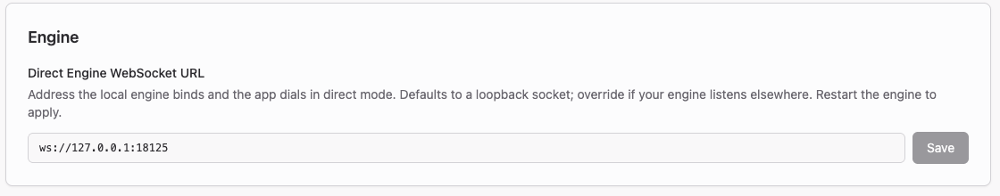

!!! note "說明"

    本區塊僅在使用授權金鑰啟用時出現（此模式會使應用程式處於直接引擎直連模式）。若您是透過 Griptape 帳戶登入，則不會顯示此項目 — 引擎的重新啟動與管理改由 Engine 專屬頁面負責。

**Direct Engine WebSocket URL (直連引擎 WebSocket 位址)**：本地引擎所繫結的監聽位址，應用程式在直接與引擎通訊時將連接此處。預設值 `ws://127.0.0.1:18125` 為僅限本機存取的迴路通訊端 (Loopback Socket)。除非您的引擎在其他自訂位址監聽，否則無需變更；修改後需重啟引擎方可生效。

## 軟體授權 (License) {: #license }

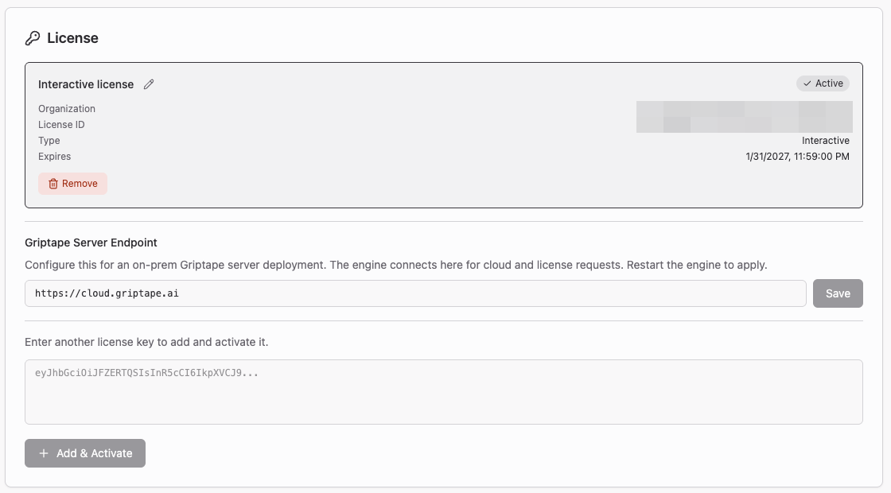

若您的企業組織透過授權金鑰運行 Griptape Nodes，您可以在本區塊進行授權管理。每個已啟用的授權都會顯示為一張卡片，載明組織名稱、授權 ID、類型與到期日，目前生效的項目會標記 **Active** 徽章。可使用鉛筆圖示為其設定易讀的自訂名稱，或點擊 **Remove** 在本機電腦上將其停用。切換不同的授權為生效項目時會自動重啟引擎。

**Griptape Server Endpoint (Griptape 伺服器端點)**：將引擎的雲端與授權請求重新導向至內部部署 (On-premises) 的 Griptape 伺服器，取代預設的 `https://cloud.griptape.ai`。修改後請重啟引擎。

若要新增其他授權金鑰，將其貼入輸入方塊並點擊 **Add & Activate (新增並啟用)** 即可。

完整的啟用指引流程，請參閱[使用管理伺服器 (Using the Admin Server)](../../enterprise/using_the_admin_server.md)。負責核發金鑰的管理者請從[管理資訊主頁 (Admin Dashboard)](../../enterprise/admin_dashboard.md)開始著手。

## 日誌與診斷 (Logging and Diagnostics) {: #logging-and-diagnostics }

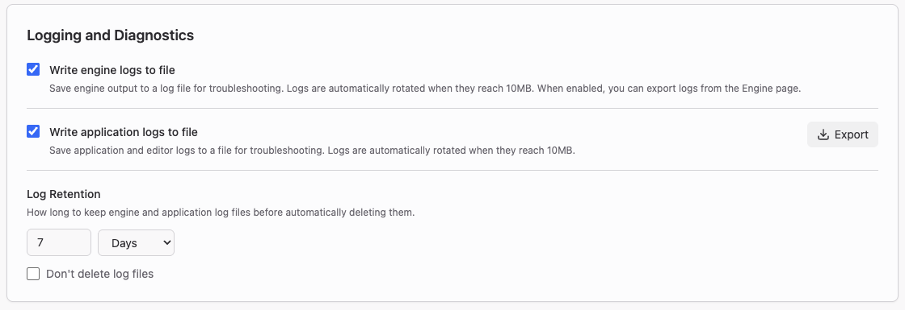

在重現準備回報的問題之前，請先開啟這些選項：

- **Write engine logs to file (將引擎日誌寫入檔案)** — 將引擎輸出保存至日誌檔案。檔案大小達 10MB 時會自動輪轉 (rotate)。開啟後，您也可以直接在 Engine 頁面匯出引擎日誌。
- **Write application logs to file (將應用程式日誌寫入檔案)** — 保存應用程式與編輯器日誌，同樣以 10MB 為單位進行輪轉。點擊 **Export (匯出)** 可選擇匯出目前工作階段或特定時間範圍的日誌，並產生可附加至錯誤回報單的日誌檔案。
- **Log Retention (日誌保留天數)** — 自動刪除日誌檔案前的保留時間。輸入數值並選擇單位（**Days (天)**、**Months (月)** 或 **Years (年)**）；預設為 7 天。勾選 **Don't delete log files** 可永久保留日誌。

取得日誌後的分析指引，請參閱[問題排解 (Troubleshooting)](../../troubleshooting.md)。

## 軟體更新 (Updates) {: #updates }

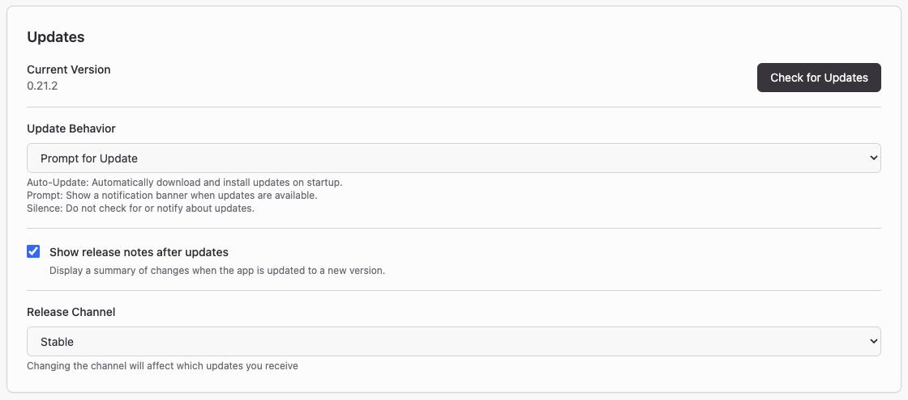

**Current Version (目前版本)** 顯示您正在運行的應用程式版本，點擊 **Check for Updates (檢查更新)** 可以立即檢查是否有新版本發布，無需等待下次啟動。

**Update Behavior (更新行為)** 控制偵測到新版本時的處理機制：

| 設定項目 | 功能說明 |
| --------------------- | -------------------------------------------------------------------------------------------------- |
| **Auto-Update** | 啟動時自動下載並安裝可用更新。 |
| **Prompt for Update** | 當有可用更新時顯示通知橫幅。此為預設選項。 |
| **Silence Updates** | 跳過自動檢查更新與通知提示。您仍然可以手動點擊 **Check for Updates**。 |

**Show release notes after updates (更新後顯示發行說明)**：在應用程式完成自我更新後，自動彈出更新摘要內容。

!!! note "更新已被您的組織停用"

    若出現此提示，表示系統管理員已透過[機器層級政策檔案](../../enterprise/disabling_app_updates.md)停用了應用程式更新。此時 **Check for Updates**、**Update Behavior** 與 **Release Channel** 將處於無法使用狀態，但 **Show release notes after updates** 依然保留。

### 發行通道 (Release channels) {: #release-channels }

**Release Channel (發行通道)** 決定應用程式接收哪個分支的組建版本。

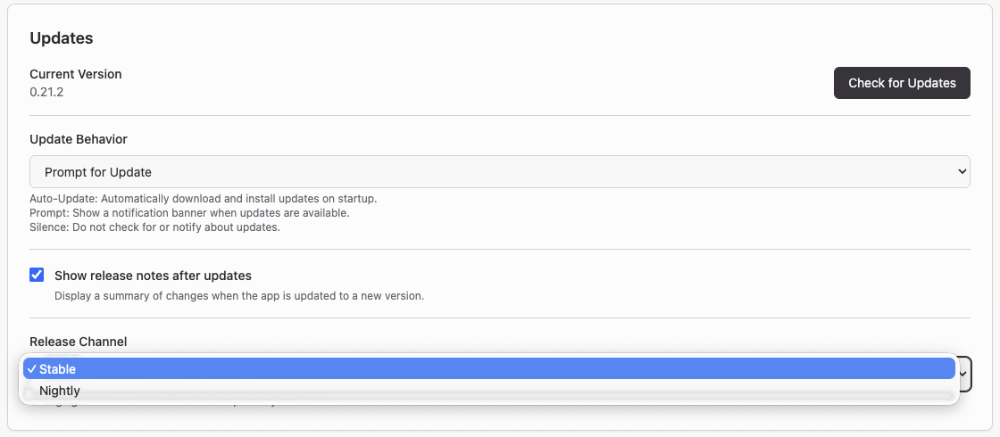

| 通道名稱 | 內容說明 |
| ----------- | ------------------------------------------------------------------------------------------------------------------------------------------------------ |
| **Stable (穩定版)** | 經過嚴格測試的正式版本。此為預設選項，除非有特殊測試需求，否則建議一般使用。 |
| **Nightly (每日建置版)** | 每日發布的最新測試組建，打包了預先發行的引擎與編輯器版本。版本格式類似 `0.22.0-nightly.20260611.123`。 |

Nightly 每日發布一次，且伺服器端僅保留最近 14 天的歷史組建；因此若安裝 Nightly 後閒置數週未開，下次更新時版本號將會大幅跨越。

!!! warning "警告"

    Nightly 組建直接取自最新的開發程式碼，未經完整穩定性測試。其中可能包含潛在錯誤 (Bugs)、未完成的功能，或日後可能被還原的改動。請勿在生產環境中使用 Nightly，若要嘗試運行，請務必養成隨時備份工作流程的習慣。

切換發行通道將在下一次檢查更新時正式生效 — 無論是下次重啟應用程式、背景定時排程檢查，或是您點擊 **Check for Updates** 的當下。您完全無需重新安裝軟體；即使穩定版的版本號數字低於目前安裝的 Nightly，亦可順利降回 **Stable**。在此過程中，您的工作區、工作流程檔案與個人設定皆會被完整保留。

如果您是自行手動安裝引擎而非使用桌面版應用程式，其對應機制為 [常見問答 (FAQ)](../../faq.md#how-can-i-test-out-unreleased-features) 中所述的引擎預發行通道。

## Griptape Cloud API 金鑰 {: #griptape-cloud-api-key }

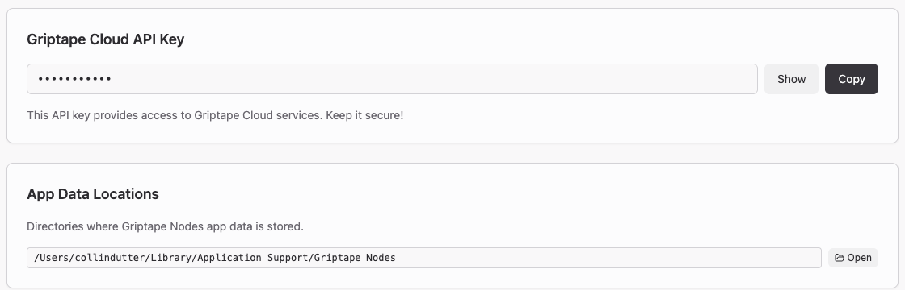

由應用程式為您自動佈建的 API 金鑰，預設保持隱藏。點擊 **Show** 顯示金鑰明文，點擊 **Copy** 複製到剪貼簿 — 當您想在手動安裝的引擎或腳本中使用同一組金鑰時非常方便。請將其視同密碼妥善保管。此區塊僅在應用程式持有您的金鑰時才會出現；若您使用授權金鑰啟用，此處將不會顯示。

## 應用程式資料位置 (App Data Locations) {: #app-data-locations }

此處展示應用程式保存自身內部資料的目錄路徑，與您的工作區彼此獨立隔離。點擊 **Open** 會在檔案總管 (Explorer)、Finder 或系統檔案管理器中開啟該資料夾。注意：日誌檔案不在該目錄中；如需日誌，請從[日誌與診斷](#logging-and-diagnostics)區塊匯出，引擎日誌則可從 Engine 頁面匯出。

## 環境資訊 (Environment Information) {: #environment-information }

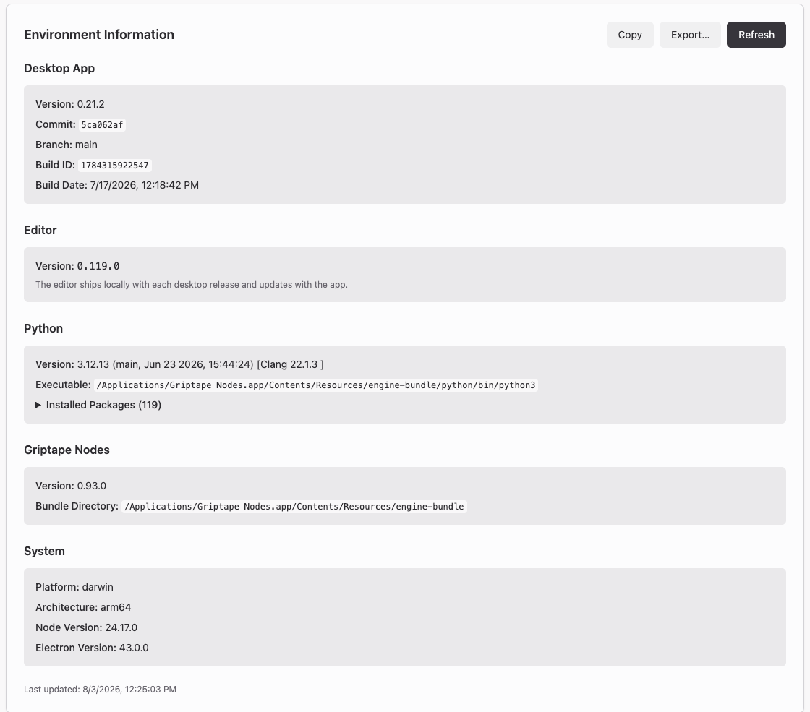

此處顯示您目前運行環境的完整快照：應用程式版本與組建編號、內建編輯器版本、Python 直譯器路徑及其已安裝的套件清單、Griptape Nodes 引擎版本與套件目錄，以及作業系統平臺詳細規格。點擊 **Refresh** 可重新整理讀取。

點擊 **Copy** 可將完整報告複製到剪貼簿，點擊 **Export...** 則可儲存為檔案。在提交任何錯誤回報 (Bug report) 時，強烈建議附上此份診斷報告。
