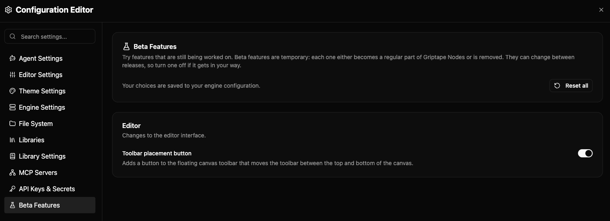

# Beta 功能 (Beta Features) {: #beta-features }

Beta 功能是尚未準備好對所有使用者預設開放的全新實驗性功能。您可以主動將其開啟以搶先體驗，並可隨時將其關閉。這些項目由編輯器設定中的 **Beta Features (Beta 功能)** 頁面集中管理。



## 開啟或關閉 Beta 功能 {: #turning-a-beta-feature-on-or-off }

開啟編輯器標頭中的 **Settings (設定)** 功能表，選擇 **All Settings**，並點擊左側清單最下方的 **Beta Features**。每個功能項目均附帶簡短說明，闡明其改動的內容與影響範圍，並附有切換開關。您的選擇會與其他設定一併儲存，因此下次開啟編輯器時將保持相同狀態。

功能依來源進行分組：

- **Editor (編輯器)** 功能：改變編輯器的視覺外觀或操作介面行為。
- **Engine (引擎)** 功能：改變幕後運算邏輯，例如工作流程的排程與執行方式。這些功能來自您目前連線的引擎執行個體，因此不同引擎與版本之間所列出的清單可能會有所差異。

自訂節點程式庫也可以提供專屬的 Beta 功能。這些項目會列在 **Engine** 群組中，緊鄰引擎原生功能。它們通常是為該特定程式庫的節點新增或變更某些參數設定，功能說明中會明確標示。當該程式庫被載入時這些功能會動態出現，當程式庫被移除時則會自動消失。

若想一次性還原所有功能為標準行為，點擊 **Reset all (全部重設)** 即可。所有功能將恢復為其預設狀態（絕大多數預設為關閉）。

### 已存在於畫布上的節點處理 {: #nodes-already-on-the-canvas }

對於新增或隱藏節點特定參數的程式庫 Beta 功能，只有在切換開關*之後*新添加到畫布上的節點才會立即呈現變更。先前已經放置在畫布上的現有節點將保留其建立時的初始參數配置。若要更新現有節點，請重新整理節點、將其刪除並重新添加，或者儲存並重新開啟工作流程。

### 開關處於反灰無法變更時 {: #when-a-toggle-cant-be-changed }

若某個開關呈現反灰鎖定狀態，表示有您個人設定之外的外部組態強制覆寫了該功能的數值。這種情況通常發生在該功能已被專案設定檔、工作區組態或系統環境變數鎖定。開關下方的說明附註會明確指出是由何者所指定。您必須至該外部組態中修改數值或將其移除，方能重新在本頁手動控制。

## Beta 功能的預期表現與特性 {: #what-to-expect-from-a-beta-feature }

- **Beta 功能可能會隨時修改或移除**：每個實驗性功能通常會在幾個月內正式納入 Griptape Nodes 的標準功能，或者被評估淘汰。一旦正式實裝或移除，該項目將自本頁消失，您先前儲存的偏好設定將不再具有任何效果。
- **您的工作流程檔案絕對安全**：Beta 功能絕不會改變工作流程檔案的底層儲存結構。無論特定功能開啟或關閉，工作流程都能正常開啟與解析，因此您可以放心與開啟不同 Beta 功能的協同夥伴共用工作流程檔案。
- **未打磨的粗糙邊角在預期之內**：若某個 Beta 功能的行為不符預期，只需將該開關關閉即可立即恢復成熟穩定的標準行為。

## 無需編輯器介面配置 Beta 功能 {: #setting-beta-features-without-the-editor }

您的偏好設定會保存在 `griptape_nodes_config.json` 檔案的 `beta_features` 區塊中，以各功能的識別碼 (ID) 為鍵值：

```json
{
    "beta_features": {
        "canvas_toolbar_placement_button": true
    }
}
```

擴充程式庫的 Beta 功能則保存在 `library_beta_features` 中，以程式庫全小寫名稱為鍵（空格與標點符號轉換為底線）。以名為 "Acme Image Tools" 的程式庫為例：

```json
{
    "library_beta_features": {
        "acme_image_tools": {
            "sharpen_after_upscale": true
        }
    }
}
```

數值僅接受嚴格的布林值 `true` 或 `false`。任何其他數值（例如字串 `"yes"`）都會被系統自動忽略並在引擎日誌中發出警告，該功能將維持預設值。此處的設定語法錯誤絕不會影響您的其他設定項目。

您也可以透過環境變數在單次工作階段中臨時啟用特定功能。在 `GTN_CONFIG_BETA_FEATURES__` 前綴後接上全大寫的功能 ID 即可：

```bash
GTN_CONFIG_BETA_FEATURES__PARALLEL_BRANCH_RESOLUTION=true gtn
```

若為程式庫的 Beta 功能，請使用 `GTN_CONFIG_LIBRARY_BETA_FEATURES__`，後接全大寫的程式庫鍵名、兩個連續底線，以及全大寫的功能 ID：

```bash
GTN_CONFIG_LIBRARY_BETA_FEATURES__ACME_IMAGE_TOOLS__SHARPEN_AFTER_UPSCALE=true gtn
```

上述使用的功能與程式庫名稱僅為示範範例。若要為您正在開發的自訂程式庫添加專屬 Beta 功能，請參閱[擴充程式庫開發指南](../../development/custom_nodes/authoring_libraries.md#beta-features)。關於組態檔案與環境變數載入機制的完整說明，請參閱[引擎組態配置 (Engine Configuration)](../configuration.md)。
