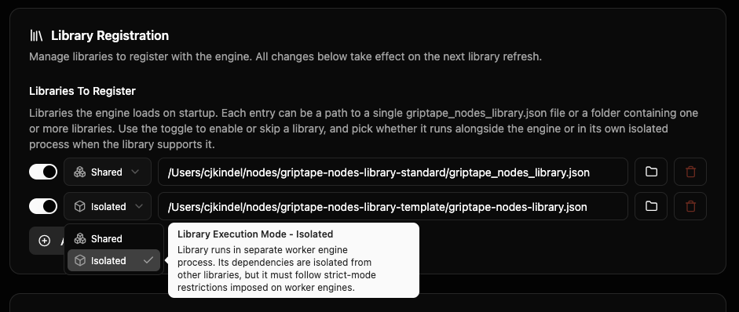

# 節點程式庫 (Libraries) {: #libraries }

**節點程式庫 (Library)** 是可在編輯器中調用的一組節點套件包。部分程式庫由引擎原生內建隨附，部分可從 Git 網址下載安裝，亦可由您自行親手編寫。本頁專門面向安裝與使用程式庫的創作者 — 而非編寫開發程式庫的工程師。（程式庫開發者請參閱[自訂節點開發指南](../development/custom_nodes/index.md)與[工作處理程序節點隔離](../development/custom_nodes/node_isolation_with_workers.md)）。

若您擔心同時安裝多個程式庫會產生衝突，可直接跳至[共存保障機制](#coexistence-guarantees) — 簡要結論是：兩個程式庫各自的 Python 套件相依性**絕不可能**彼此破壞，但若兩個程式庫包含完全相同的節點名稱，可能會產生命名歧義，引擎會在執行時給出明確指引。

## 起始內建模組與沙盒 {: #what-you-start-with }

引擎支援**沙盒程式庫 (Sandbox Library)** — 這是用於快速開發個人自訂節點、無需打包完整正式套件的草稿測試程式庫。該目錄預設未啟用：前往 **Settings → Library → Sandbox Settings**，將 **Sandbox Library Directory** 指向磁碟上已存在的實體資料夾。啟用後，引擎會自動從該目錄中掃描並載入 `.py` 節點檔案，您在編輯器 Sandbox 分類中所看到的項目完全取決於該資料夾中的實際代碼。

在執行 `gtn init` 初始化期間，系統會詢問是否安裝 **Advanced Media Library (進階多媒體程式庫)**（包含擴散生成、圖像處理、影片生成等功能）。您可以當時確認安裝，亦可稍後重新執行 `gtn init` 補裝。具體步驟請參閱[常見問答 (FAQ)](../faq.md#how-do-i-install-the-advanced-media-library-after-initial-setup)。

其他程式庫 — 無論是官方第一方套件還是開源社群擴充 — 皆可直接在編輯器中自行安裝。

## 在編輯器中安裝程式庫 {: #installing-a-library-in-the-editor }

編輯器的 **Libraries** 面板是安裝程式庫的主要圖形介面。從頂部標頭功能表依序點擊 **Manage → Library Management** 即可開啟。

點擊右上角的 **Add Library (新增程式庫)** 開啟對話視窗。貼入 Git 倉庫網址（例如託管社群自訂節點的 GitHub 倉庫）並點擊 **Install**。編輯器會自動 Clone 該倉庫、讀取其中的 `griptape_nodes_library.json` 資訊清單、安裝相依套件並完成註冊。對話方塊中的 **Advanced Options** 允許您選取安裝特定的分支、標籤或 Commit Hash，而非預設主分支。

若不確定要安裝什麼，視窗底部的 **Browse Community Libraries** 按鈕提供了精選的社群程式庫目錄供您瀏覽挑選。

安裝成功後，新程式庫會即時出現在清單中。每個條目清晰呈現：

- 程式庫名稱與當前版本號。
- 該程式庫提供的節點總數。
- **Open** 按鈕：在系統檔案管理器中開啟該程式庫的本機存放資料夾。
- **Advanced** 展開面板：顯示 Git 遠端倉庫 URL、Ref（分支或標籤）以及精確的 Commit Hash。若需提交錯誤回報，此處展示的 Commit 是精確追溯版本的關鍵憑證。

您可以使用清單上方的 **All**、**Updates** 或 **Errors** 標籤進行篩選。當程式庫運作異常時，**Errors** 是首選排查入口 — 它將安裝失敗、相依性安裝異常與開機載入錯誤集中彙整呈現在此。

## 檢查與更新程式庫 {: #updating-libraries }

在同一 **Libraries** 面板中，篩選標籤旁邊的圖示按鈕支援：

- **Check for updates (檢查更新)** — 掃描所有已安裝的程式庫是否有新版本發布。任何有新版可用的項目皆會歸入 **Updates** 篩選檢視中。
- **Refresh (重新整理)** — 重新讀取本機程式庫狀態清單（當您剛完成手動安裝並想確認已被正確識別時非常實用）。

若希望引擎在背景自動感應更新，**Configuration Editor → Libraries** 提供了更新頻率與自動偵測設定。

**Update Notifications (更新通知)** 選項：

- **Enable sidebar notifications** — 當有可用更新時，在側邊欄 Libraries 標籤頁與個別程式庫旁顯示通知徽章。
- **Notification color / animation** — 自訂通知徽章的色彩與動態效果。
- **Check on startup** — 每次引擎啟動時自動檢查更新。
- **Check periodically** — 定期排程檢查週期（Never、Hourly 等）。
- **Check Now** — 立即手動觸發全量掃描。

對於絕大多數創作者而言，保持預設值即可順暢運作，無需刻意調整。

## 啟用/停用與移除程式庫 {: #toggling-and-removing-libraries }

前往 **Configuration Editor → Libraries** 檢視 **Library Registration → Libraries To Register**。清單中的每條項目均代表引擎開機時自動載入的程式庫。每個項目提供三項控制項：

- 左側開關 (Toggle) — 關閉開關可將其自開機載入清單中排除，但檔案依然完好保留在磁碟上。
- 中間下拉選單 (**Shared / Isolated**) — 選擇該程式庫的執行模式（詳見下文）。
- 右側垃圾桶圖示 — 將該程式庫自註冊清單中徹底移除。磁碟上的實體 Clone 檔案仍會保留；若需釋放硬碟空間，請手動刪除對應資料夾。

### 共用模式 (Shared) 與隔離模式 (Isolated) {: #shared-vs-isolated }

下拉選單決定了該程式庫節點在作業系統中的執行程序邊界：

- **Shared (共用模式)** — 該程式庫直接在主引擎進程內部執行，與其他共用程式庫共用同一個 Python 進程環境。
- **Isolated (隔離模式)** — 該程式庫在完全獨立的專屬子進程 (Worker Process) 中運行，其 Python 套件相依性與其餘所有程式庫徹底物理隔離，且該子進程發生崩潰絕不會拖垮主引擎。

下拉選單預設反映引擎實際採用的模式：通常依循程式庫作者建議的模式，除非您在此手動覆寫。對於極度消耗運算資源的大型套件建議選擇 **Isolated** 以達成嚴密隔離；輕量級功能套件則可維持 **Shared** 於進程內高速運行。部分程式庫被作者標記為不相容隔離模式，此時下拉選單會**鎖定在 Shared**。

此下拉選單在引擎版本 0.86.0 及以上版本中提供。修改設定將在下一次重新整理程式庫時正式生效。

下方的 **Add Library** 按鈕允許您將引擎手動指向磁碟上既有的 `griptape_nodes_library.json` 檔案（例如手動 Clone 的專案或本機正在開發中的擴充套件）。

## 程式庫共存保障機制 {: #coexistence-guarantees }

同時安裝多個不同擴充程式庫的核心關鍵在於：彼此之間絕不能產生干擾破壞。系統透過三道嚴謹的架構層防護來確保此一承諾：

### Python 相依性套件環境隔離 {: #python-dependency-isolation }

每個已註冊的程式庫皆獲配專屬的**獨立虛擬環境 (Virtual Environment, `.venv`)** — 這是一套完全隔離的 Python 套件集合，絕不與引擎原生套件或其他任何第三方程式庫共用全域狀態。程式庫 A 可以宣告鎖定 `torch==2.4.1`；而程式庫 B 則可鎖定 `torch==2.0.0`。兩者分別安裝在各自獨立的 `.venv` 目錄中，並在各自節點運算時調用專屬環境。

無論程式庫配置為 **Shared** 還是 **Isolated** 模式（參閱下文[進程隔離](#process-isolation-the-isolated-mode)），此相依性隔離原則皆嚴格成立：實體 `.venv` 始終存放在程式庫資訊清單旁邊的磁碟上。唯一的差異僅在於是由哪個作業系統進程負責載入這些套件 — Shared 模式由主引擎進程載入，Isolated 模式則由該程式庫的專屬子進程載入。從使用者角度來看，套件相依性隔離體驗完全相同。

**您可以同時安裝底層依賴完全衝突的各類程式庫，絕不會引發 pip 套件解析衝突。** 這是本頁最重要的穩定性承諾。

#### 編輯期相依性 vs 執行期相依性 {: #edit-time-vs-execution-dependencies }

程式庫作者可以在其資訊清單中將相依套件嚴格拆分為兩個集合：

- `pip_dependencies` — **編輯期 (Edit-time)** 相依項：僅用於在編輯器中呈現節點 UI、將其放置在畫布上並編輯參數所需的輕量套件。
- `pip_dependencies_exec` — **執行期 (Execution)** 相依項：體積龐大的大型計算套件（如 torch、diffusers 等深度學習框架），僅在節點實際**點擊運行 (Run)** 時才被調用。

執行期相依項會被安裝至獨立的專屬環境（位於程式庫 `.venv` 旁邊的 `.venv-exec`）中，且**僅在節點實際執行的專屬進程中載入** — 絕不侵入主引擎進程。這意味著程式庫可以引入數十 GB 的頂級機器學習運算框架，而編輯器介面本身依然輕盈流暢，且兩個依賴版本衝突的大型模型庫亦能在畫布上完美並存編輯。

若資訊清單未宣告 `pip_dependencies_exec` 也是完全安全的：所有依賴項均被視為編輯期依賴，程式庫將作為單一虛擬環境平穩運作。

#### 宣告執行期相依性帶來的運作差異 {: #what-declaring-execution-dependencies-changes }

宣告了執行期相依項的程式庫在底層具備以下三項運作特質：

- **節點運算強制在程式庫獨立進程中執行**：主引擎負責 UI 顯示、參數配置與工作流程儲存，但底層重度運算會交由重裝套件進程處理。若該背景進程尚未啟動，運行節點時會明確給予提示。
- **節點程式碼透過標準協定請求引擎狀態**：在 `process()` 內部，節點若直接嘗試存取全域管理器（組態、密鑰、檔案等）將會被阻斷，系統會提示改用規範的非同步請求介面。
- **無法跨進程傳輸的非序列化數值必須保留在進程內部**：若節點輸出被標記為 `serializable=False` 的物件（例如活躍模型控制代碼或 GPU Tensor），系統會指引最佳實踐：將數值序列化，或者在程式庫內部進行快取並輸出輕量描述元 (Descriptor)，以便下游節點進行換取。

### 進程隔離：Isolated 模式 (Process isolation: the Isolated mode) {: #process-isolation-the-isolated-mode }

將程式庫以 **Isolated** 模式執行（在獨立專屬子進程中運行，而非在主引擎內）為您帶來：

- **絕佳的容錯韌性 (Fault tolerance)**：即使該程式庫發生底層 C++ 崩潰 (Segmentation Fault) 或記憶體溢位 (OOM)，僅有該獨立子進程會結束 — 主引擎與整個工作流程編輯器依然穩如泰山。
- **嚴密的硬體資源隔離 (Resource isolation)**：該程式庫載入記憶體的所有物件（模型權重、GPU 顯存、背景運算執行緒）全部局限於其專屬進程中，絕不拖累或污染其他程式庫。

重型機器學習套件（Diffusion、Transformers、自訂 CUDA 算子）從此模式中獲益最深；輕量級純數據處理套件則在 Shared 模式下即可高效運作。您可透過上文所述的 **Shared / Isolated** 下拉選單進行自訂調配。

### 節點名稱衝突：由使用者明確指定 {: #node-name-collisions-not-solved }

若兩個不同的程式庫註冊了完全相同的節點類別名稱（例如兩者都提供了一個名為 `MyImageNode` 的節點），引擎在技術上會同時接納兩者。**引擎在安裝時不會拋出警告阻攔。** 當您在畫布上建立該節點時：

- 若您的工作流程中明確指定了程式庫來源名稱，將正常運作。
- 若未明確限定，引擎在執行時會彈出提示並清楚列出衝突的兩個程式庫，要求您進行消除歧義的明確選取。

這是引擎交由使用者自主決策的邊界。若您希望徹底杜絕衝突，最穩妥的作法是在 **Libraries To Register** 清單中將不使用的程式庫切換為停用或刪除。

## 疑難排解與常見問題 (When something goes wrong) {: #when-something-goes-wrong }

### 「我已安裝了程式庫，但在編輯器中看不到它的節點」 {: #i-installed-the-library-but-i-dont-see-its-nodes }

開啟 **Libraries** 面板並將篩選標籤切換至 **Errors**。此處集中呈現了所有安裝失敗、相依性套件下載異常或開機載入報錯的程式庫。點擊進入對應的程式庫即可閱讀完整具體的錯誤日誌。

常見肇因包含：

- 該程式庫依賴的預編譯 Wheel 套件在您的 Python 版本或作業系統架構下不存在 — 例如找不到支援當前 CUDA 版本的 `torch` 安裝檔。
- 公司企業網路防火牆或代理阻擋了套件下載。
- 本機磁碟空間不足（引擎會明確回報磁碟已滿）。

排除底層網路或環境問題後，重新觸發安裝（在 **Add Library** 視窗中重新貼上網址，或使用下方 CLI 命令並加上 `--overwrite` 旗標）。

### 「某個節點在編輯器中呈現紅色或損毀外觀」 {: #a-node-looks-broken-or-red-in-the-editor }

這代表引擎無法成功實例化該節點 — 通常是因為其所屬的程式庫載入失敗。編輯器會自動放置一個佔位元節點 (Placeholder)，確保您的工作流程拓撲結構與相依連線不被破壞。在 **Libraries** 面板的 **Errors** 標籤中查閱底層載入失敗原因；一旦修復環境並重啟，重新開啟工作流程即可無縫恢復為真實節點。

### 查詢原始詳細錯誤日誌 {: #looking-for-the-raw-error-text }

在啟動引擎的終端機視窗中，會持續輸出最詳盡的偵錯日誌，包含完整 Python 呼叫堆疊追蹤 (Traceback)。運行在 Isolated 模式下的程式庫日誌在輸出時會帶有 `Worker-<id>` 前綴標籤。

## CLI 命令列操作替代方案 {: #cli-alternatives }

若您偏好在終端機命令列中執行自動化維運或無外設部署，GUI 中的所有程式庫操作皆具備完全等效的 `gtn` 命令：

| 編輯器 GUI 操作 | 對應 CLI 命令 |
| ----------------------------------- | ---------------------------------- |
| Add Library → Install | `gtn libraries download <git_url>` |
| Check for updates → install pending | `gtn libraries sync` |
| 同步更新並覆寫本機修改 | `gtn libraries sync --overwrite` |
| 重新註冊 Advanced Media Library | 執行 `gtn init` 並回答 `y` |

完整指令清單請參閱 [CLI 命令列參考手冊](../reference/command_line_interface.md)。

## 程式庫在磁碟上的存放位置 {: #where-libraries-are-stored-on-disk }

- **組態登錄**：`~/.config/griptape_nodes/griptape_nodes_config.json`（或平臺相應目錄 — 參閱[引擎組態配置](configuration.md)）。其內部的 `app_events.on_app_initialization_complete.libraries_to_register` 欄位即對應編輯器所維護的清單。
- **程式碼 Clone 與虛擬環境**：位於編輯器複製套件的目錄中；程式庫的 `.venv` 與其 `griptape_nodes_library.json` 同級存放。
- **沙盒程式庫 (Sandbox)**：沙盒資料夾依據您的設定獨立指定，各作業系統預設值有所不同。

關於如何將專案精確鎖定於特定程式庫版本（在啟動專案時自動佈建相符的程式庫版本），請參閱[鎖定引擎與程式庫版本](projects/version_pinning.md)。
