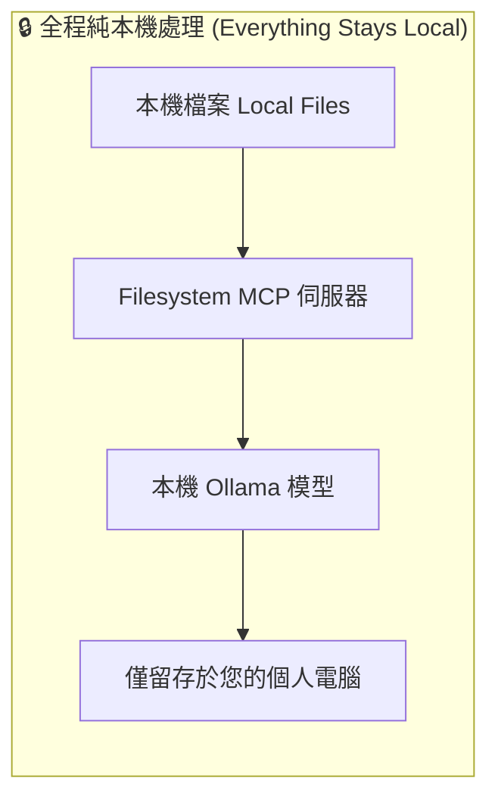

# 在 Agent 中使用本機模型 (Local Models with Agents) {: #local-models-with-agents }

!!! tip "在對話側邊欄或 Agent 節點中使用本機模型？"

    如果您希望直接將 Ollama 或 LM Studio 作為**對話側邊欄 (Chat Sidebar)** 或 **Agent 節點**的 AI 提供商，請參閱 [AI 提供商 (AI Providers)](../agent/providers/index.md)。這對大多數使用情境來說是更為簡捷的途徑。

    本進階教學則涵蓋了另一種架構模式：在工作流程中**透過 MCP 伺服器路由本機模型**，讓模型能存取本機檔案與各類專屬工具，同時將所有數據嚴格保留在您的本機電腦上。

本進階教學示範如何將**本機 AI 模型 (Local AI Models)** 與 MCP 伺服器搭配使用，在無需將數據傳送至外部雲端服務的情況下處理機密與敏感資訊。這對於企業內部文件、隱私檔案或任何希望完全留存在個人電腦上的資料來說是極為理想的解決方案。

## 為何在 MCP 中採用本機模型？ {: #why-use-local-models-with-mcp }

### 安全優勢 {: #security-benefits }

- ✅ **資料零外流** — 所有運算與數據完全留存在本機
- ✅ **免 API 調用費用** — 直接在您自有的硬體設備上執行模型
- ✅ **極致隱私保護** — 專為機密文件與專有資料設計
- ✅ **離線可用性** — 無需連網即可完整離線運作

### 最佳適用情境 {: #perfect-use-cases }

- **企業內部文件** — 公司合約、財務數據、敏感調研報告
- **個人隱私資料** — 私人筆記、密碼憑證、個人檔案
- **專有程式碼** — 不便上傳至第三方雲端的原始碼
- **本機檔案智慧管理** — 批次整理與檢索個人電腦磁碟檔案

## 我們即將建置的內容 {: #what-were-building }

我們將建立一個具備以下特性的完整工作流程：

1. **配置 [Filesystem MCP](https://github.com/modelcontextprotocol/servers/blob/main/src/filesystem/README.md) 伺服器**以受控存取本機檔案
1. **搭配 Ollama 與本機模型**（`qwen3:1.7b`）進行本機 AI 推理運算
1. **驗證安全檔案讀取**，示範讀取本機上的「機密 (secret)」文字檔
1. **展示敏感資料在全流程中始終留存於本機**的安全架構

## 事前準備 {: #prerequisites }

- 已具備基本 MCP 概念（可先參閱[快速入門指南](./getting_started.md)）
- 擁有 Mac、Windows 或 Linux 作業系統環境
- 熟悉基礎作業系統檔案操作

## 步驟 1：安裝 Ollama {: #step-1-install-ollama }

### 下載並安裝 Ollama {: #download-and-install-ollama }

1. **前往 [ollama.org](https://ollama.org)**
1. **下載適用於您作業系統的 Ollama 安裝程式**
1. **依安裝指引完成安裝**
1. **開啟終端機驗證安裝**，執行：
    ```bash
    ollama --version
    ```

### 下載 Qwen3 模型 {: #download-the-qwen3-model }

1. **開啟終端機**並執行：
    ```bash
    ollama pull qwen3:1.7b
    ```
1. **等待下載完成** — 根據您的網路速度，這可能需要數分鐘
1. **驗證模型**已就緒：
    ```bash
    ollama list
    ```

> **為何選用 Qwen3:1.7b？** 此模型體積輕量，能在絕大多數普通電腦上順暢執行，同時完整支援 MCP 整合所需的工具調用 (Tool Use) 功能。

## 步驟 2：設定 Filesystem MCP 伺服器 {: #step-2-set-up-filesystem-mcp-server }

[Filesystem MCP Server](https://github.com/modelcontextprotocol/servers/blob/main/src/filesystem/README.md) 提供了對本機檔案系統的安全受控存取，允許 AI Agent 讀取、寫入與管理檔案與目錄。該伺服器非常適合本機資料處理，因為它**僅能存取您明確授權白名單**的目錄，確保其餘敏感檔案不受侵擾。伺服器支援常見的目錄列舉、讀檔、寫檔與整理本機儲存等操作 — 全程將所有數據鎖定在您的本機電腦。

有關 Filesystem 伺服器的完整能力與詳細配置選項，請參閱我們的 [Filesystem 伺服器手冊](./servers/filesystem.md)。

### 建立 MCP 伺服器配置 {: #create-the-mcp-server-configuration }

1. **開啟 Griptape Nodes** 並前往 **Settings** → **MCP Servers**
1. **點擊 + New MCP Server**
1. **配置伺服器參數**：
    - **Server Name/ID (伺服器名稱/識別碼)**：`filesystem`
    - **Connection Type (連線類型)**：`Local Process (stdio)`
    - **Configuration JSON (組態 JSON)**：

```json
{
  "transport": "stdio",
  "command": "npx",
  "args": [
    "-y",
    "@modelcontextprotocol/server-filesystem",
    "/Users/jason/Desktop",
    "/Users/jason/Downloads"
  ],
  "env": {},
  "cwd": null,
  "encoding": "utf-8",
  "encoding_error_handler": "strict"
}
```

> **重要提示**：請將 `/Users/jason/Desktop` 與 `/Users/jason/Downloads` 替換為您電腦上的真實桌面與下載資料夾路徑。Filesystem 伺服器僅能存取您在清單中明確列出的目錄。

1. **點擊 Create Server** 完成建立

### 測試檔案系統存取 {: #test-the-filesystem-access }

1. **在桌面上建立名為 `secret.txt` 的測試檔案**
1. **在檔案中填入以下測試內容**：
    ```
    The password is: CAPYBARA
    ```
1. **儲存該檔案**

## 步驟 3：建置本機 AI 工作流程 {: #step-3-build-the-local-ai-workflow }

### 建立 Ollama Prompt 組態節點 {: #create-the-ollama-prompt-configuration }

1. **拖曳一個 Ollama Prompt 節點**至工作流程畫布中
1. **配置模型參數**：
    - **Model**：`qwen3:1.7b`
    - **Temperature**：`0.1`（確保輸出穩定一致）
    - **Max Tokens**：`-1`（無限制）
    - **Stream**：`True`
    - **Use Native Tools**：`True`（MCP 調用必選項目）

### 建立 Agent 節點 {: #create-the-agent }

1. **拖曳一個 Agent 節點**至畫布中
1. **將 Ollama Prompt 節點的 `prompt_model_config` 輸出**連線至 Agent 節點的 `prompt_model_config` 輸入
1. **配置 Agent 參數**：
    - **Prompt**：暫時保持空白
    - **Additional Context**：暫時保持空白

### 建立 MCP Task 節點 {: #create-the-mcp-task }

1. **拖曳一個 MCPTask 節點**至畫布中
1. **將 Agent 節點的 `agent` 輸出**連線至 MCPTask 節點的 `agent` 輸入
1. **配置 MCPTask 參數**：
    - **MCP Server Name**：`filesystem`
    - **Prompt**：`"what's the password in secret.txt? it's in the desktop folder"`

## 步驟 4：執行安全工作流程 {: #step-4-run-the-secure-workflow }

### 執行工作流程 {: #execute-the-workflow }

1. **先執行 Ollama Prompt 節點**以初始化本機模型連線
1. **執行 Agent 節點**以建立具備本機模型存取能力的 Agent
1. **執行 MCPTask 節點**觸發本機檔案存取任務

### 預期執行成果 {: #expected-results }

MCPTask 節點執行後應傳回類似以下的回覆內容：

```
<think>
Okay, the user asked for the password in secret.txt. After checking the allowed directories and listing the contents, the secret.txt file was found. Reading the file revealed the password "CAPYBARA". Since the user requested the password, the assistant needs to provide it. The previous steps were successful, so the final answer is the password.
</think>

The password in secret.txt is **CAPYBARA**.
```

## 深度解析：為何此架構具備高安全性？ {: #why-this-is-secure }

### 資料流向架構分析 {: #data-flow-analysis }



### 具體呈現的安全優勢 {: #security-benefits-demonstrated }

1. **零外部 API 調用** — AI 推理模型完整執行於您的本機設備
1. **零外部數據傳輸** — 檔案在本機讀取、在記憶體中本機處理
1. **無雲端儲存風險** — 絕不向任何外部第三方伺服器上傳資料
1. **細粒度授權管控** — 您精確限制 AI 僅能存取特定白名單路徑

## 進階配置選項 {: #advanced-configuration-options }

### 模型選型建議 {: #model-selection }

根據您的運算資源與工作需求選擇適配的模型：

| 模型名稱 | 參數量大小 | 推理速度 | 能力面向 | 最佳適用場景 |
| :--- | :--- | :--- | :--- | :--- |
| `qwen3:1.7b` | 小型 (Small) | 極快 (Fast) | 基礎工具調用 | 輕量與日常檔案任務 |
| `qwen3:4b` | 中型 (Medium) | 中等 (Medium) | 更佳邏輯推理 | 複雜分析與歸納總結 |
| `llama4` | 大型 (Large) | 較慢 (Slower) | 高階邏輯推理 | 複雜大型工作流程 |

### 檔案系統安全性強化 {: #filesystem-security }

配置 Filesystem 伺服器時，嚴格限制其僅能存取特定工作目錄：

```json
{
  "args": [
    "-y",
    "@modelcontextprotocol/server-filesystem",
    "/Users/jason/Documents/Work",
    "/Users/jason/Documents/Projects"
  ]
}
```

### 效能最佳化建議 {: #performance-optimization }

- **配置充裕的 RAM 記憶體**（執行較大型模型建議至少 8GB 以上）
- **關閉其他高負載應用程式**以釋出系統運算資源
- **優先採用輕量化模型**以獲得即時流暢的回應速度

## 疑難排解 {: #troubleshooting }

### 常見問題 {: #common-issues }

#### 找不到模型 (Model Not Found) {: #model-not-found }

```bash
# 檢視已下載的本機模型清單
ollama list

# 若模型遺失則重新拉取下載
ollama pull qwen3:1.7b
```

#### 檔案系統存取遭拒 (Filesystem Access Denied) {: #filesystem-access-denied }

- 仔細檢查 MCP 伺服器組態中的目錄路徑是否正確無誤
- 確認目標目錄確實存在且路徑拼寫無誤
- 確認執行 Griptape Nodes 的使用者權限具備該目錄的讀取權限

#### 模型運算效能低落 {: #model-performance-issues }

- 改用更輕量的模型（如 `qwen3:1.7b`）
- 關閉其他背景高記憶體佔用程式
- 檢查系統 CPU 與 RAM 資源負載

#### 工具調用未生效 (Tool Use Not Working) {: #tool-use-not-working }

- 確認 Ollama Prompt 節點中的 `use_native_tools` 參數已明確設為 `True`
- 驗證所選模型是否具備工具調用 (Tool Calling) 能力（Qwen3 系列完整支援）
- 檢查 Filesystem MCP 伺服器是否配置正確且正常啟動

## 相關參考資源 {: #next-steps }

掌握了本機模型與 MCP 伺服器的整合運作後，您可以進一步探索：

- **[精選 MCP 伺服器範例 (Example MCP Servers)](./servers/index.md)** — 探索更多多元功能的伺服器配置
- **[連線架構類型 (Connection Types)](./index.md#connection-types)** — 深入了解與外部系統連接的各類傳輸協定
