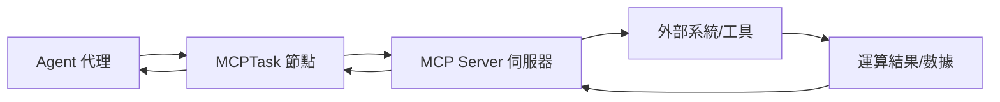
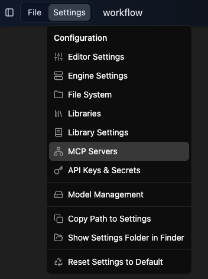
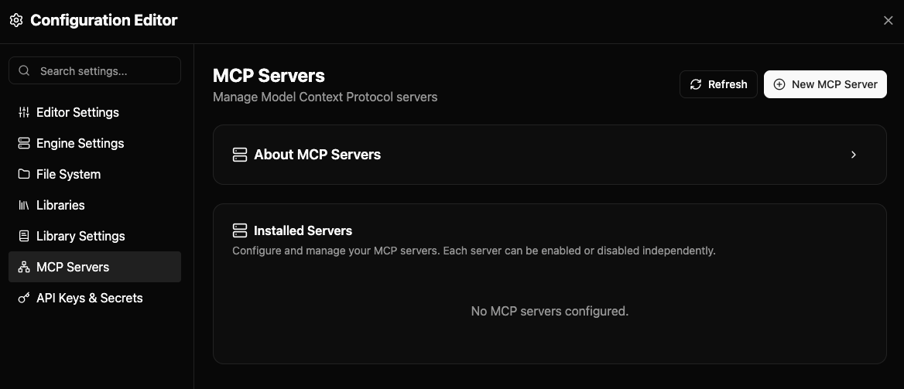
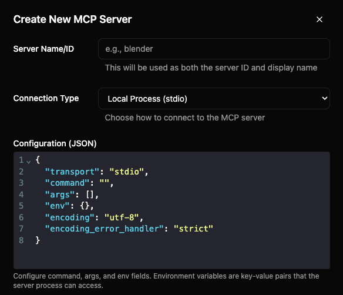
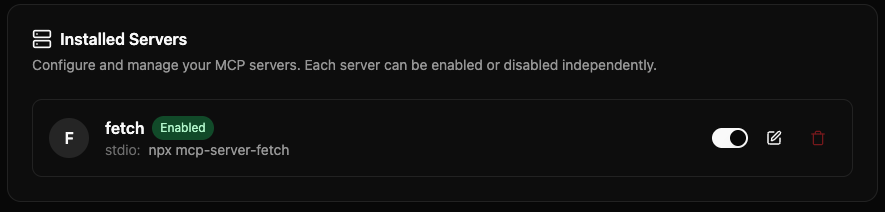
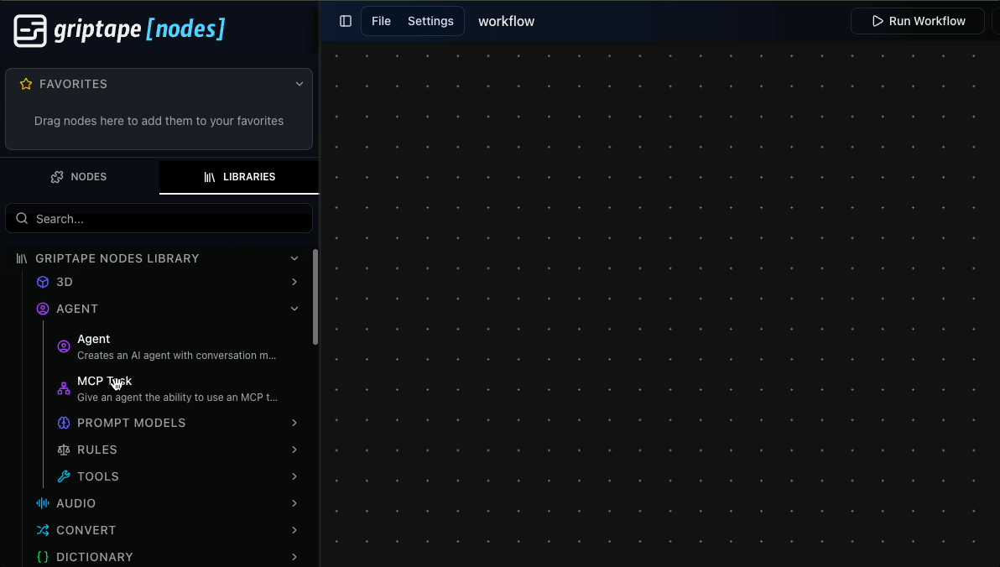
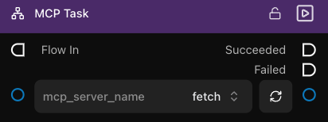
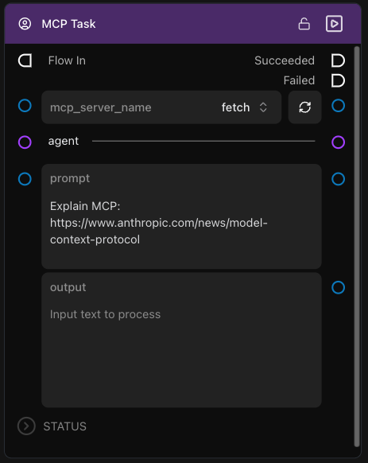
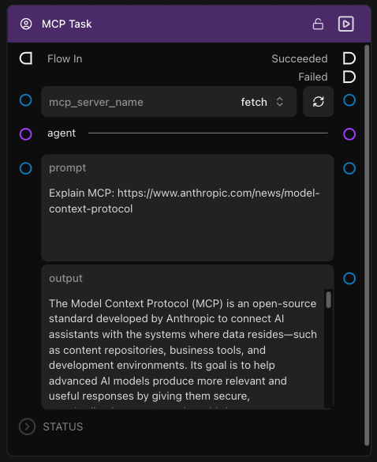
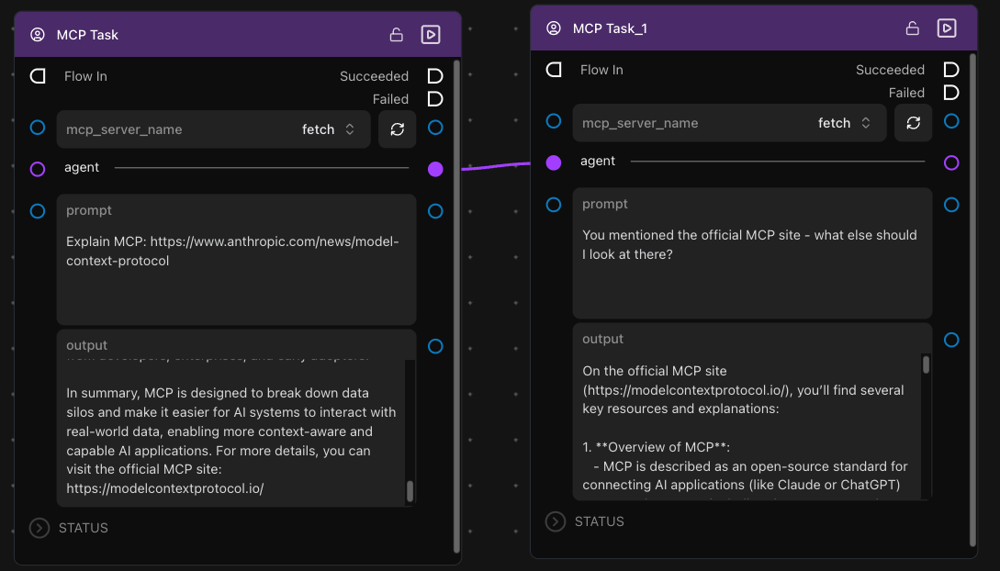

# MCP 快速入門：Fetch 伺服器實戰教學 {: #getting-started-with-mcp-fetch-server-tutorial }

本教學將帶領您使用 **[Fetch MCP Server](https://github.com/modelcontextprotocol/servers/tree/main/src/fetch)** 設定您的第一個 MCP 伺服器 — 這是一款精簡的網頁內容抓取工具，非常適合作為入門實戰。

## 我們即將建置的內容 {: #what-were-going-to-build }

我們將配置 [Fetch MCP Server](https://github.com/modelcontextprotocol/servers/tree/main/src/fetch)，它提供了網頁內容擷取功能。此伺服器能讓您的 AI Agent 擷取並解析網頁內容，並自動將 HTML 轉換為乾淨的 Markdown 格式以便閱讀與處理。

**為何選擇 Fetch？**

- ✅ **配置極簡** — 使用 `uvx` 自動下載執行，無需複雜安裝
- ✅ **無深層依賴** — 只要電腦具備網際網路連線即可運作
- ✅ **立竿見影** — 設定完畢即可立即在畫布上測試
- ✅ **真實實用** — 在資料調研與內容分析工作流程中不可或缺

## MCP 在 Griptape Nodes 中的運作機制 {: #how-mcp-works-in-griptape-nodes }



MCPTask 節點扮演 Griptape Nodes 工作流程與外部 MCP 伺服器之間的通訊橋樑，使 AI Agent 能無縫調用外部系統。

## 循序漸進實戰教學 {: #step-by-step-tutorial }

### 步驟 1：開啟 MCP 伺服器設定視窗 {: #step-1-open-mcp-server-settings }

1. 開啟 Griptape Nodes 編輯器
1. 從頂部功能表依序點選 **Settings** → **MCP Servers**

    

1. 若您是首次開啟 MCP Server 設定，清單中尚未配置任何伺服器。

    

### 步驟 2：建立新 MCP 伺服器 {: #step-2-creating-an-mcp-server }

點擊建立按鈕並填寫連線參數：

1. 點擊 **+ New MCP Server**

    

1. 將 **Server Name/ID (伺服器名稱/識別碼)** 命名為 `fetch`
1. 將 **Connection Type (連線類型)** 保持為 `Local Process (stdio)`（若尚未選取）。
1. 檢視 **Configuration (JSON)** 組態欄位，預設樣板如下：

    ```json
    {
        "transport": "stdio",
        "command": "",
        "args": [],
        "env": {},
        "encoding": "utf-8",
        "encoding_error_handler": "strict"
    }
    ```

    這段 JSON 定義了用戶端 (Griptape Nodes) 如何啟動並連線至該本機伺服器進程。

    多數 MCP 伺服器官方文件皆會提供針對 Claude 或 VS Code 的設定範例。Fetch 伺服器亦同，我們只需將其命令移植至此即可。

1. 前往 [Fetch MCP Server](https://github.com/modelcontextprotocol/servers/tree/main/src/fetch) 的 GitHub 專案首頁
1. 向下捲動至 [Configuration](https://github.com/modelcontextprotocol/servers/tree/main/src/fetch#configuration) 設定章節
1. 在 **Configure for Claude.app** 區塊中，展開 "Using `uvx`" 並查閱其指示：

    ```json
    {
        "mcpServers": {
            "fetch": {
            "command": "uvx",
            "args": ["mcp-server-fetch"]
            }
        }
    }
    ```

    我們關注的核心欄位為 `command` 與 `args`。這即是我們需要填入伺服器配置中的內容。

1. 將 **Configuration (JSON)** 修改為：

    ```json
    {
        "transport": "stdio",
        "command": "uvx",
        "args": ["mcp-server-fetch"],
        "env": {},
        "encoding": "utf-8",
        "encoding_error_handler": "strict"
    }
    ```

    **選填：加入自訂規則 (Custom Rules)**

    您可以在 **Rules** 文字方塊中輸入自訂指引規則，引導 AI Agent 在使用此 MCP 伺服器時的行為準則。當 Agent 調用該伺服器的工具時，這些規則會自動注入提示詞中：

    例如輸入：

    ```
    Always validate URLs before fetching. Return errors in JSON format if a fetch fails.
    ```

1. 點擊 **Create Server** 完成建立

    

### 步驟 3：管理您的伺服器 {: #step-3-manage-your-server }

建立完成後，伺服器會出現在清單中。您可以隨時：

- 使用開關按鈕 **啟用/停用 (Enable/Disable)** 特定伺服器
- 點擊 Edit 按鈕 **編輯 (Edit)** 伺服器參數（包括新增或修改行為規則）
- 點擊垃圾桶圖示 **刪除 (Delete)** 伺服器

完成後關閉設定對話方塊。

### 步驟 4：在畫布上建立 MCP Task 節點 {: #step-4-create-an-mcp-task }

1. 在工作流程編輯器中，從左側節點面板的 **Agent** 分類拖出一個 **MCP Task** 節點至畫布上

    

1. 在 MCP Task 節點的 **mcp_server_name** 下拉選單中選取剛建立的 `fetch`

    

1. 若下拉選單中未顯示該伺服器，點擊旁邊的**重新整理圖示**以更新清單

### 步驟 5：測試執行 {: #step-5-test-your-setup }

在節點的 prompt 提示詞欄位中，詢問一個需要聯網查詢的具體網址問題，例如：

```
Explain MCP: https://www.anthropic.com/news/model-context-protocol
```



接著點擊節點上的 **Run (執行)** 按鈕。

### 步驟 6：檢視執行成果 {: #step-6-see-the-results }

節點運算完畢後會傳回解析後的摘要結果：



## 下一步：鏈式任務串聯 (Chaining Tasks) {: #next-steps-chaining-tasks }

現在您已成功運行了首個 MCP 伺服器，您可以進一步：

### 串聯多個連續任務 {: #chain-multiple-tasks }

- 將第二個 **MCP Task** 節點連線至第一個節點的下游
- 第二個任務可基於前一個任務的回答進一步追問，並在需要時繼續調用 MCP 伺服器
- 若有需要，不同的任務節點可指定調用不同的 MCP 伺服器



在第二個任務中，我們詢問 Agent 關於 MCP 官方網站的資訊，但完全未在提示詞中提及具體 URL。這是因為前一個任務中 MCP 伺服器已在回覆中帶出了該網址。Agent 具備完整的對話上下文記憶，並能在此基礎上精準迭代。

## 延伸探索 {: #whats-next }

- **[在 Agent 中使用 MCPTask (Using MCPTask with Agents)](./mcp_task_agents.md)** — 進階整合設計模式
- **[精選 MCP 伺服器範例 (Example MCP Servers)](./servers/index.md)** — 其他實用伺服器的建置指引
- **[連線架構類型 (Connection Types)](./index.md#connection-types)** — 深入了解與外部應用對接的各類底層傳輸協定
