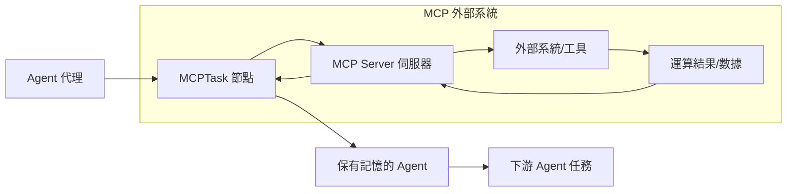
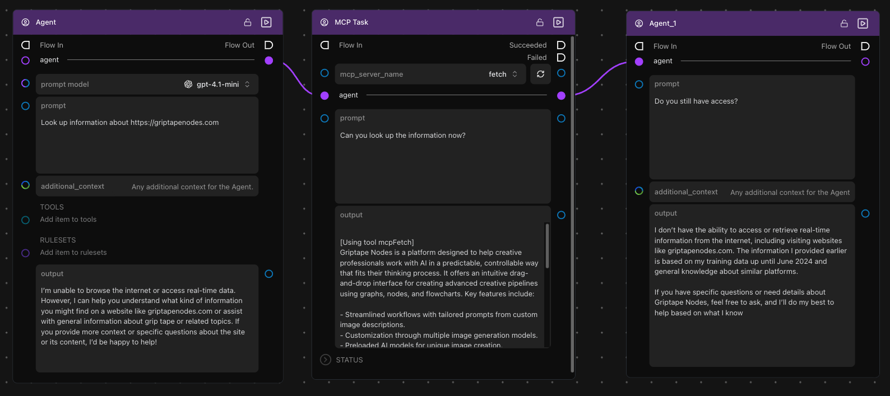

# 在 Agent 中使用 MCPTask (Using MCPTask with Agents) {: #using-mcptask-with-agents }

**MCPTask** 節點讓您能向 AI Agent 授予對外部工具與資料庫的臨時調用存取權。這項強大的機制讓您能精準掌控 Agent 何時以及如何與外部系統互動。

## 核心設計理念：具備記憶的臨時存取權 {: #key-concept-temporary-access-with-memory }

當您將 Agent 連線至 MCPTask 節點時：

- ✅ **Agent 獲配存取權限**：臨時取得調用指定 MCP 伺服器工具的能力
- ✅ **Agent 能執行未知任務**：完成原本受限於封閉環境而無法執行的操作
- ✅ **Agent 完整保留記憶**：深度記住執行過程中所獲取的新知識與數據
- ❌ **任務結束即回收權限**：跳出 MCPTask 後，Agent 立即喪失對該 MCP 工具的直接連線

這實現了嚴謹的最小權限原則：創作者精確掌控外部工具的調用邊界，同時 Agent 能將成果知識帶往下游節點。

## MCPTask 與 Agent 的架構互動流程 {: #how-mcptask-works-with-agents }

MCPTask 節點扮演暫時性擴充 Agent 能力的轉接橋樑，任務執行完畢後輸出承載了全新知識、但已剝離外部工具權限的乾淨 Agent。

## 逐步實戰演示：臨時存取與記憶保留 {: #step-by-step-demonstration-temporary-access-with-memory }

讓我們建構一個工作流程，直觀展示 Agent 如何臨時獲配 MCP 能力並在權限收回後持續維持記憶。我們將使用 Fetch MCP 伺服器示範 Agent 連網擷取資訊、隨後在無網狀態下繼續運用該知識。

### 事前準備 {: #prerequisites }

- 已依據[快速入門教學](./getting_started.md)完成 **Fetch MCP 伺服器**的建立
- 具備 Griptape Nodes 基本節點連線概念

### 步驟 1：建立首個基準 Agent {: #step-1-create-your-first-agent }

1. **拖曳一個 Agent 節點**至畫布上
1. **配置 Agent 參數**：
    - 將 **prompt model** 設為 `gpt-4o-mini`（或您慣用的模型）
    - 將 **prompt** 輸入為：`"Look up information about https://griptapenodes.com"`
    - **additional_context** 暫時留空
1. **點擊執行 Agent** — 觀察其回覆，它會明確表示無法連線至網際網路：

    > I'm unable to browse the internet or access real-time data. However, I can help you understand what kind of information you might find on a website like griptapenodes.com...

這清楚展示了在未獲配 MCP 工具前 Agent 的能力邊界。

### 步驟 2：接入 MCPTask 節點 {: #step-2-add-mcptask-node }

1. **拖曳一個 MCPTask 節點**至畫布上
1. **將前述 Agent 的輸出埠**連線至 MCPTask 節點的 **agent** 輸入埠
1. **配置 MCPTask 參數**：
    - 將 **mcp_server_name** 下拉選單指定為 `fetch`
    - 將 **prompt** 輸入為：`"Can you look up the information now?"`
1. **點擊執行 MCPTask** — Agent 此刻獲配了 Fetch 工具權限，成功聯網抓取到了資訊：

    > [Using tool mcpFetch] Griptape Nodes is a platform designed to help creative professionals work with AI in a predictable, controllable way that fits their thinking process. It offers an intuitive drag-and-drop interface for creating advanced creative pipelines using graphs, nodes, and flowcharts...

### 步驟 3：接續下游普通 Agent 節點 {: #step-3-connect-to-another-agent }

1. **拖曳另一個 Agent 節點**至畫布下游
1. **將 MCPTask 的 agent 輸出埠**連線至該新 Agent 節點的 **agent** 輸入埠
1. **配置第二個 Agent**：
    - 將 **prompt** 輸入為：`"Do you still have access?"`
1. **點擊執行第二個 Agent** — 觀察其回答：

    > I don't have the ability to access or retrieve real-time information from the internet... The information I provided earlier is based on my training data...

**核心觀察**：該 Agent 已經不再擁有 MCP 工具的調用存取權，但它完好記住了在 MCPTask 期間所學到的全部資訊！

### 步驟 4：驗證長期記憶留存 {: #step-4-test-memory-retention }

1. **追加另一個 Agent 節點**連線至上一步驟的下游
1. **配置提示詞**：`"What did you learn about Griptape Nodes?"`
1. **點擊執行** — Agent 能精準回憶並重述先前學到的具體細節：

    > Based on the information I learned earlier, Griptape Nodes is a platform designed to help creative professionals work with AI in a predictable, controllable way...

這證實了 Agent 在權限被安全收回後，認知與記憶依然完好繼承。

## 進階 Agent 行為配置 {: #advanced-agent-configuration }

### 打造客製化 Agent 行為 {: #customizing-agent-behavior }

您可以透過多維度參數進一步自訂 Agent 的表現：

#### 規則集 (Rulesets) {: #rulesets }

加入行為準則規則以約束 Agent 的決策邊界：

- **調研型 Agent**："Always cite sources when providing information"（提供資訊時一律引用來源網址）
- **創意型 Agent**："Think outside the box and suggest innovative solutions"（打破常規思維，提出創新方案）
- **分析型 Agent**："Provide detailed analysis with pros and cons"（提供詳盡的優劣對比分析）

#### 原生工具擴充 (Tools) {: #tools }

在 MCP 伺服器之外補充原生輕量工具：

- **Calculator 工具**：輔助進行高精度數學運算
- **Date Time 工具**：輔助感知當前實體時間與排程解析

#### 靈活選用 Prompt Model 模型 {: #prompt-models }

針對不同任務指派最適模型：

- **gpt-4o-mini**：輕量任務高速且經濟
- **gpt-4o**：複雜多步驟邏輯推理
- **Claude Sonnet**：專業內容分析與長篇寫作

## 相關參考資源 {: #next-steps }

- **[在 Agent 中使用本機模型 (Local Models with Agents)](./advanced_local_models.md)** — 使用本機離線 AI 模型處理極度敏感數據
- **[精選 MCP 伺服器範例 (Example MCP Servers)](./servers/index.md)** — 探索更多專業領域的 MCP 工具配置
- **[連線架構類型 (Connection Types)](./index.md#connection-types)** — 深入了解與外部系統對接的連線協定
