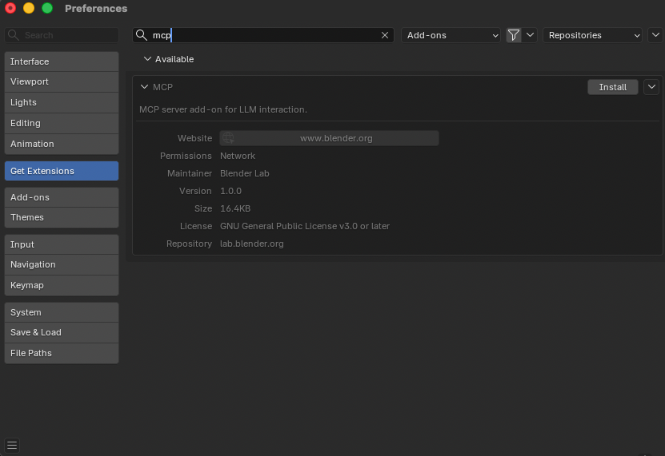
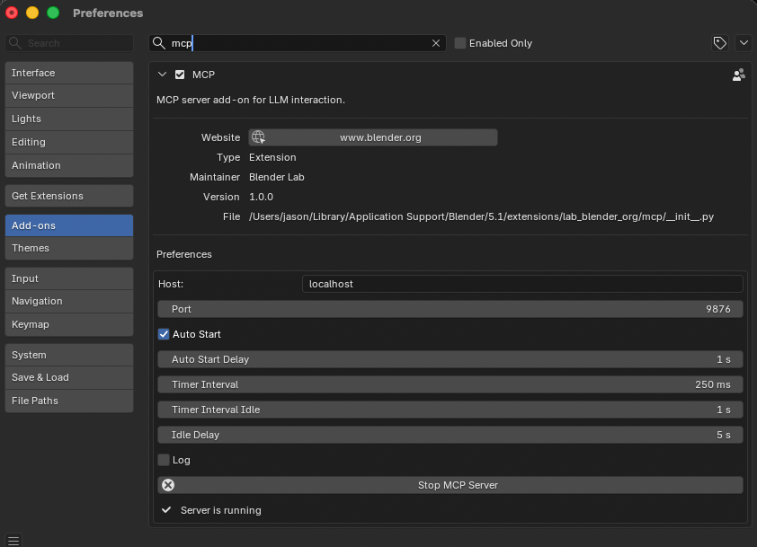

# Blender MCP 伺服器 (Blender MCP Server) {: #blender-mcp-server }

**[Blender MCP 伺服器](https://www.blender.org/lab/mcp-server/)** 是專為 [Blender](https://www.blender.org) 打造的官方 MCP 整合外掛，由 Blender Lab 團隊主導開發與維護。它允許 AI Agent 直接與 Blender 進行雙向互動並控制 3D 視圖，實現自然語言提示輔助建模、場景檢驗與各類自動化操作。

!!! note "事前準備 (Prerequisites)"

    在使用 Blender MCP 伺服器前，您必須具備：

    1. 安裝 [Blender](https://www.blender.org) 5.1 或更新版本
    1. 安裝 `uv` 套件管理工具（[安裝指引](https://docs.astral.sh/uv/getting-started/installation/)）
    1. Clone 複製 [Blender MCP 原始碼存放庫](https://projects.blender.org/lab/blender_mcp)
    1. 安裝 Blender MCP 擴充套件（步驟見下文）

## 安裝 Blender MCP 擴充套件 {: #installing-the-blender-mcp-extension }

Blender MCP 伺服器以 Blender Extension 形式透過官方擴充套件平台分發。

1. 造訪 [blender.org/lab/mcp-server](https://www.blender.org/lab/mcp-server/#addon) 並向下捲動至 **Add-on** 章節

1. 選擇以下兩種安裝方式之一：

    **選項 A — 拖放安裝 (Drag and Drop)**

    將網頁上的 **Drag and Drop into Blender** 按鈕直接拖曳至已開啟的 Blender 視窗中。

    !!! warning "需連續拖放兩次 (Drag and drop twice)"

        您必須進行**兩次**拖放操作：第一次拖放會新增 Blender Lab 擴充套件倉庫，第二次拖放才會正式安裝該 Add-on。

    **選項 B — 從磁碟檔案安裝 (Install from Disk)**

    點擊網頁上的 **download** 下載套件檔案。隨後在 Blender 中依序前往 **Edit** → **Preferences** → **Get Extensions** → 右上方下拉選單 → **Install from Disk...** 並選取剛下載的檔案。

1. 在 Blender 中前往 **Edit** → **Preferences** → **Get Extensions**

1. 在搜尋列輸入 `mcp` — 您應能看到狀態為 Available 的 **MCP** 擴充套件

1. 點擊 **Install** 進行安裝



## 在 Blender 中啟動 MCP 伺服器 {: #starting-the-mcp-server-in-blender }

擴充套件安裝完畢後，在自 Griptape Nodes 連線之前，您需要先在 Blender 內部啟動 MCP 伺服器進程：

1. 在 Blender 中依序前往 **Edit** → **Preferences** → **Add-ons**
1. 搜尋 `mcp` 並展開 **MCP** 擴充套件的偏好設定面板
1. 如有需要可調整 **Host** 與 **Port** 參數（預設值為：`localhost` / `9876`）
1. 可自由勾選 **Auto Start**，使伺服器在 Blender 啟動時自動於背景執行
1. 點擊 **Start MCP Server** 按鈕

當連線就緒時，面板狀態會明確顯示 **Server is running**。



## 複製 MCP 伺服器原始碼 (Clone) {: #cloning-the-mcp-server-code }

Griptape Nodes 的本機 MCP 連線需要存取 Blender MCP 存放庫的本機副本。請將其複製到容易檢索的目錄 — 例如在 macOS / Linux 上可使用 `$HOME/Documents/GitHub`，在 Windows 上可使用 `%USERPROFILE%\Documents\GitHub`：

```bash
cd $HOME/Documents/GitHub
git clone https://projects.blender.org/lab/blender_mcp.git
```

稍後在 Griptape Nodes 的組態設定中，將會直接引用該副本內部的 `mcp/` 子目錄路徑。

## 在 Griptape Nodes 中配置連線 {: #installation-in-griptape-nodes }

1. **開啟 Griptape Nodes** 並前往 **Settings** → **MCP Servers**

1. **點擊 + New MCP Server**

1. **填寫伺服器配置**：

    - **Server Name/ID (伺服器名稱/識別碼)**：`blender`
    - **Connection Type (連線類型)**：`Local Process (stdio)`
    - **Configuration JSON (組態 JSON)**：

    ```json
    {
      "transport": "stdio",
      "command": "uv",
      "args": [
        "--directory",
        "/path/to/blender_mcp/mcp",
        "run",
        "blender-mcp"
      ],
      "env": {},
      "cwd": null,
      "encoding": "utf-8",
      "encoding_error_handler": "strict"
    }
    ```

1. **將 `/path/to/blender_mcp/mcp` 替換**為您本機複製副本中 `mcp/` 子目錄的真實絕對路徑

1. **點擊 Create Server** 完成建立

!!! example "路徑範例參考"

    若您將存放庫複製至 `$HOME/Documents/GitHub/blender_mcp`，則傳遞給 `--directory` 的數值應為：

    ```
    /Users/yourname/Documents/GitHub/blender_mcp/mcp
    ```

## 實用應用場景提示詞範例 {: #example-use-cases }

- 「針對目前開啟的 Blender 專案檔案，為所有 data-blocks 提供語意化命名建議，經確認後自動套用更名」
- 「找出當前檔案中多邊形面數 (poly-count) 最多的是哪個模型？請忽略未連結至任何場景的孤立物件」
- 「在場景中建立一個球體 (Sphere)，並將其放置於立方體 (Cube) 的正上方」
- 「將場景打光配置調整為專業攝影棚 (Studio) 風格」
- 「將攝影機對準場景中心並切換為等距視角 (Isometric)」
- 「讀取當前場景的階層資訊並匯出為結構化 JSON 檔案」

## 疑難排解 {: #troubleshooting }

### 常見問題 {: #common-issues }

- **連線遭拒 (Connection refused)**：請確認 Blender 內部的 MCP 伺服器已確實啟動（檢查擴充套件面板是否顯示 **Server is running**）
- **首次執行指令失敗**：建立連線後的首個指令偶爾可能發生交握逾時。請直接再次點擊執行該節點
- **路徑錯誤 (Wrong path)**：確認 `--directory` 參數精確指向副本內的 `mcp/` 子目錄，而非存放庫的根目錄
- **逾時錯誤 (Timeout errors)**：嘗試將複雜的 3D 生成需求拆解為多個步驟循序交代
- **程式碼執行警告**：若伺服器開啟了 Python 腳本執行工具，在進行操作前務必先行手動儲存 Blender 專案

### 除錯小技巧 {: #debug-tips }

1. 確認擴充套件已在 **Edit** → **Preferences** → **Add-ons** 中被勾選啟用
1. 確認兩端的 Host 與 Port 數值完全一致（Blender 內部與 Griptape Nodes 設定）
1. 先以極度單純的查詢指令進行測試（例如：「場景中有哪些模型物件？」）
1. 若連線卡死，嘗試重啟 Blender 與 Griptape Nodes

## 相關參考資源 {: #resources }

- [Blender MCP 伺服器首頁](https://www.blender.org/lab/mcp-server/) — 官方網站與擴充套件下載
- [Blender MCP 原始碼倉庫](https://projects.blender.org/lab/blender_mcp) — 原始碼與問題回報 (Issue Tracker)
- [Blender Python API 參考文件](https://docs.blender.org/api/current/) — Blender 腳本控制規範
- [uv 套件管理器安裝手冊](https://docs.astral.sh/uv/getting-started/installation/) — 執行 MCP 伺服器必備工具

## 安全性考量 {: #security-considerations }

!!! danger "動態程式碼執行 (Code Execution)"

    部分進階 MCP 工具可能會在 Blender 的 Python 執行階段中直接動態執行代碼。這賦予了強大能力的同時亦伴隨潛在風險：

    - 在執行任何涉及代碼生成的工具前，**務必手動備份並儲存當前 Blender 專案**
    - 在可行情況下先行檢閱 AI 生成的指令碼
    - 在正式生產環境中謹慎使用
