# 在圖形介面 (GUI) 中管理專案 {: #managing-projects-in-the-gui }

**專案 (Project)** 是一套已儲存的配置架構，用以指引 Griptape Nodes 檔案應存放於何處，以及應調用哪些節點程式庫和引擎版本。切換專案會全面變更您各項操作的上下文環境：彩現圖像與下載項目的儲存位置、可選取的工作流程清單，以及當前畫布上可用的節點程式庫。

本頁全面示範您可在 GUI 中執行的所有專案維護任務：在不同專案之間切換、建立新專案、檢視與編輯專案，以及移除專案。如需深入理解專案背後的底層核心概念（檔案格式、巨集語法、版本鎖定），請參閱[專案系統總覽](index.md)。

> 本頁介紹的所有操作皆在 **Project Management (專案管理)** 視窗中完成。從頂部功能表列依序點擊：**Manage → Project Management** 即可開啟。

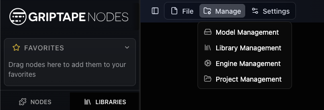

## 專案管理視窗 {: #the-project-management-window }

專案管理視窗預設顯示**專案清單 (Project List)**。各專案以樹狀目錄結構呈現：子專案會以縮排方式巢狀排列於其父專案下方。您目前所在的專案會醒目標註 **Active (當前活躍)** 徽章。

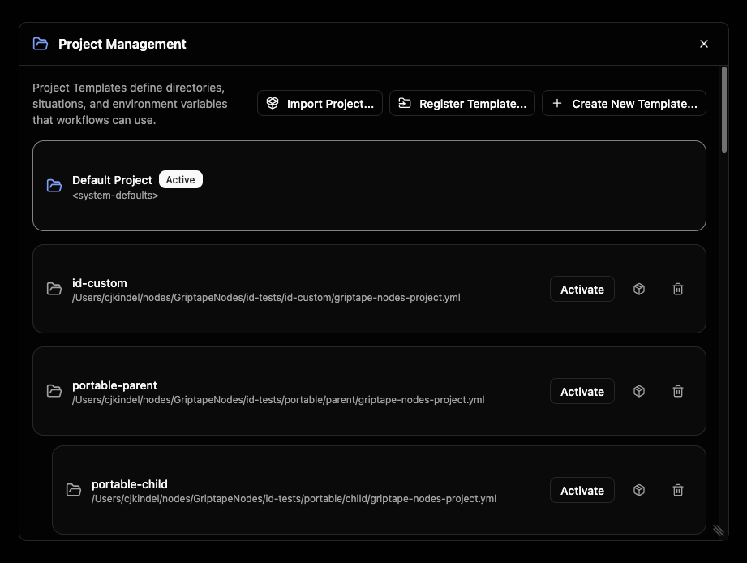

右上角提供兩個按鈕用於向此清單中新增專案：

- **Register Template… (註冊範本...)**：指向磁碟上現有的專案設定檔並將其納入清單。
- **Create New Template… (建立新範本...)**：從頭開始建立全新的獨立專案。

點擊清單中的任何專案即可開啟其詳細資料檢視頁面，您可在此進行檢視與參數編輯。

## 切換專案 {: #switching-projects }

切換專案是日常最頻繁的操作。您可以在專案管理視窗中進行切換（點選某個專案，隨後點擊 **Activate**），但最迅速便捷的途徑是透過工作流程選取器中的**專案挑選下拉選單 (Project Picker)**。

該選取器會即時顯示您目前所在的專案。展開選單可搜尋並挑選其他專案；當前活躍的專案旁會打上勾號標記。

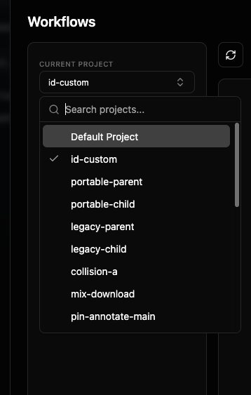

當您選取不同專案時，Griptape Nodes 會彈出確認對話方塊，清晰展示您即將離開哪個專案並切換至哪個專案。

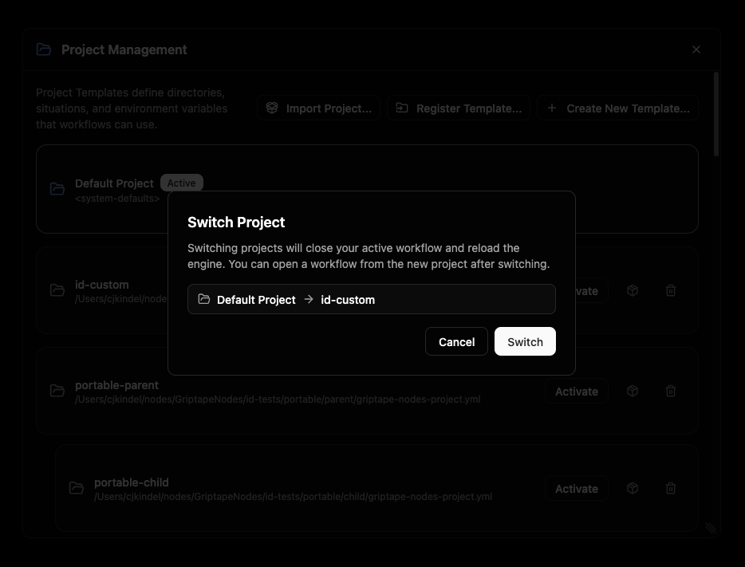

> **切換專案會重新載入引擎。** 您當前開啟的工作流程會先被關閉（若有未儲存的修改，系統會提示您先存檔），隨後工作流程清單會自動重新整理，僅呈現新專案所屬的工作流程。切換完成後，直接從新專案中開啟工作流程即可繼續作業。

若您即將切換到的目標專案鎖定了特定的程式庫版本，系統會先彈出**佈建預覽 (Provisioning Preview)** 視窗，方便您在正式切換前審查（並核准）即將自動安裝或異動的程式庫套件。

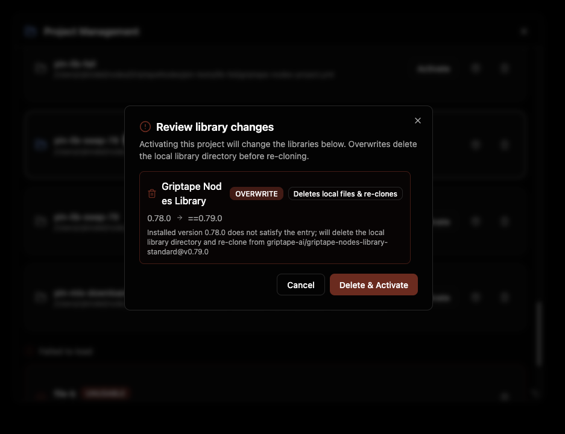

介面會顯示 **Switching to <project>…** 的進度指示，完成後會彈出 **Switched to <project>** 的確認提示通知。

## 建立新專案 {: #creating-a-project }

點擊 **Create New Template…** 開啟 **New Project Template** 對話方塊。對於絕大多數專案而言，您只需填寫專案名稱；其餘所有選項皆具備合理的預設值。

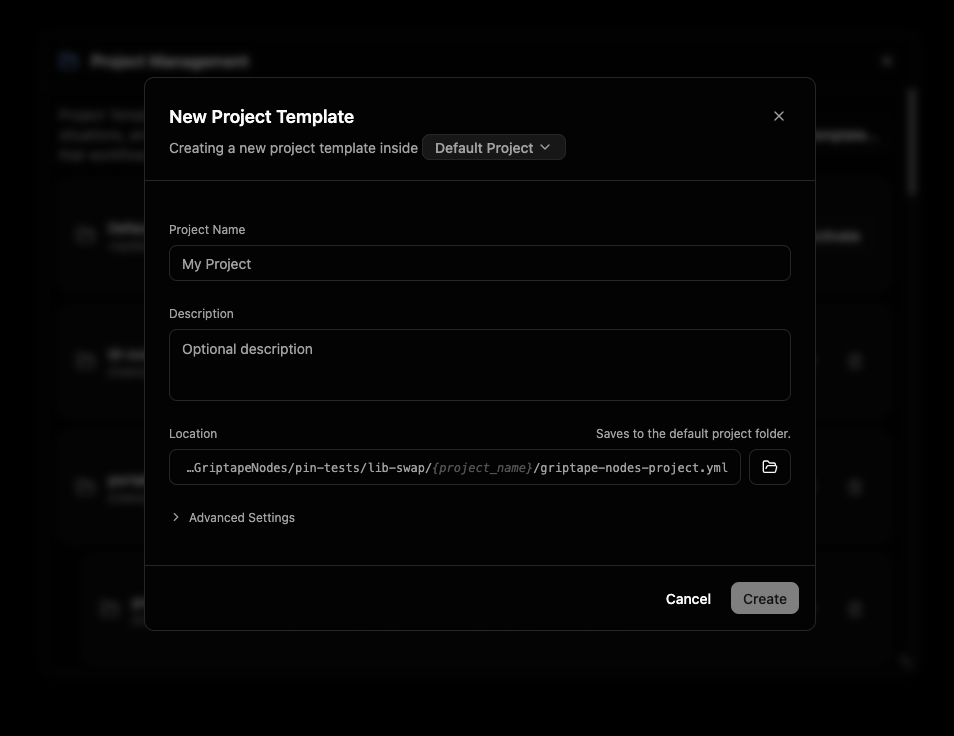

視窗頂部的副標題會顯示 "Creating a new project template inside *Default Project*."。其中醒目提示的名稱即為**存放位置 (Location)**：用於指定新專案設定檔寫入哪個專案資料夾下的挑選器。它預設指向您當前活躍的專案（或 Default Project）。點擊它即可改選其他位置。

填寫基本資訊：

- **Project Name (專案名稱)**：在 GUI 介面各處呈現的人類可讀顯示名稱。此為唯一必填欄位。
- **Description (描述)**：選填，說明該專案用途的備忘筆記。
- **Location (存放位置)**：專案設定檔 (`griptape-nodes-project.yml`) 實際寫入的實體路徑。預設情況下此路徑與所選位置綁定，並顯示為以 `your-project-name/griptape-nodes-project.yml` 結尾的唯讀路徑，因此會隨您輸入名稱即時自動更新。若需手動自訂路徑，點擊該路徑（或資料夾圖示展開瀏覽）；點選 **Reset** 即可重新恢復與預設值連動。

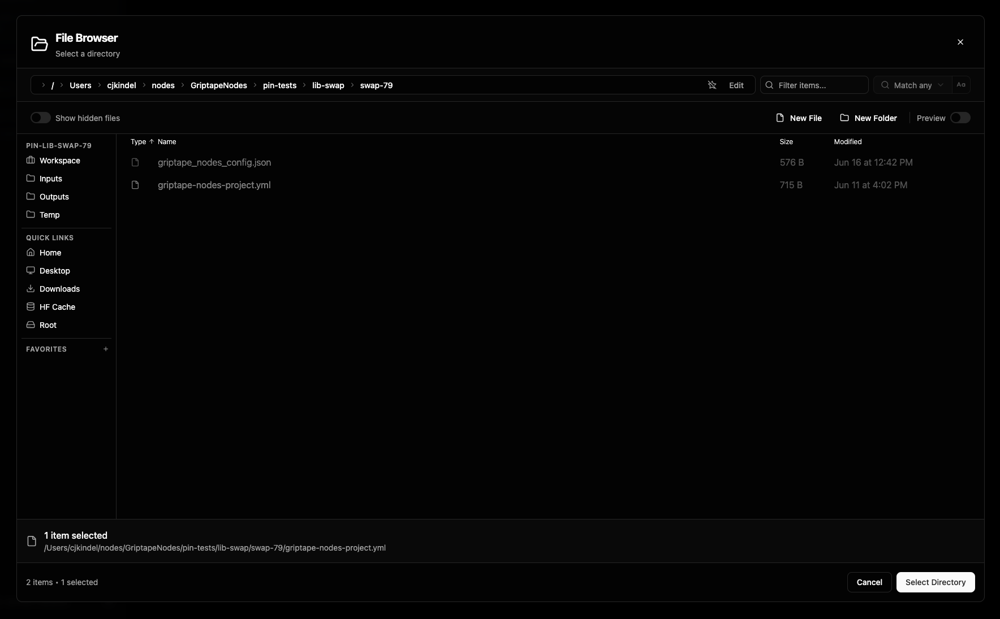

### 進階設定 (Advanced Settings) {: #advanced-settings }

多數創作者通常無需展開此面板。展開 **Advanced Settings** 可設定：

- **Project ID (專案識別碼)**：專案的永久全域唯一識別碼。系統會自動由名稱追加短隨機後綴生成，您可直接保留預設值。點擊它可手動自訂（僅限小寫英文字母、數字與破折號，且必須保持全域唯一）。專案一旦建立，其 ID 即不可變更。
- **Inherits settings from (繼承設定自)**：父專案 (Parent Project)。子專案以父專案的配置為起點，僅儲存您額外自訂的覆寫項目。此選項預設與存放位置連動，因此挑選存放位置時亦會自動指定父級；若您不希望有任何繼承關係，在此處選擇 **Default Project**。繼承運作原理請參閱[專案設定檔與繼承](projects.md#parent-projects)。
- **Workspace directory (工作區目錄)**：新專案存放工作流程與生成檔案的根資料夾。新專案預設為 `./` — 即專案本身的專屬資料夾 — 達成自給自足的獨立封閉性。您可修改指向其他位置，或清空此欄位以直接繼承父專案的工作區路徑。（僅在採用最新架構綱要的專案中顯示；參閱[綱要版本 (Schema versions)](projects.md#schema-versions)）。

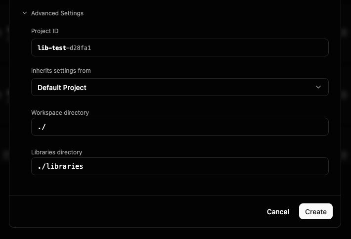

點擊 **Create**。進度面板會依序執行儲存專案、向引擎註冊、啟動並完成整體佈建。建立專案會直接將其啟動為當前活躍專案，因此引擎會執行重新載入（與一般切換專案時的重載相同）；若您有尚未儲存的工作流程開啟，系統會提示您先存檔。

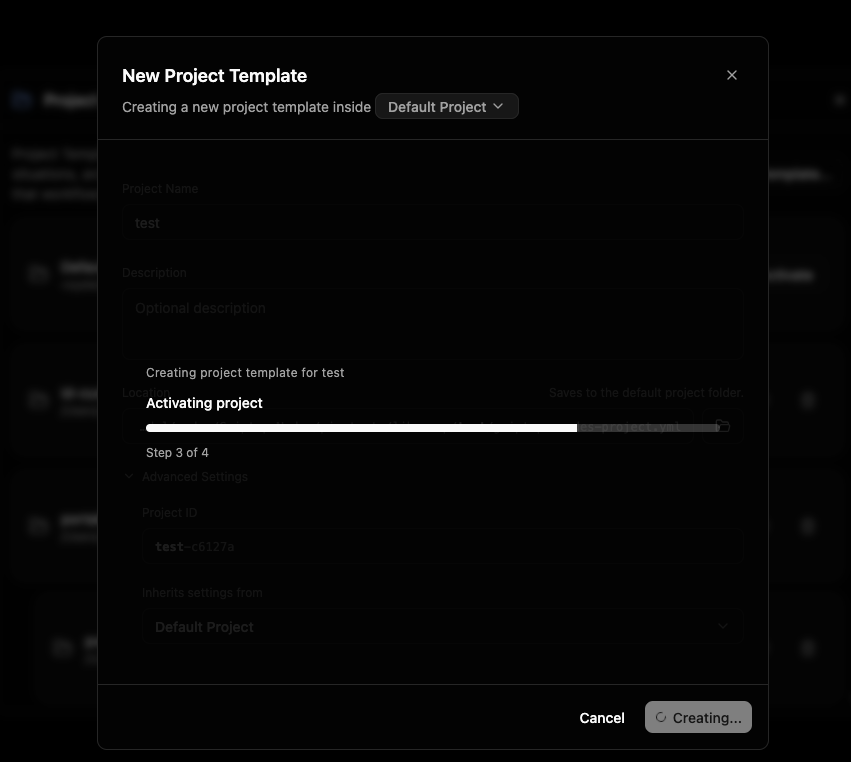

> 若所選存放位置或父專案鎖定了特定程式庫版本，在切換時出現的同款[佈建預覽](#switching-projects)亦會在此彈出，以便您在新專案啟動前審查並授權這些程式庫。

就緒後會顯示 **Project created** 確認提示。

## 檢視與編輯專案 {: #viewing-and-editing-a-project }

點擊清單中的專案可開啟其詳細資料檢視頁面。頂部標頭呈現專案名稱、實體檔案路徑（附帶一鍵複製按鈕），以及 **Active (活躍)** 與 **Unsaved changes (未儲存變更)** 狀態標籤。

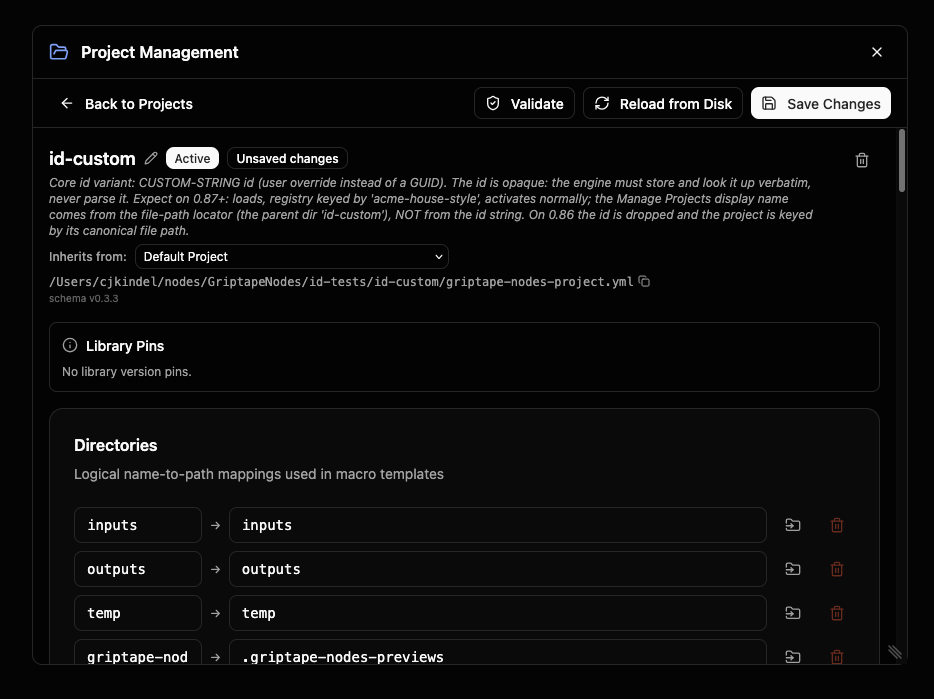

點選名稱旁的鉛筆圖示即可在行內直接修改**名稱**與**描述**。

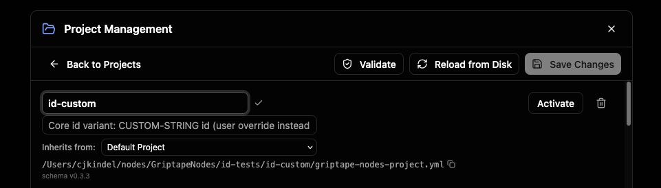

**Inherits from (繼承自)** 下拉選單可隨時設定（或解除）父專案關聯。詳細資料頁面同時展開了專案各個可編輯的核心區塊：

### 工作區目錄 (Workspace directory) {: #workspace-directory }

**Workspace dir** 欄位設定本專案所有工作任務的根目錄：所有相對路徑、輸出成品與下載檔案皆以此資料夾為基準進行解析。此處設定具備最高優先權，會覆寫使用者層級與全域層級的設定值。

保持空白時，專案會套用引擎依據全域設定所計算出的預設工作區；當此欄位為空時，會以灰色預留位置文字呈現該**計算路徑 (Calculated path)**，方便您無需任何額外配置即可清楚預覽檔案落點。鍵入路徑可明確鎖定工作區，亦可點選資料夾按鈕進行圖形瀏覽。與目錄設定類似，它提供跨平臺切換開關，允許您分別為 Linux、macOS 與 Windows 指定不同的實體路徑。

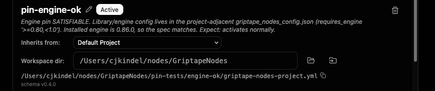

完整規格請參閱[工作區目錄 (Workspace directory)](projects.md#workspace-directory)與[工作區 (Workspace)](workspace.md)。

### 節點程式庫目錄 (Libraries directory) {: #libraries-directory }

**Libraries dir** 欄位設定本專案安裝與解析節點程式庫的實體目錄，使其與工作區互相分離。這使得關聯的多個專案能共用同一個程式庫安裝目錄，而無需各自重複下載重複的套件複本。

保持空白時，專案會繼承父專案的程式庫目錄；若上層鏈路皆未宣告，則退回至工作區內部的 `libraries` 資料夾。全新的頂層專案會預先填入 `./libraries`，使其子專案預設繼承該共用位置；子專案建立時此欄位預設留空。鍵入路徑可鎖定特定目錄，或點選資料夾圖示展開瀏覽。同樣提供跨平臺開關，支援在 Linux、macOS 與 Windows 上定義不同路徑。

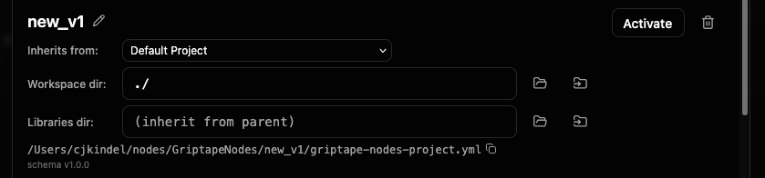

完整規格請參閱[程式庫目錄 (Libraries directory)](projects.md#libraries-directory)。

### 目錄架構 (Directories) {: #directories }

**Directories** 將簡短的邏輯名稱（例如 `outputs`）映射至磁碟上的真實資料夾路徑。工作流程與節點一律參照該邏輯名稱，由專案統一決定其真實指向。點選 **Add Directory** 可新增目錄條目；每列資料皆提供跨平臺開關，允許在 Linux、macOS 與 Windows 上映射至不同的路徑。

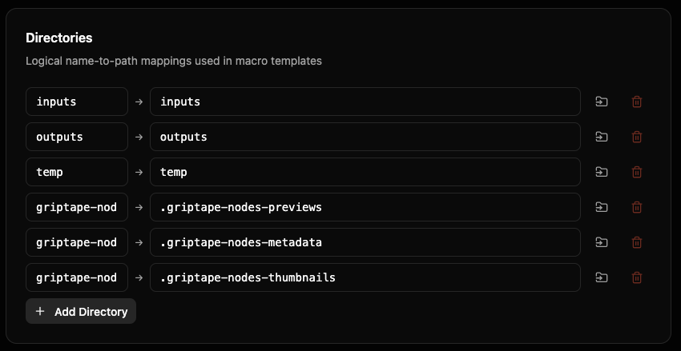

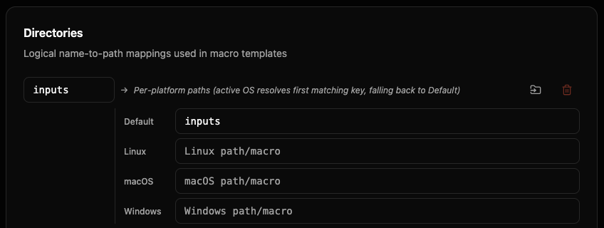

完整規格請參閱[目錄架構 (Directories)](directories.md)。

### 副檔名目錄分流 (File Extension Directories) {: #file-extension-directories }

**File Extension Directories** 依據副檔名將檔案自動分流歸檔至指定資料夾（例如：`png → images`、`mp4 → videos`）。展開此區塊可新增或編輯映射規則。

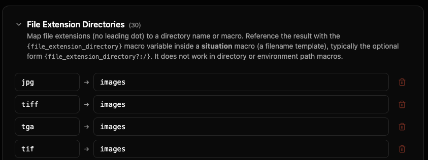

完整規格請參閱[副檔名目錄分流 (File Extension Directories)](file_extension_directories.md)。

### 環境變數 (Environment) {: #environment }

**Environment** 為本專案提供的一組自訂鍵值變數。您可以在專案其他設定中靈活引用它們。點擊 **Add Variable** 即可新增鍵值對。

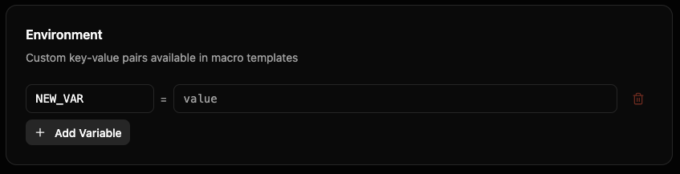

完整規格請參閱[環境與內建變數 (Environment & Builtin Variables)](environment.md)。

### 情境規則 (Situations) {: #situations }

**Situations** 定義各類具名的檔案儲存場景（例如儲存節點輸出成品、下載網址資源等）。每個情境具備路徑範本（巨集）以及目標路徑已存在同名檔案時的覆寫原則。點選 **Add Situation** 即可自訂新規則。

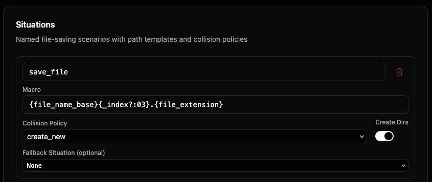

完整規格請參閱[情境規則 (Situations)](situations.md)。

### 儲存、驗證與重新載入 {: #saving-validating-and-reloading }

詳細檢視視窗頂部的工具列提供針對當前編輯專案的各項操作：

- **Validate (驗證)**：在不存檔的前提下對專案設定進行全面語法與邏輯檢查。若有異常會列出問題欄位與具體描述；通過檢查則回報 **Template is valid**。
- **Reload from Disk (自磁碟重新載入)**：放棄當前視窗中所有未儲存的編輯，還原為磁碟上實體檔案的最新內容。
- **Save Changes (儲存變更)**：將您的修改正式寫回專案設定檔中。（僅在存在未儲存變更時啟用）。
- **Upgrade schema (升級結構綱要)**：僅在專案採用的綱要版本舊於目前引擎所支援的最新版本時出現。詳見下文[升級專案結構綱要](#upgrading-a-projects-schema)。
- **Back to Projects (返回專案清單)**：返回主清單。若有未儲存的變更，系統會在放棄前彈出確認提示。

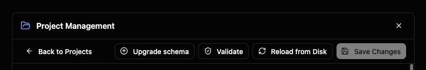

若專案鎖定了特定程式庫版本，**Library Pins** 面板會詳細列出鎖定的版本清單。

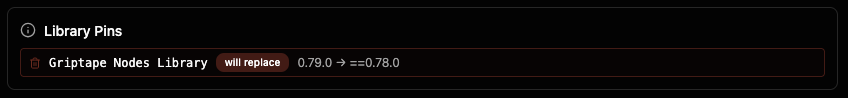

### 升級專案結構綱要 {: #upgrading-a-projects-schema }

當專案是基於舊的主版號綱要建立（例如：在當前綱要為 `1.x` 的引擎中開啟 `0.x` 的專案），工具列會亮起 **Upgrade schema** 按鈕。升級會將專案以當前最新預設值為基礎進行重置 (Re-base)：您曾明確自訂的各項設定皆會完整保留，而先前維持舊版預設值的項目則全面套用新架構規範。

這項變更屬於**重大破壞性變更 (Breaking Change)** — 它可能會改變專案工作區、程式庫目錄與檔案儲存的實際落點 — 因此系統絕不會自動進行。在寫入任何變更前，確認對話方塊會詳述所有具體影響；您可隨時取消。（舊版專案在系統中受到完整向下相容支援；僅在您確實需要新特性時再行升級）。

當有未儲存變更時該按鈕會保持停用 — 請先存檔或重新載入，因為升級流程會自磁碟重新讀取檔案。

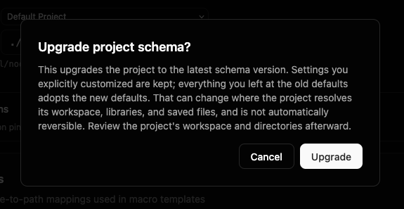

## 註冊磁碟上既有的專案 {: #registering-an-existing-project }

若磁碟上已存在現成的專案設定檔（例如團隊成員分享給您的專案），點擊專案清單中的 **Register Template…**，瀏覽並選取該 `griptape-nodes-project.yml` 檔案，即可將其登錄至清單中。登錄後即可如同原生專案般自由切換、檢視或編輯。

## 移除專案 {: #removing-a-project }

若要自清單中移除專案，開啟該專案並點擊垃圾桶圖示（或在專案清單該列點擊垃圾桶圖示）。在 **Remove Template** 對話方塊中確認。

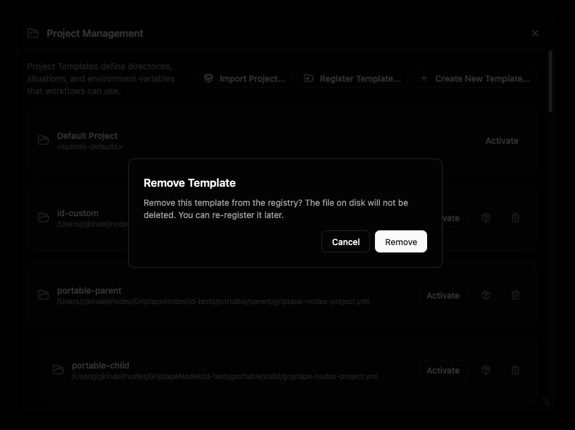

> **移除僅代表取消登錄。** 磁碟上的實體專案檔案**絕不會被刪除**，日後隨時可透過 **Register Template…** 重新註冊找回。

## 匯出與匯入專案 {: #exporting-and-importing-projects }

您可將專案完整打包為單一 `.zip` 封裝檔案，輕鬆遷移至其他電腦、移交給團隊夥伴，或作為安全備份存檔。該封裝包同時收錄了專案設定檔及其所依賴的節點程式庫，因此在目標端無需手動配置即可開箱即用。

> **機密金鑰數值絕不會打包進封裝檔案中。** 諸如 API Key 等敏感資訊僅以鍵名形式參照。匯入後，您需在 **Settings** 中自行配置這些密鑰；匯入對話方塊會精確列出所需的所有金鑰名稱。

### 匯出專案 {: #exporting-a-project }

在專案清單中，每個專案列右側皆有一個小型包裹圖示。點擊它並選擇目標資料夾，Griptape Nodes 會在該處生成 `<project-name>.zip`。完成後會彈出路徑確認提示，若專案依賴任何敏感機密，亦會同步列出匯入者日後必須補齊的金鑰名稱清單。

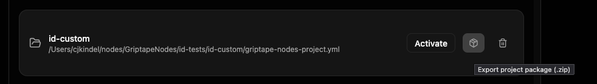

### 匯入專案 {: #importing-a-project }

點擊專案清單右上角的 **Import Project…** 並選取 `.zip` 封裝包。在解壓縮實體檔案前，**Import project** 對話方塊會清晰展示內涵元素：

- **Package (原始套件名稱)**：專案最初的原始名稱。
- **New project name (新專案名稱，選填)**：為匯入的複本重新命名。留空則沿用原始名稱。在建立分支或複製專案複本時非常實用。
- **Libraries (程式庫清單)**：隨附的各節點程式庫，標註為 **bundled (內建打包)**（完整複本包含於壓縮包中）或 **referenced (外部參照)**（匯入時動態聯網重新下載）。
- **Secrets to set (需配置的機密金鑰)**：本專案所需但您當前環境中尚未配置的敏感金鑰清單。在正式執行該專案的工作流程前，需至 **Settings** 中完成設定。

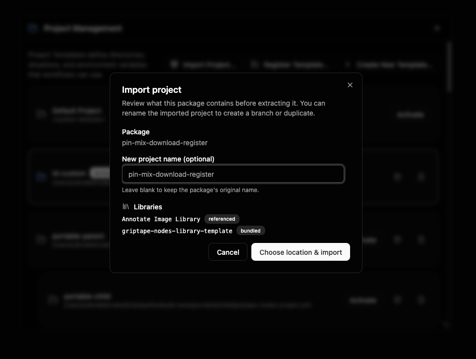

點擊 **Choose location & import**，挑選欲解壓縮存放的實體資料夾，專案便會完成解壓並自動登錄於您的清單中。彈出的確認畫面會指明安裝路徑（並再次提醒需補齊的金鑰）。匯入的專案已加入清單，但**不會**自動啟動切換；當您準備就緒後手動切換至該專案即可。

## Default Project (預設專案) {: #the-default-project }

Griptape Nodes 永遠內建一個 **Default Project**。該專案具備唯讀屬性：您可任意檢視其設定，但無法直接修改或儲存它。開啟它時頂部會展示橫幅提示，並提供 **Create a custom project** 捷徑，引導您建立自訂專案以定義專屬的目錄、情境規則與變數。

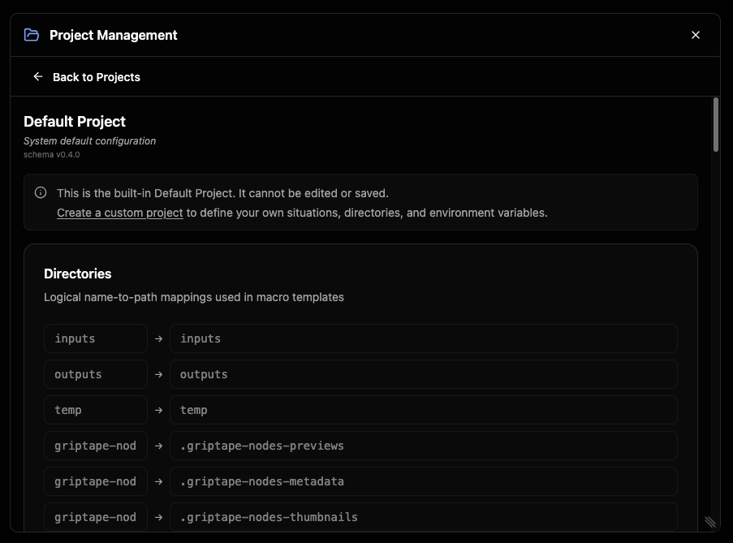

當沒有其他自訂專案被啟用時，Default Project 同時也是系統預設採用的基礎專案。

## 檢視專案所屬的工作流程 {: #seeing-a-projects-workflows }

工作流程挑選器僅展示歸屬於您當前活躍專案的工作流程，因此切換專案時，您所看見的工作流程清單亦會即時連動切換。

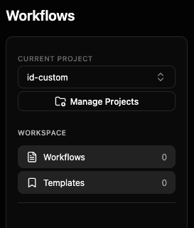

## 相關參考資源 {: #where-to-go-next }

- [專案系統總覽 (Project overview)](index.md)：各架構組件如何協同運作
- [工作區 (Workspace)](workspace.md)：根工作環境以及相對路徑如何解析
- [專案設定檔與繼承 (Projects)](projects.md)：專案檔案格式、父專案與設定合併模型
- [版本鎖定 (Version Pinning)](version_pinning.md)：將專案鎖定於特定引擎版本與指定程式庫版本
- [巨集語法 (Macros)](macros.md)：情境規則與目錄設定中所採用的範本語法
- [目錄架構 (Directories)](directories.md)、[情境規則 (Situations)](situations.md)、[副檔名目錄分流 (File Extension Directories)](file_extension_directories.md)、[環境與內建變數 (Environment & Builtin Variables)](environment.md)
