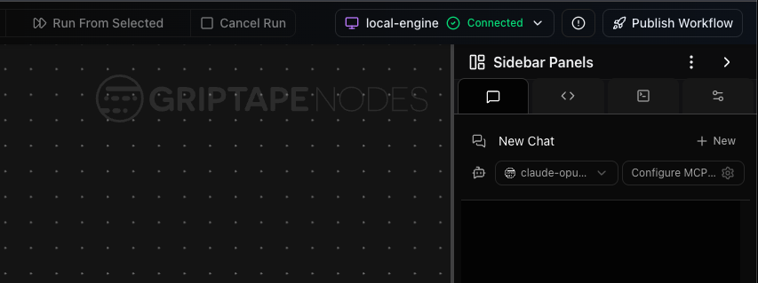
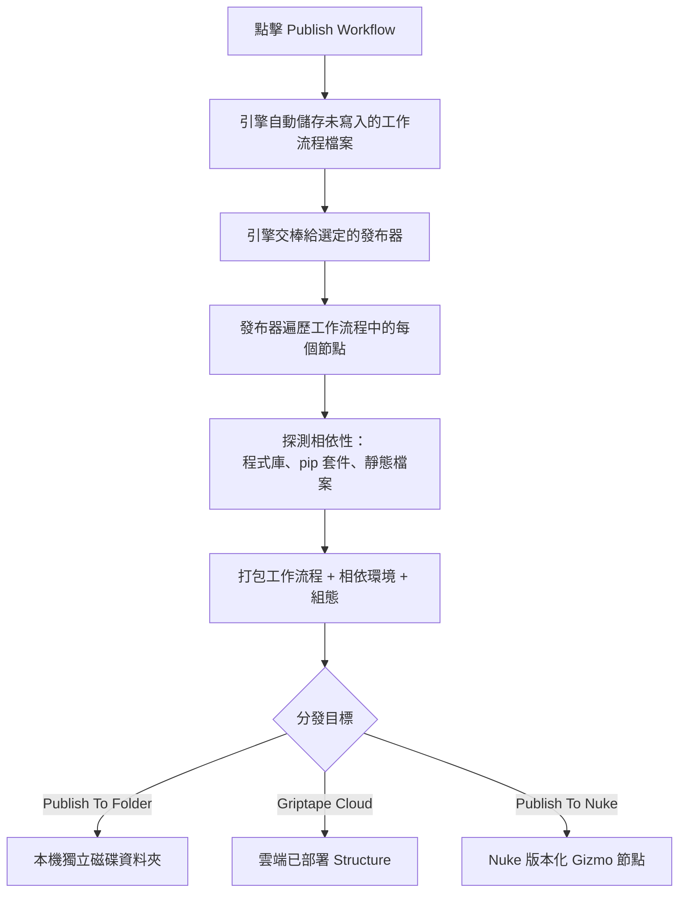

# 發布工作流程 (Publishing a workflow) {: #publishing-a-workflow }

發布功能可將已儲存的工作流程打包為完全獨立自主的套裝組合 (Bundle) — 包含工作流程本體、所需的節點程式庫、Python 相依套件、組態檔案以及靜態資源 — 並傳遞分發至可運行的目標環境：本機磁碟資料夾、Griptape Cloud 雲端架構 (Structure)，或是 Foundry Nuke 內部的 Gizmo 工具節點。負責打包與分發的模組稱為**發布器 (Publisher)**，每個分發目標皆有其專屬的發布器。

所有發布器均遵循相同的生命週期規範，並以完全一致的邏輯探測相依性。本頁首先闡明共用的標準打包機制，隨後解析各發布器的特性。若發布後的工作流程遺失了所載入的多媒體檔案（圖像、音訊、影片或文字檔），請直接跳至[靜態檔案打包防護](#static-files-making-sure-they-get-bundled)。

## 支援的發布器一覽 {: #publishers }

工作流程發布核心機制內建於引擎中，但具體的發布器是由各擴充程式庫動態註冊提供。任何程式庫皆可擴充註冊自訂發布器，因此可見清單取決於目前已安裝的程式庫。官方原廠提供以下幾款主流發布器：

| 發布器名稱 | 提供所屬程式庫 | 工作流程分發目標 |
| --------------------- | ---------------------- | ----------------------------------------------------------------------------------------- |
| **Publish To Folder (發布至資料夾)** | Griptape Nodes Library | 本機磁碟上的獨立封閉資料夾，支援無外設命令列直接執行。 |
| **Griptape Cloud (發布至雲端)** | Griptape Cloud Library | 部署至 Griptape Cloud 雲端的 Structure 架構，可遠端調用與 API 整合。 |
| **Publish To Nuke (發布至 Nuke)** | Foundry Nuke Library | 封裝為版本化 `.gizmo` 並安裝至 Foundry Nuke 環境中，可直接在 Nuke UI 中調用。 |

當您發布工作流程時，首先挑選目標發布器。每個發布器會依目標環境要求您配置對應參數 — Publish To Folder 要求指定輸出目錄；Griptape Cloud 從您配置的雲端儲存貯體 (Bucket) 與 Griptape Cloud Start Flow 節點讀取目標；Publish To Nuke 則詢問欲安裝的 Nuke 實體版本與 gizmo 目錄，並確認是更新現有版本還是發布新版。

## 發布前準備工作 {: #before-you-publish }

**Publish Workflow (發布工作流程)** 按鈕位於頂部工具列的最右側，緊鄰引擎狀態指示燈（在側邊欄面板標頭正上方）。這是一項全域編輯器動作 — 無論後續在對話方塊中選取哪種發布器，按鈕位置皆保持一致。



- **工作流程必須至少在磁碟上儲存過一次**：每當發布時，尚未儲存的變更會自動寫入磁碟，因此無需在點擊發布前刻意手動存檔；但從未命名儲存過的空白流程缺少實體磁碟路徑，必須先儲存一次方能發布。
- **選擇目標發布器**：挑選您希望工作流程部署至何處（參閱上方表格）。若僅有一個程式庫提供了發布器，系統會為您自動選取。
- **填寫發布器參數**：對話方塊會動態展示所選發布器所需的欄位（例如輸出資料夾路徑）。系統會自動帶入您上次發布時的歷史參數。

## 發布執行流程解析 {: #what-happens-when-you-publish }

無論選取何種發布器，其生命週期邏輯完全一致：引擎自動儲存未寫入的變更，交棒給選定的發布器；發布器全面遍歷工作流程，深入探測並打包所有依賴項目，最後遞送至目標端點：



在打包過程中，發布器會即時向介面回報進度狀態（如 `Copying libraries...` 或 `Deploying workflow to Griptape Cloud...`），方便您全程掌握打包進展。

## 打包套件內涵元素 {: #what-ends-up-in-the-bundle }

所有發布器打包的核心成分均相同，因為工作流程在任何環境下執行皆必須具備這些要素：

- **工作流程檔案**本體。
- 工作流程所引用的所有**節點程式庫**（包含傳遞相依性 — 即這些程式庫所依賴的其他下層程式庫，確保無任何間接依賴被遺漏）。
- 指引引擎開機時該載入哪些程式庫的**組態檔案**。
- 一個 **`.env` 檔案**：包含您**整個**工作區環境變數、**所有**在 Secrets Manager 中配置的機密金鑰，以及您啟動編輯器終端機 shell 中導出的所有環境變數（以明文寫入）。請務必詳閱下方的安全警示。
- 一個**專案範本 (Project template)**：確保在執行期能精準解析[目錄巨集 (Macros)](projects/macros.md)與[情境規則 (Situations)](projects/situations.md)。
- **Python 相依套件**：精確鎖定於構建該工作流程時所採用的引擎與程式庫版本。
- **Hugging Face 模型下載步驟腳本**（當工作流程使用此類本機模型時）。

!!! warning "套裝組合內含所有敏感機密明文，請務必嚴格審查"

    打包產生的 `.env` 檔案**並未**針對該工作流程實際使用到的變數進行過濾！它會將整個工作區的 `.env` 與 Secrets Manager 中的所有機密以純文字形式全量合併 — 包含此流程完全未曾調用的第三方商業服務 API 金鑰。任何取得此發布資料夾（或共用安裝了該 Gizmo 的電腦）的人員，皆能直接閱讀所有憑證。**在向外部團隊分發分享發布套件前，請務必親自開啟 `.env` 檢查並手動刪除無關的敏感金鑰！**

各發布器最終遞送的*交付型態*各有千秋：

- **Publish To Folder**：輸出至本機資料夾，額外隨附 `run.py` 入口腳本與 `README.md`。說明文件詳載了相依套件安裝命令 (`uv sync`) 以及命令列執行指引 (`uv run python run.py --help`)。
- **Griptape Cloud**：將套件壓縮為 Structure 壓縮包並上傳，在您的雲端帳戶中建立或更新 Structure。它還可建立 Webhook 整合，並為您生成專屬的 *executor* 工作流程以供遠端觸發調用。發布成功後直接提供直達雲端主控台的超連結。
- **Publish To Nuke**：將套件安裝為版本化 `.gizmo` 與執行腳本至 Nuke 的 gizmo 目錄，並在 Nuke 工具列中加入 Griptape 功能表。重複發布可選擇原位更新或建立新版本，運算輸出成品會自動儲存於 Nuke 腳本同級目錄下。

## 相依性探測機制 {: #how-dependencies-are-discovered }

發布器會逐一走訪工作流程中的每個節點，詢問其內部相依項目。它在全流程層級匯總三類相依性：

- **節點程式庫**：所調用的所有擴充程式庫（含名稱與精確版本），全量打包。
- **Python (pip) 套件**：各程式庫在資訊清單中宣告的所有 Python 相依套件，完整鎖定版本。
- **靜態檔案**：節點從專案中讀取的外部媒體與資料檔案（圖像、音訊、影片、文字等）。注意：這些檔案**僅在節點主動宣告時**才會被自動打包。

最後這項靜態檔案特性往往容易引發疏漏，所有發布器皆適用此規則。

## 靜態檔案打包防護 {: #static-files-making-sure-they-get-bundled }

!!! warning "引用的靜態檔案可能未被自動打包"

    靜態檔案僅在調用它的節點明確將其*宣告*為相依性時，才會被納入發布套件中；並非所有第三方節點都會主動宣告。若節點載入了檔案卻未進行宣告，該檔案將**被排除在打包套件之外**，導致發布後的工作流程在執行嘗試讀取該檔案時崩潰。

確保靜態檔案 100% 隨同打包的可靠方式，是透過官方隨附的 **`SelectFromProject`** 節點進行轉接：

1. 在畫布上添加一個 `SelectFromProject` 節點，將其 `selected_path` 參數指向您欲納入打包的檔案（或目錄）。
1. 將其 `project_path` 輸出連接埠連線至實際讀取該檔案的下游目標節點。

`SelectFromProject` 在代碼中明確將其 `selected_path` 宣告為靜態檔案相依項，因此發布器一定會將該檔案整包隨行打包。

!!! tip "專案內部檔案具備最佳可攜性"

    當選取的檔案位於專案目錄內部時，`SelectFromProject` 會自動將其解析為相對於專案的[巨集路徑 (Macro)](projects/macros.md)而非絕對路徑。這確保了套裝組合在移動至其他電腦或部署至雲端時，參照路徑依然完好有效。

!!! warning "專案目錄外部的檔案無法隨行打包"

    若檔案存放在專案資料夾外部（例如外接隨身碟或網路掛載磁碟），該檔案不會被複製進打包套件中。發布後的工作流程依然會嘗試至該絕對路徑尋找它，因此僅在路徑完全相同的環境中才能運作。若希望檔案隨套件一同攜帶，請將其複製至專案目錄內部後再進行引用。

    被排除在外的檔案會在引擎日誌中明確記錄為 `will not be bundled because ...`。若發布後找不到檔案，請參閱[匯出引擎日誌](../troubleshooting.md#exporting-engine-logs)排查。

## 擴充開發指引（針對程式庫作者） {: #for-library-authors }

發布系統具備高度可擴充性：任何節點程式庫皆可自訂發布器以支援自訂部署目標，且自訂節點可精確宣告自身所需的檔案資源。

**註冊自訂發布器**：程式庫繼承 `AdvancedNodeLibrary`，並在 `after_library_nodes_loaded` 階段透過 `LibraryManager.on_register_event_handler(...)` 註冊 `PublishWorkflowRequest` 事件處理常式。該常式將作為可選項目出現在發布對話方塊中。

**節點宣告相依檔案**：徹底解決靜態檔案遺失的最佳途徑，是由節點主動宣告其所使用的檔案。覆寫 `get_node_dependencies()` 並將檔案路徑添加至 `NodeDependencies.static_files` 即可：

```python
def get_node_dependencies(self) -> NodeDependencies | None:
    deps = super().get_node_dependencies()
    if deps is None:
        deps = NodeDependencies()
    value = self.get_parameter_value("path")
    if value and isinstance(value, str):
        deps.static_files.add(value)
    return deps
```

始終優先呼叫 `super().get_node_dependencies()` 以確保基底程式庫與 UI 組件相依性被完整繼承，隨後再追加個人自訂相依項。更多開發規範請參閱[自訂節點開發指南](../development/custom_nodes/index.md)。
