# 第 1 課：新手快速入門 {: #lesson-1-getting-started }

歡迎來到 Griptape Nodes！本教學將引導您掌握這款強大視覺化工作流程工具的基礎知識。您將學習如何啟動應用程式、巡覽操作介面、添加並連接節點，以及運行您的第一個 AI 智慧體。完成本教學後，您將具備繼續後續進階教學所需的堅實基礎。

## 本課涵蓋內容 {: #what-well-cover }

在本教學中，主題包括：

- 啟動 Griptape Nodes
- 從首頁進入工作流程畫布
- 熟悉 Griptape Nodes Editor 介面
- 向工作區添加節點
- 理解不同節點之間的相容連接規則
- 運行智慧體

## 啟動 Griptape Nodes {: #launch-griptape-nodes }

若要啟動 Griptape Nodes，請開啟終端機並運行以下任一命令：

```bash
griptape-nodes
```

或者使用簡寫命令：

```bash
gtn
```

執行該命令後，您的預設瀏覽器應會自動開啟 [https://nodes.griptape.ai](https://nodes.griptape.ai)。如果未自動開啟，只需在終端機中按住 Ctrl 點擊（Mac 上按住 Cmd 點擊）顯示的連結，並在出現提示時選擇「在瀏覽器中開啟」。當然，您也可以隨時將該網址加入瀏覽器書籤，以便日後直接存取。

<p align="center">
  <a href="https://nodes.griptape.ai">
    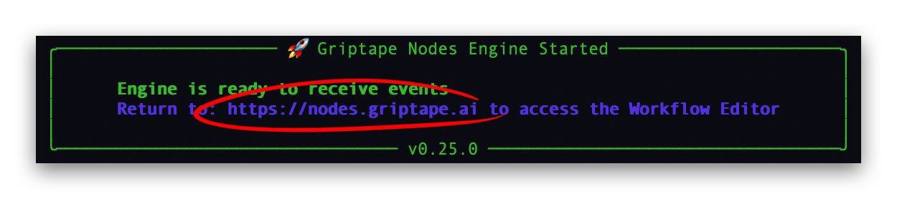
  </a>
</p>

!!! tip "提示"

    為了獲得最佳學習體驗，建議將兩個瀏覽器視窗左右並排顯示：一邊開啟本教學，另一邊操作您的 Griptape Nodes 工作區。

## 首頁 (The Landing Page) {: #the-landing-page }

當瀏覽器開啟時，首先呈現在您眼前的是 Griptape Nodes 首頁。此頁面展示了多個範本工作流程，向您介紹 Griptape Nodes 的各種核心能力。一旦您開始儲存自己的工作流程，它們也會按照從新到舊的順序顯示在此處。

<p align="center">
  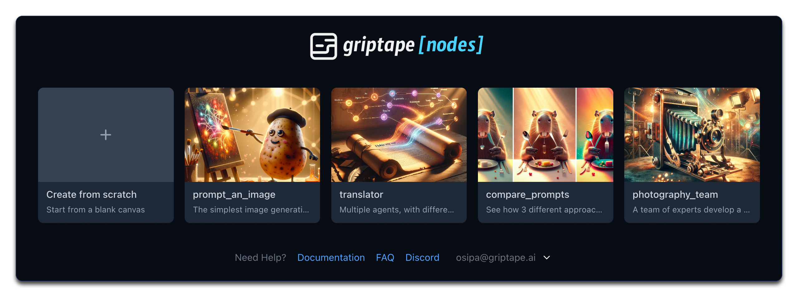
</p>

這些範例工作流程是學習 Griptape Nodes 功能的極佳資源，但現在，讓我們先從「空白畫布」開始體驗。

## 從空白畫布建立新工作流程 {: #create-a-new-workflow-from-scratch }

在首頁上，找到並點擊 **"Create from scratch"**（從空白畫布建立）卡片。此操作將開啟一個乾淨的工作區畫布，供您自由構建工作流程。

<p align="center">
  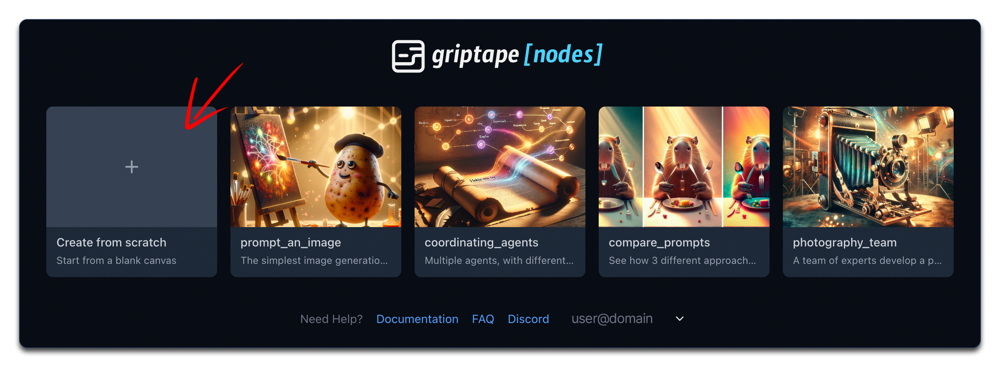
</p>

## 熟悉 Griptape Nodes 介面 {: #get-familiar-with-the-griptape-nodes-interface }

進入工作流程編輯器後，請花片刻時間熟悉整體介面配置：

<p align="center">
  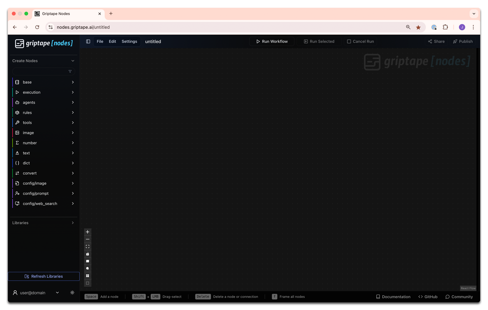
</p>

### 節點程式庫 (Libraries) {: #libraries }

初期最需要關注的區域是左側面板 — 節點程式庫。在面板頂部，您會看到 **Create Nodes** 區塊。該面板匯集了 Griptape Nodes 內建的所有標準節點。每個節點都有其特定功能。隨著對 Griptape Nodes 的逐步熟悉，您將理解這些節點的工作原理，以及如何將它們組合起來建立強大的自動化流程。

<p align="center">
  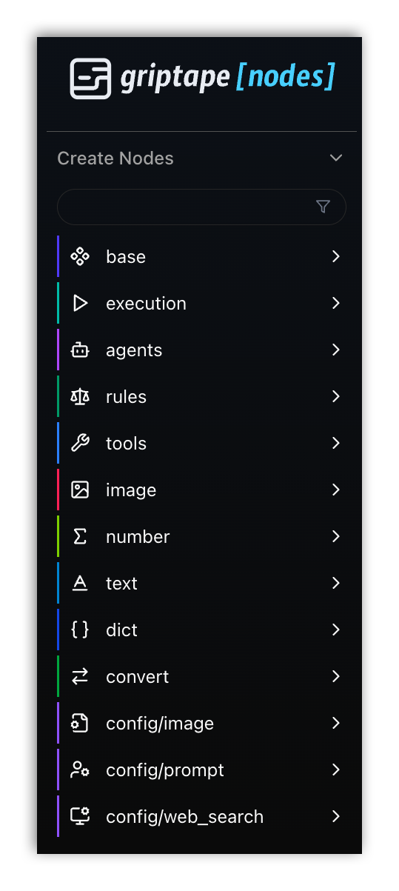
</p>

## 向工作區添加節點 {: #adding-nodes-to-the-workspace }

以下是建立節點最快捷的幾種方式。如需查看編輯器中所有可用的節點添加方法，請參閱[節點操作指南](../../guides/editor/working_with_nodes.md#adding-nodes)；如需透過程式碼建立節點，請參閱 [Retained Mode (保留模式)](../../development/retained_mode.md)。

<div style="display: flex; justify-content: space-between; gap: 20px; margin-bottom: 30px;">
  <div style="flex: 1;">
    <p><strong>拖曳放置 (Drag and Drop)</strong>：在左側面板中點擊並按住某個節點，然後將其拖放到工作區畫布上釋放。</p>
    <p align="center">
      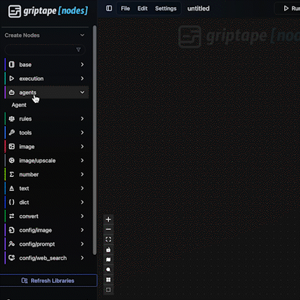
    </p>
    <h4 align="center">拖曳放置</h4>
  </div>

<div style="flex: 1;">
    <p><strong>Tab 或 Shift+A 搜尋</strong>：將滑鼠指標懸停在流編輯器上方時按下 Tab 或 Shift+A，會彈出搜尋方塊。輸入關鍵字找到目標節點後，按 Enter 即可快速建立。</p>
    <p align="center">
      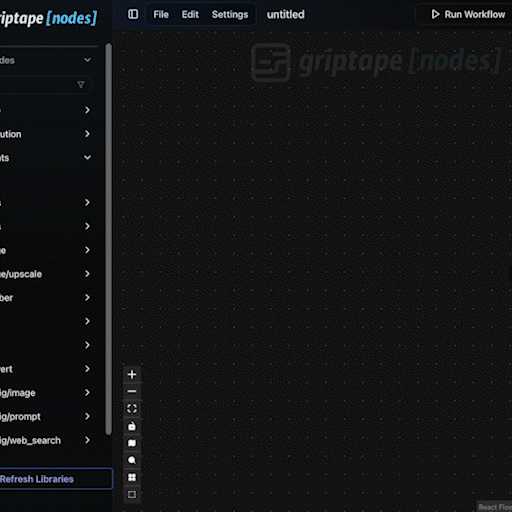
    </p>
    <h4 align="center">Tab 或 Shift+A 搜尋</h4>
  </div>
</div>

添加節點後，您可以：

- 點擊並拖曳以調整其在畫布上的擺放位置
- 編輯其參數數值與運行行為
- 將其與其他節點相連接

## 連接節點 (Connecting Nodes) {: #connecting-nodes }

讓我們使用上述第一種技巧 — 從節點庫拖放到工作區，建立以下三個節點：

1. 一個 **Agent** 智慧體節點 ( agents > Agent )
    \- 這是一個與 LLM（如 OpenAI ChatGPT 或 Anthropic Claude）進行互動的智慧體節點

    1. 在側邊欄中展開 agents 分類
    1. 將 Agent 節點拖曳到工作區並放開以建立該節點

    !!! info "說明"

        為簡潔起見，我們將此路徑表示為 ( 分類 > 節點名稱 )。例如對於 Agent，我們簡寫為 ( agents > Agent )。接下來的兩個節點請依此類推。

1. 一個 **FloatInput** 浮點數輸入節點 ( number > FloatInput )
    \- 用於輸入帶小數點數值 (floats) 的節點

1. 一個 **TextInput** 文字輸入節點 ( text > TextInput )
    \- 用於輸入文字字串的節點

<p align="center">
  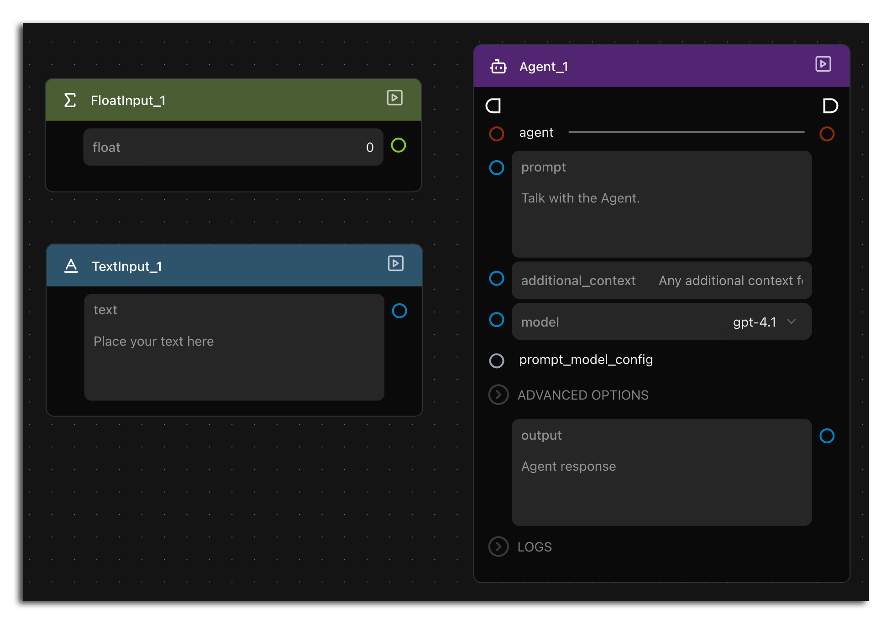
</p>

現在嘗試進行連線：從兩個輸入節點的右側連接埠拖曳連接線至 Agent 節點上的各個輸入連接埠。嘗試多種組合，您會發現並非所有連接埠都能成功相連。

這是因為**參數只有在資料型別彼此相容時才能直接建立連線**：

- **TextInput** 節點輸出的是**文字 (text)**，因此它可以連接到 Agent 節點上任何接受文字的參數。
- **FloatInput** 節點輸出的是浮點小數 (**floats**)，而 Agent 節點目前沒有任何參數接受浮點型別輸入。

無法將 FloatInput 連接到任何地方完全不用擔心 — 這正是我們設計此處練習的目的。此節點出現在*這裡*純粹是為了向您直觀展示並非所有參數都能隨意互連。FloatInput 節點在數值運算中極為有用，只是它並非*當前*工作流程中其他節點所需的輸入型別。

!!! Pro tip "專家提示"

    將連接埠的顏色作為直觀的相容性參考指引。顏色相符的連接埠之間通常支援直接相連。

<p align="center">
  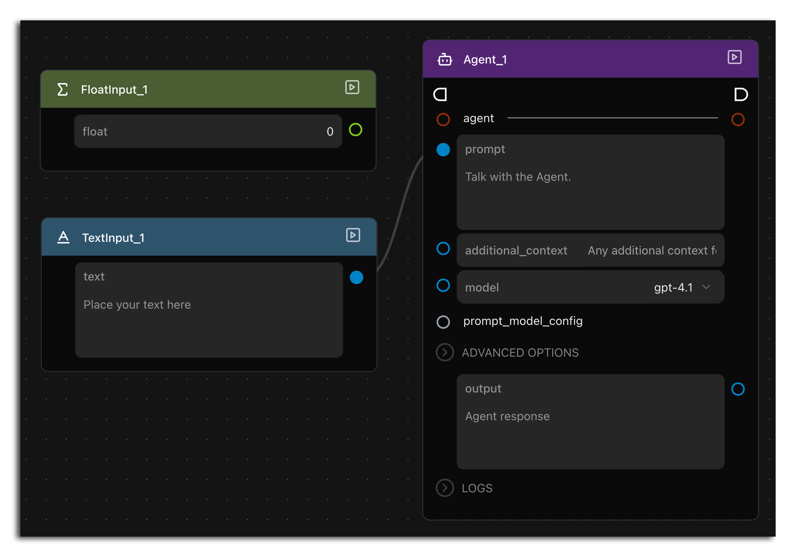
</p>

## 運行智慧體 (Use an Agent) {: #use-an-agent }

現在，讓我們清理畫布，來親身體驗一次真實的 AI 互動：

1. 前往頂部 **File (檔案)** 功能表並選擇 **New (新建)**。
1. 在全新工作流程中，以您偏好的任何方式建立一個 **Agent** 節點。
1. 在 Agent 節點的 prompt 提示詞欄位中輸入一個問題。您可以輸入 "Who trained you?" 來確認後端運行的 AI 模型服務，或者隨意輸入任何您平時會向聊天機器人詢問的問題。

    <p align="center">
    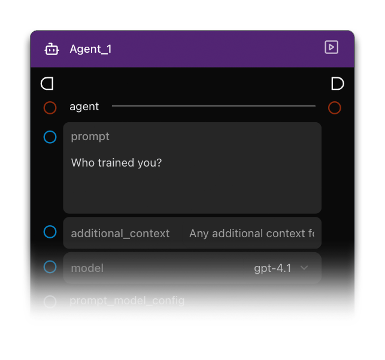
    </p>

1. 點擊 Agent 節點右上角的**播放按鈕圖示**以執行該節點。

    <p align="center">
    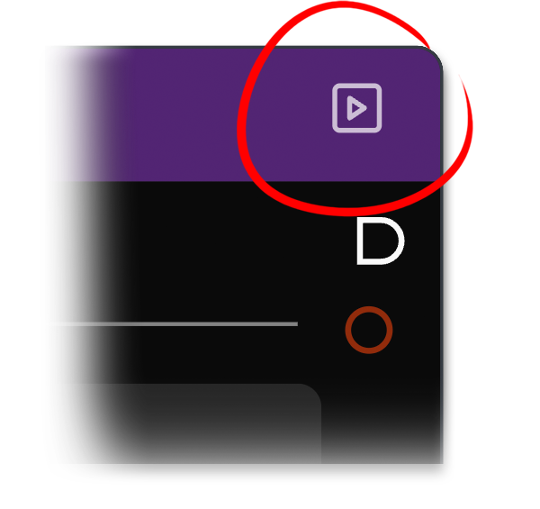
    </p>

1. 當文字生成並顯示在輸出區塊時，仔細閱讀其回答。

恭喜！您剛剛成功與大型語言模型 (LLM) 完成了互動。如果您保持了預設設定，您所使用的是 OpenAI ChatGPT (GPT-4.1)。

雖然這種體驗看似與直接在網頁上使用 ChatGPT 或 Claude 類似，但 Griptape Nodes 的真正威力在於能夠將 LLM 與眾多其他功能節點無縫編排串聯。再次瀏覽左側的節點庫面板，看看還有哪些豐富的節點可供調用。我們才剛剛啟程 — 前方還有廣闊的天地等待探索！

## 總結 {: #summary }

在本教學中，我們涵蓋了：

- 啟動 Griptape Nodes
- 從首頁進入工作流程畫布
- 熟悉 Griptape Nodes Editor 介面
- 將第一批節點添加到工作區
- 瞭解不同型別節點之間的連線相容性規則
- 運行第一個 AI 智慧體

## 下一步 {: #next-up }

在下一節：[第 2 課：生成圖像提示詞](../01_prompt_an_image/index.md)中，我們將進入更精采的部分：親手製作 AI 圖像！
