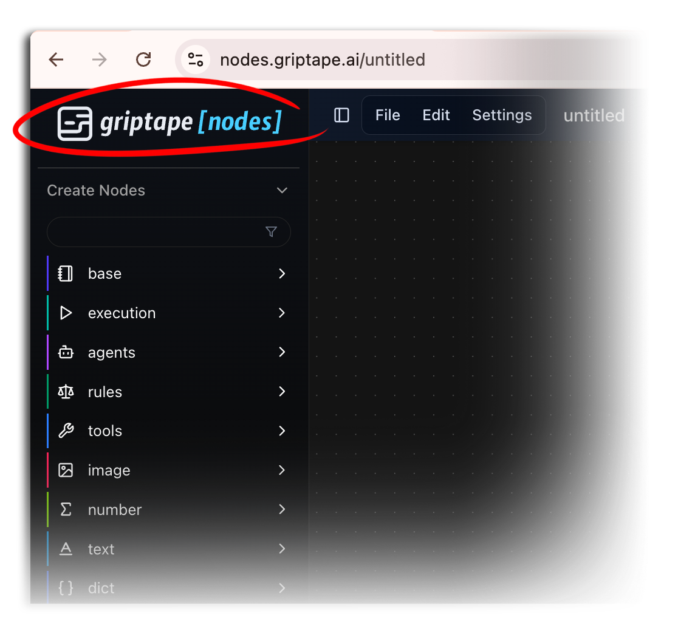
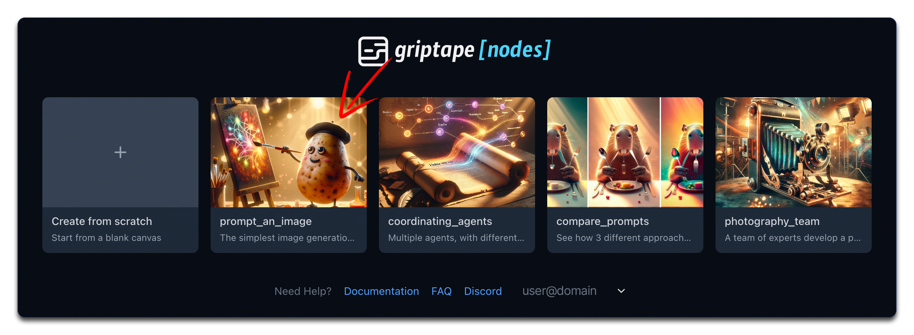
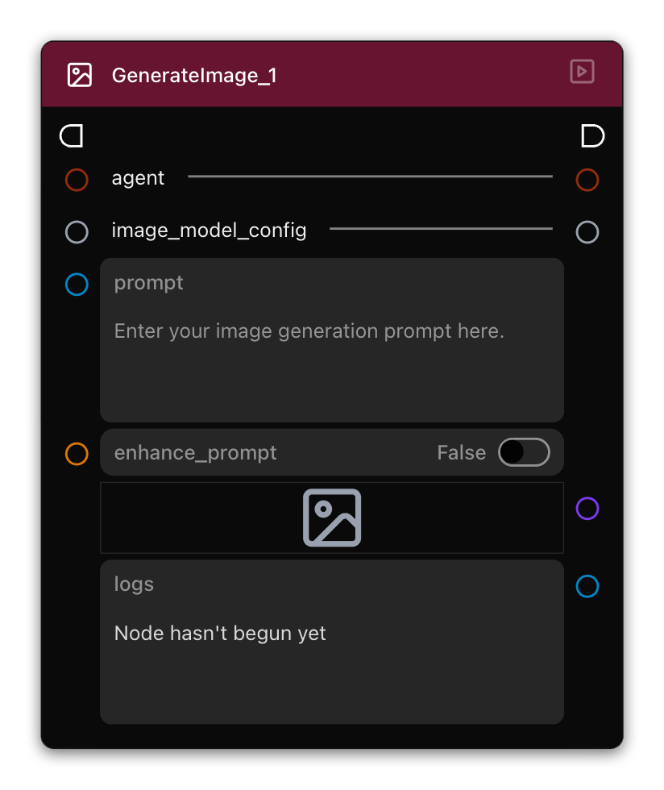
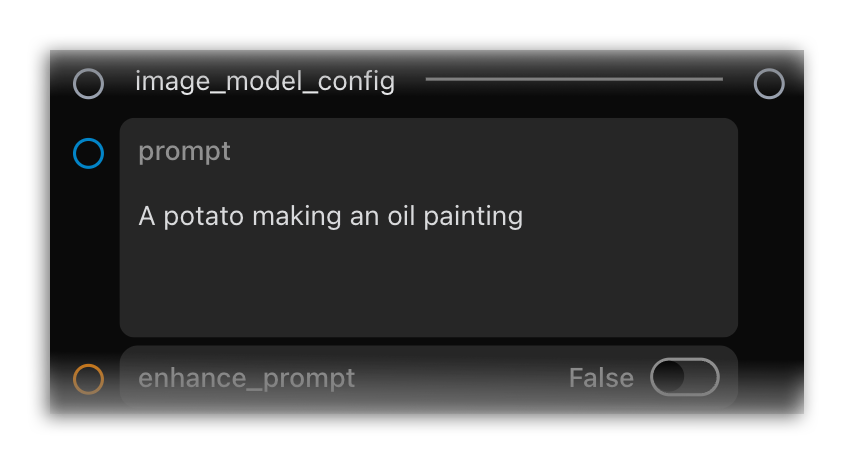
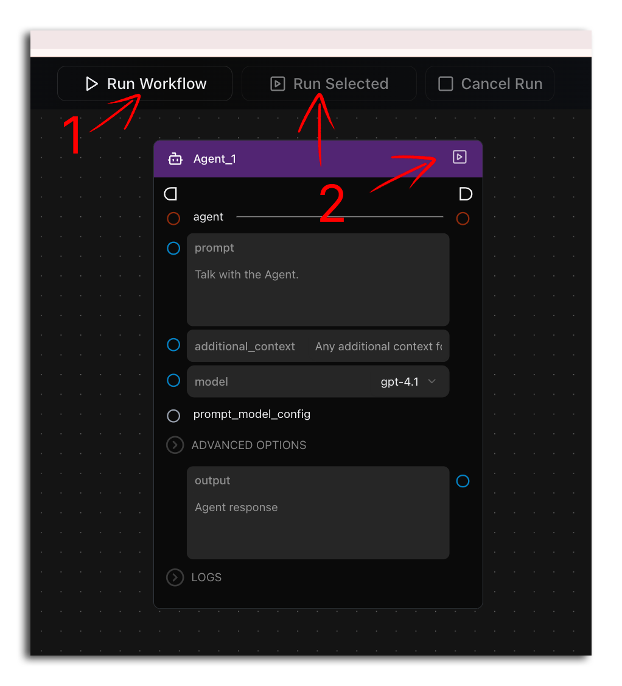
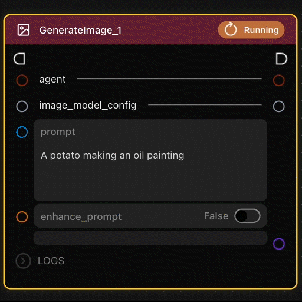

# 第 2 課：生成圖像提示詞 {: #lesson-2-prompt-an-image }

歡迎來到 Griptape Nodes 系列教學的第二課！本指南重點介紹如何熟悉並使用 GenerateImage 節點。

雖然工作流程本身極為精簡（僅包含這單一節點），但 GenerateImage 節點將是您在初期專案中生成圖像的核心主力。這個功能強大的節點確實是創作多樣化視覺內容的基石。

## 本課涵蓋內容 {: #what-well-cover }

在本教學中，您將會：

- 學習如何開啟已儲存的工作流程
- 認識 GenerateImage 節點
- 使用文字提示詞生成圖像

## 返回首頁 {: #navigate-to-the-landing-page }

開始本教學前，您需要先返回主首頁。點擊編輯器左上方的巡覽導航按鈕，返回顯示所有範本工作流程和您個人已儲存檔案的首頁。

  

## 開啟圖像提示詞範例 {: #open-the-image-prompt-example }

在首頁上，找到並點擊 **"Prompt an Image"** 卡片開啟此範例工作流程。

  

## 認識 GenerateImage 節點 {: #understand-the-generateimage-node }

當範例載入完成後，您會發現它僅由單個節點組成。切莫被其表面上的簡潔所欺騙 — 這個節點是 Griptape Nodes 中最強大的創作工具之一，並將在您未來的各類流中扮演舉足輕重的角色。

  

該節點經過高度整合封裝，能夠直接處理通常需要複雜工作流程才能完成的眾多任務，使其成為新手快速上手 AI 圖像生成的絕佳選擇。

## 使用文字提示詞生成圖像 {: #generate-images-using-text-prompts }

此節點最主要的核心互動點是文字提示詞 (prompt) 欄位，您可以在此處描述希望 AI 創作出怎樣的圖像。

生成您的第一張圖像：

1. 找到節點中的文字提示詞欄位
1. 輸入您希望建立的圖像描述

    
  

現在，執行您的節點。介面中有三個按鈕，但它們實際上對應著兩種不同的運行行為：

  

1. 運行*整個*工作流程：

    1. 點擊編輯器頂部的 **Run Workflow (運行工作流程)** 按鈕。這將從頭到尾完整執行整個工作流程。所有節點將根據連線關係依序執行。

1. 運行工作流程中的單個節點（兩種方式效果相同）：

    1. 點擊特定節點右上角的 **Run Node (運行節點)** 按鈕。
    1. 或者，選取該節點並點擊工具列中的 **Run Selected (運行所選)**。

單獨運行某個節點非常適合用於測試或除錯工作流程的特定環節，或者當您暫時不想更新流程中其他無關部分時快速取得單點結果。

兩者的本質區別在於影響範疇 — 第一種方式會全量執行所有節點，而第二種方式僅運行所選節點及其依賴的前置節點。

!!! warning "生成耗時提示"

    對於初次接觸 AI 圖像生成的使用者：圖像生成運算通常需要花費一定時間。請注意節點邊框呈現的黃色高亮線條，以及節點右上角從原本的播放圖示變為旋轉中的 **Running** 動畫圖示。這些視覺提示告知您當前哪些節點正在執行運算，代表系統正在正常運作中。

    

      
    

## 嘗試不同的提示詞描述 {: #experiment-with-different-descriptions }

讓我們嘗試透過輸入不同的提示詞來生成多種風格的圖像：

1. **第一個範例**：工作流程載入時提示詞預設為 "A potato making an oil painting"（一隻正在畫油畫的馬鈴薯）。點擊運行該流。

    

    
    

1. **第二個範例**：將提示詞修改為 "A potato doing aerobics in 70s workout attire"（一隻穿著70年代運動服跳有氧健身操的馬鈴薯），然後再次點擊運行。

    

    
    

請觀察僅僅更改提示詞中的寥寥數語，生成的最終圖像就會發生多麼顯著的變化。這生動展示了 GenerateImage 節點強大的適應力與靈活性。只要您能用文字描述出來，AI 就能為您將其生成。

## 總結 {: #summary }

在本教學中，我們涵蓋了：

- 如何開啟已儲存的工作流程
- GenerateImage 節點的核心特性
- 如何利用文字提示詞生成視覺圖像

GenerateImage 節點是 Griptape Nodes 中構建創意流的基礎模組。隨著學習的深入，您將掌握如何將其與其他更多節點靈活組合，打造出更強大的智慧應用。

## 下一步 {: #next-up }

在下一節：[第 3 課：多智慧體協調](../02_coordinating_agents/index.md)中，我們將學習如何引導多個 AI 智慧體相互配合，在工作流程中像傳遞接力棒一樣協同完成任務。
