# 第 3 課：多智慧體協調 {: #lesson-3-coordinating-agents }

歡迎來到 Griptape Nodes 系列教學的第三課！在本指南中，您將學習如何在單一工作流程中協調多個智慧體以執行連續任務 — 具體而言，是跨語言翻譯故事並對其進行摘要提煉。

## 本課涵蓋內容 {: #what-well-cover }

在本教學中，我們將：

- 分析並親手重建一個由智慧體依序協同作業的翻譯工作流程
- 探索如何使用「合併文字 (MergeTexts)」將前級節點的輸出轉換組裝為新提示詞
- 學習用於精確控制工作流程執行順序的「執行鏈 (Exec Chain)」機制
- 擴展範本工作流程，追加多故事綜合摘要任務

完成本課學習後，您將深刻理解如何構建各個智慧體相互承接工作、在不同專業任務之間無縫傳遞資訊的高階工作流程。這將為您今後設計需要多階段不同智慧能力協同處理的複雜 AI 系統打下堅實基礎。

讓我們從剖析一個展示上述核心原理的簡易翻譯工作流程開始。

## 返回首頁 {: #navigate-to-the-landing-page }

開始本教學前，請點擊左上角帶有 Griptape Nodes 圖示的導覽列返回首頁。在頁面頂部找到並開啟名為 "coordinating_agents" 的範例工作流程。

  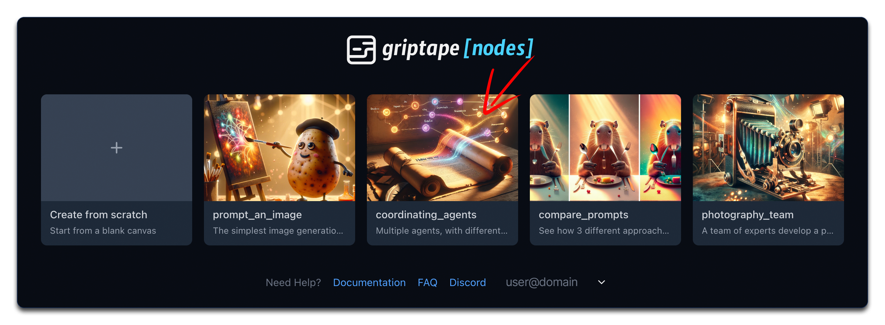

## 探索範本工作流程 {: #explore-the-template-workflow }

當範本載入後，您將看到一個由以下核心組件構成的工作流程：

  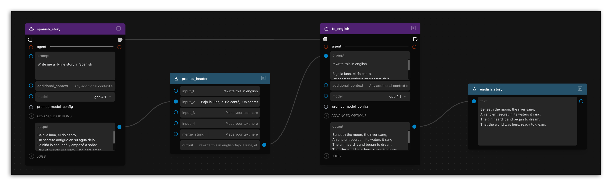

1. **第一個 Agent 節點 (spanish_story)**：生成一段四行西班牙語小故事
1. **MergeTexts 節點**：將西班牙語故事與 "Rewrite this in English:" 指令拼接合併
1. **第二個 Agent 節點 (to_english)**：將合併後的提示詞翻譯成英文
1. **DisplayText 節點**：直觀展示最終的英文翻譯結果

該工作流程清晰呈現了多個智慧體如何各自承擔並專注於自身的獨立「職責」。

透過 **MergeTexts** 節點將一個智慧體的輸出連接傳遞給另一個智慧體，您可以靈活構建出*全新*的提示詞來精準驅動下一個智慧體的行為。

## 此處如何使用 MergeTexts 節點 {: #how-were-using-the-mergetext-node-here }

**MergeTexts** 節點的核心功能就是使用指定的分隔符號字串（稱為 "merge string"）將多個傳入的文字內容拼接起來。預設的拼接字串為兩個換行符號：`\n\n`。在此範例中，我在 MergeTexts 節點的 **input_1** 欄位中直接輸入了 "Rewrite this in English:"，並將 **spanish_story** 節點的輸出端連接到了 **input_2**。運行時，**MergeTexts** 節點將輸出如下內容：

> Rewrite this in English:
>
> Bajo la luna, el río cantó,
> Un secreto antiguo en su agua dejó.
> La niña lo escuchó y empezó a soñar,
> Que el mundo era suyo, listo para amar.

正如您所見，這種利用前級節點輸出結果即時組裝新提示詞的方法，賦予了構建複雜多智慧體工作流程極大的靈活性：第一個智慧體專注於撰寫西班牙語故事，第二個智慧體則負責將其精準轉譯為英文。您的最終輸出將是無論第一步生成了怎樣獨特的故事內容，都能如實呈現其對應的英譯版本。

    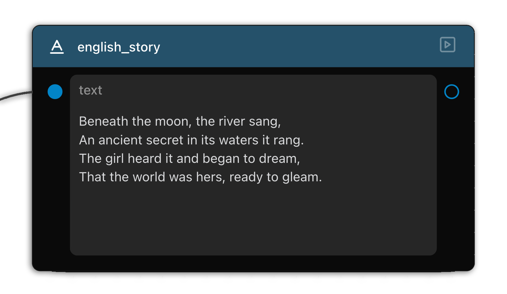
  

!!! info "隨機性提示"

    每次運行時生成的故事內容都會有所不同，這完全符合預期！請記住，與 AI 智慧體互動在某種程度上就像與真人交談一樣。即使問同一個問題多次，每次得到的具體措辭也可能存在細微差異。

## 構建一個平行的對等流 {: #build-a-sibling-workflow }

這是我們接下來的目標效果：

  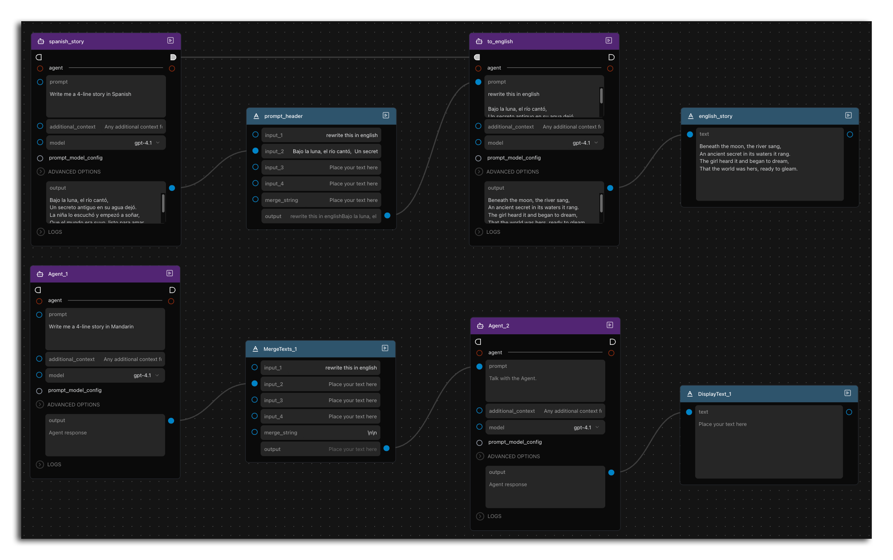

現在輪到您親手搭建了。在當前流程正下方構建一個幾乎完全平行的獨立流，以此練習添加與連接節點的操作。向畫布中添加以下節點：

1. 兩個 **Agent** 智慧體節點 ( agents > Agent )
    \- 與 LLM（如 ChatGPT 或 Claude）互動的核心節點
1. 一個 **MergeTexts** 節點 ( text > MergeTexts )
    \- 接收多段文字並將其合併輸出的節點
1. 一個 **DisplayText** 節點 ( text > DisplayText )
    \- 用於直接展示文字輸出以方便查看的檢視節點

## 設定第一個智慧體 {: #configure-the-first-agent }

設定您的第一個智慧體以您自訂選擇的語言生成內容：

1. 在第一個 Agent 節點中輸入：`Write me a four line story in [your chosen language]`（例如繁體中文、法文等）
1. 該智慧體將負責生成我們稍後需要翻譯的原始故事

  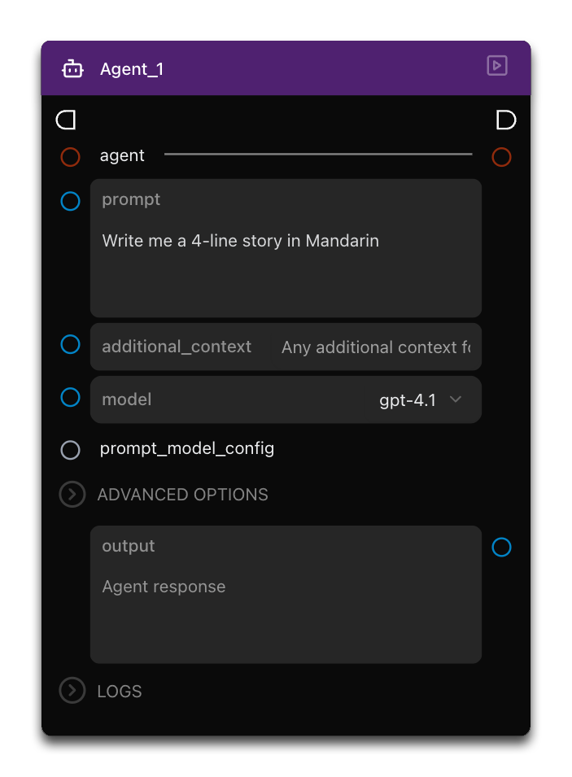

## 連接至 MergeTexts 節點 {: #connect-to-the-mergetexts-node }

接下來，準備翻譯提示詞：

1. 直接在 MergeTexts 節點的 **input_1** 欄位中輸入：`Rewrite this in English:`
1. 將第一個 Agent 的 output 輸出連接埠連接至 MergeTexts 節點的 **input_2**

  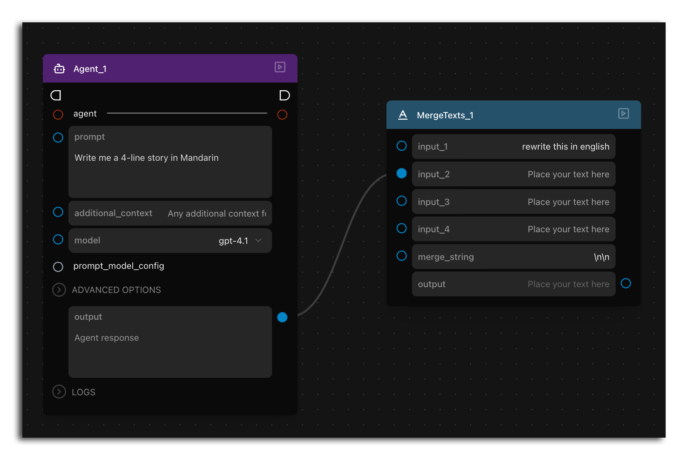

## 設定第二個智慧體 {: #configure-the-second-agent }

設定擔任翻譯任務的第二個智慧體：

將 MergeTexts 節點的 output 輸出端連接至第二個 Agent 節點的 **prompt** 提示詞輸入埠。現在，第二個智慧體將同時接收到原始故事文本以及將其翻譯成英文的明確指令。

  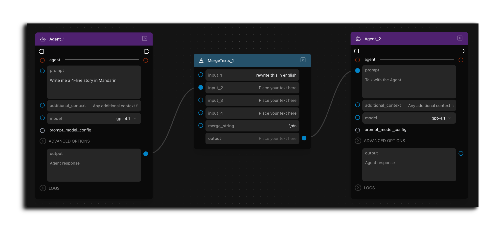

## 顯示翻譯結果 {: #display-the-result }

查看最終翻譯成品的配置：

1. 將第二個 Agent 的 output 連接埠連接至 DisplayText 節點
1. 運行您的工作流程。
1. 工作流程執行完畢後，該 DisplayText 節點將展示翻譯好的英文文字：

  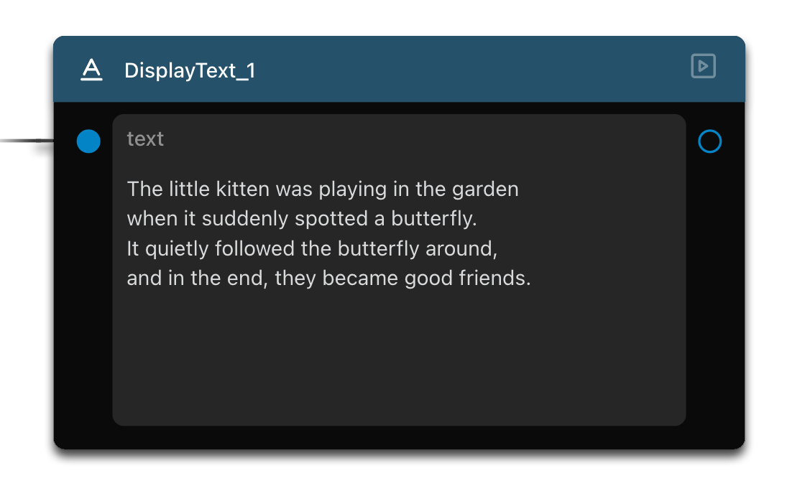

## 理解執行順序（執行鏈 Exec Chain） {: #understanding-execution-order-exec-chain }

Griptape Nodes 中一個極其關鍵的架構概念是**執行鏈 (Execution Chain)**。隨著工作流程複雜度的攀升，精準控制節點的執行順序變得尤為重要。

1. 注意節點邊緣半圓形的 "exec in"（執行輸入）和 "exec out"（執行輸出）引腳
1. 它們專門用來嚴格定義節點之間的運行先後次序
1. 對於複雜的工作流程，按照您希望的先後順序將各節點的 exec 連接埠依次串聯起來
1. 即使資料依賴關係錯綜複雜，這也能確保各個節點完全按照您預期的時序依序執行

  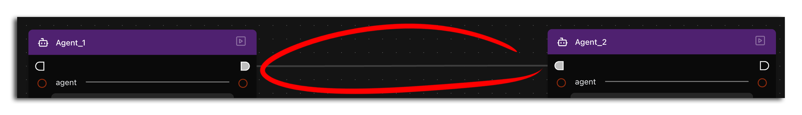

!!! info "自動依賴與顯式控制"

    Griptape Nodes 預設會透過深度分析各節點之間的資料依賴關係，自動判定最佳的節點執行順序。

    然而，當您需要對執行時序擁有絕對精確的控制權時，可以使用執行鏈功能。當自動依賴推導無法滿足您的特殊業務邏輯時，這提供了一種明確指定執行次序的途徑。

    隨時使用執行鏈不會產生任何額外效能損耗或處罰，唯一需要注意的是避免因錯誤連線而人為造成逆序邏輯衝突。對於大部分簡單的常規工作流程而言，通常無需顯式配置執行鏈。

## 擴展工作流程：多故事綜合摘要 {: #expand-the-workflow-summarize-multiple-stories }

讓我們進一步增強該工作流程，使其能夠自動對*兩篇*翻譯後的故事進行綜合提煉與摘要：

1. 添加另一個全新的 **MergeTexts** 節點，用於將兩組英文翻譯結果整合在一起：
    1. 在這個新節點的 **input_1** 欄位中輸入：`Summarize both these stories`
    1. 將兩條翻譯鏈中 Agent 節點的 **output** 分別連入該 MergeTexts 節點的 **input_1** 和 **input_2**
1. 添加第三個 **Agent** 智慧體節點
1. 將此 MergeTexts 節點的 **output** 連線至新 Agent 的 **prompt** 提示詞輸入埠
1. 將該 Agent 的 **output** 連接至一個全新的 **DisplayText** 節點
1. （選用）使用 exec chain 執行鏈連接，確保這個綜合摘要步驟始終最後執行（您甚至可以將所有節點完整串聯起來以嚴格指定順序）

  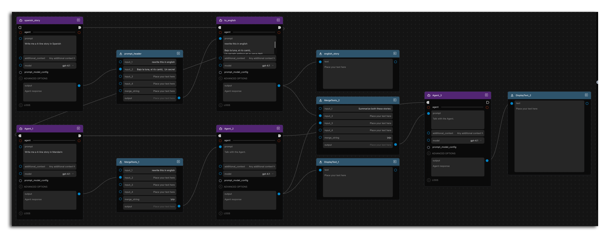

## 運行完整工作流程 {: #run-the-complete-workflow }

執行您擴展後的完整工作流程並觀察整個協同執行過程：

1. 第一梯隊的智慧體各自以不同語言生成故事
1. 文字合併節點即時拼裝出對應的英文翻譯提示詞
1. 第二梯隊的智慧體將各自的故事精準轉譯為英文
1. 終審摘要智慧體將兩篇譯文結合並撰寫綜合摘要報告
1. 多個 DisplayText 節點同步直觀呈現各階段產出

  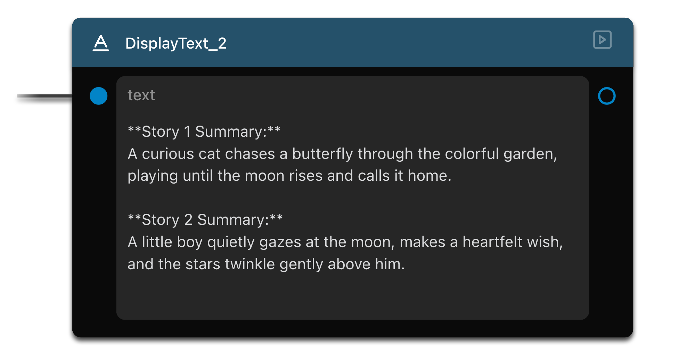

!!! info "結果驗證提示"

    再次提醒！請重點關注輸出結果中整體*邏輯結構*的正確性，而不必強求與教學截圖中的具體文字字字吻合 — 由於 LLM 的創造性，您的具體故事與摘要內容完全可能截然不同！

## 總結 {: #summary }

在本教學中，我們學習了：

- 工作流程如何將任務在多個智慧體之間傳遞以協同完成翻譯等複雜工序
- 探索了如何藉助 "MergeTexts" 節點將前置輸出動態組裝為全新的驅動提示詞
- 學習了利用 "Exec Chain"（執行鏈）精確掌控工作流程執行時序的底層機制
- 成功擴展範本工作流程，追加了跨文本多維度綜合摘要任務

## 下一步 {: #next-up }

在下一節：[第 4 課：提示詞對比](../03_compare_prompts/index.md)中，我們將深入探索如何透過多智慧體接力精細化雕琢提示詞，大幅提升生成結果的品質！
