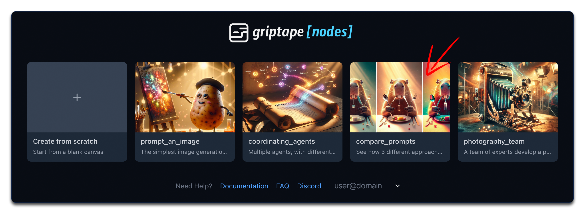
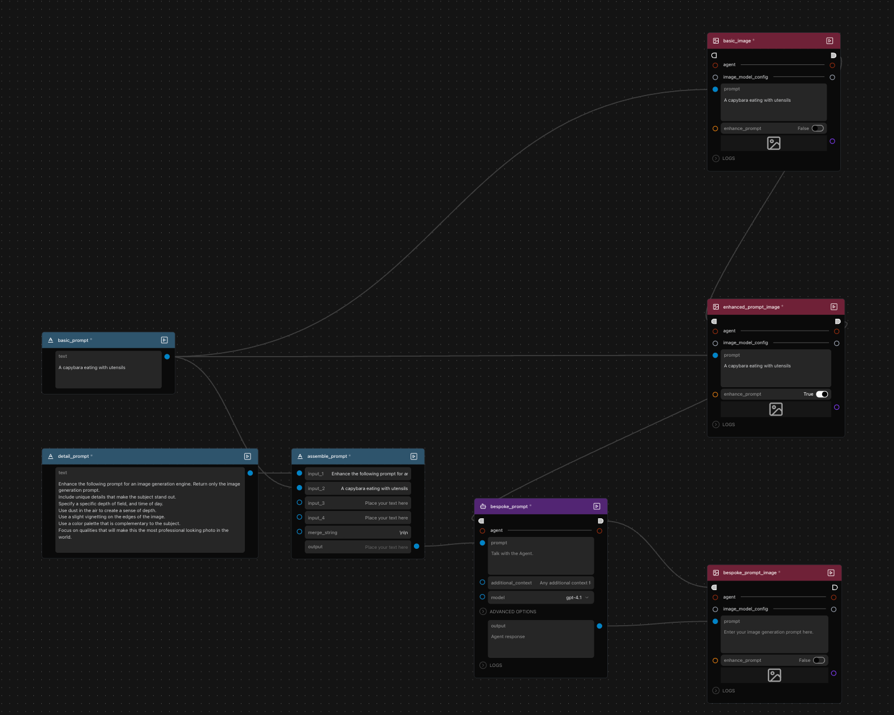
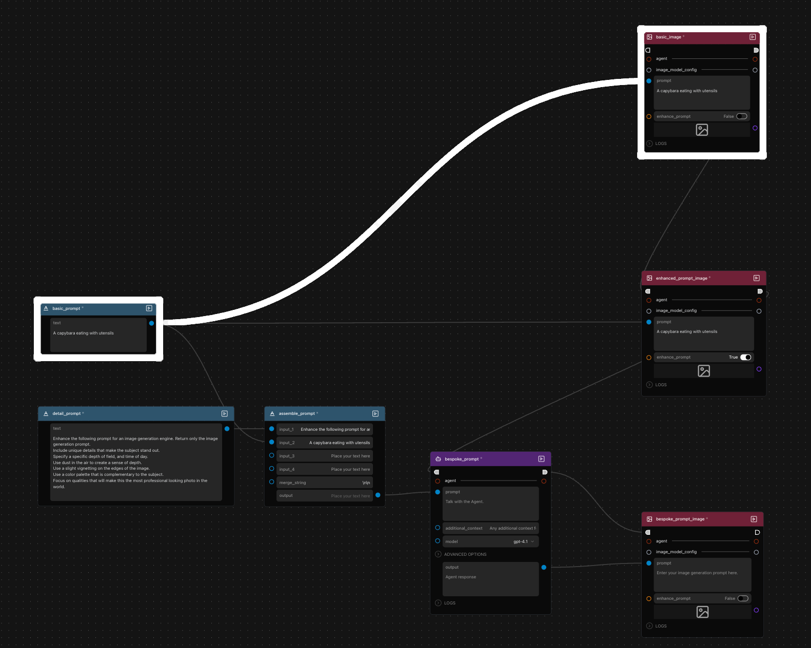
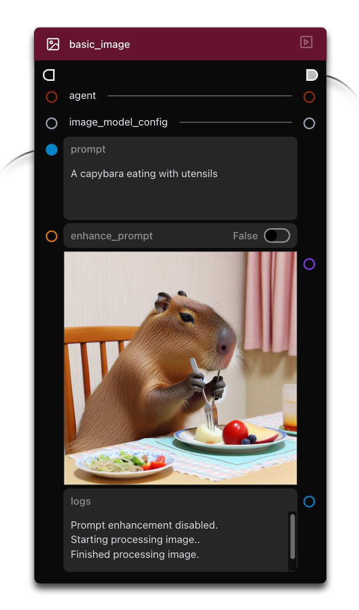
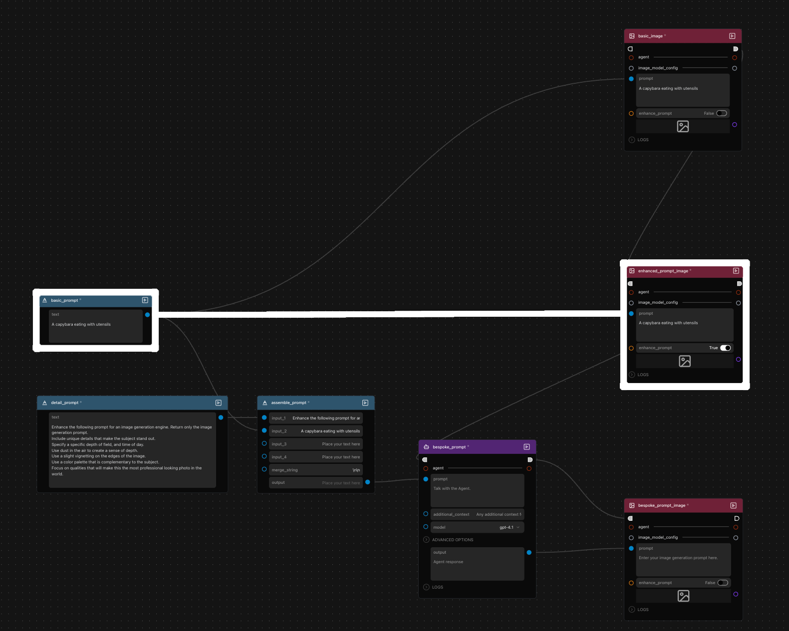
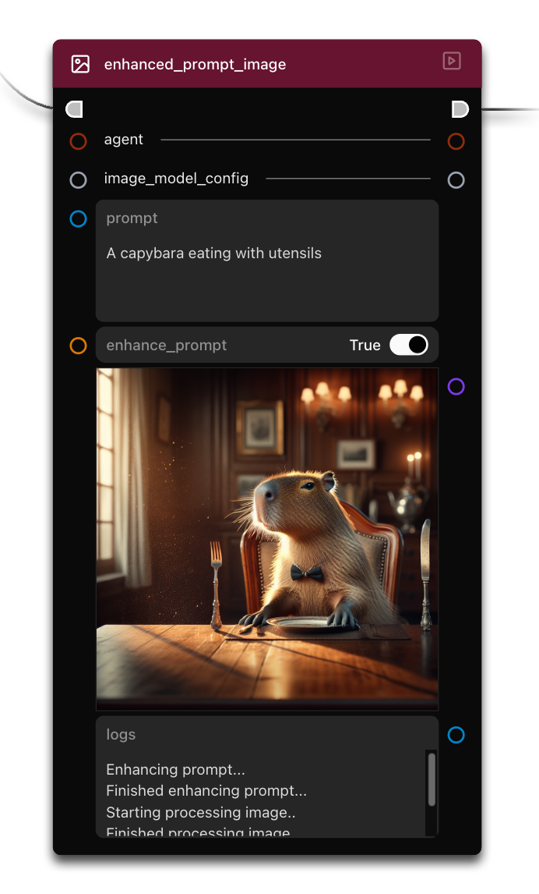
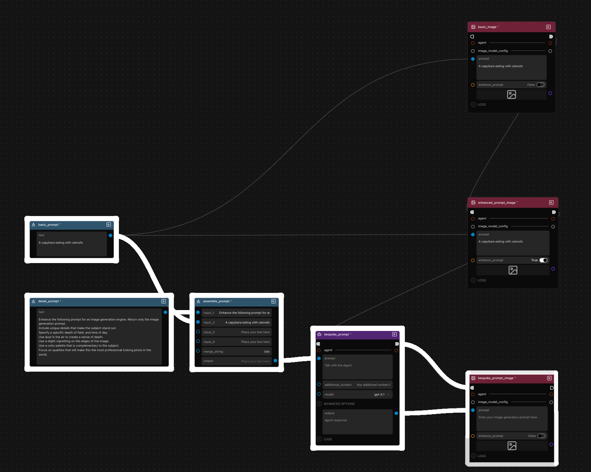
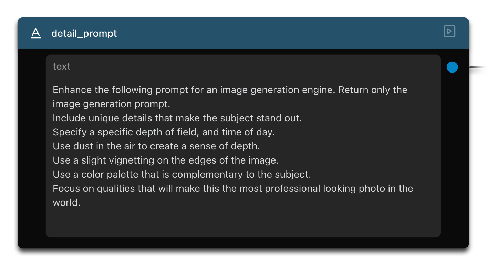
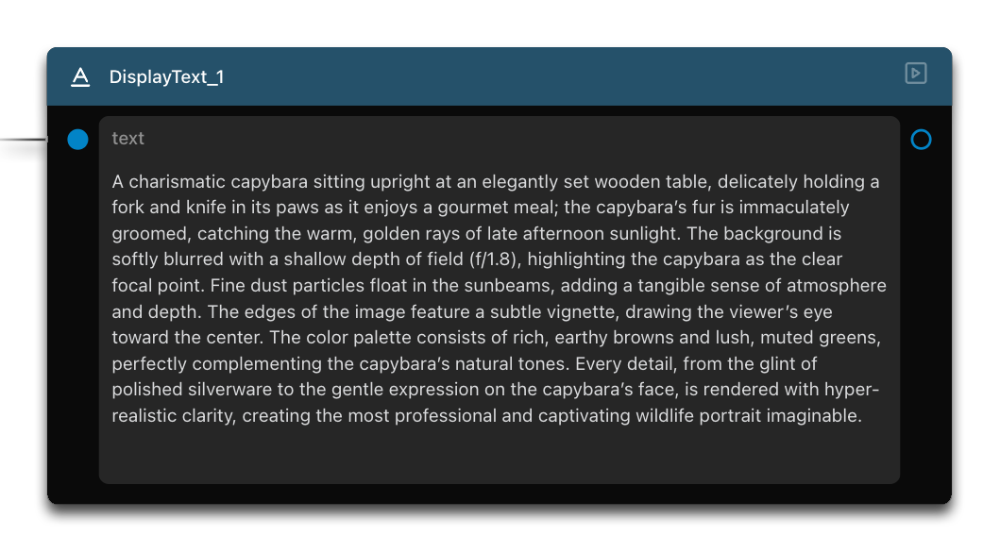
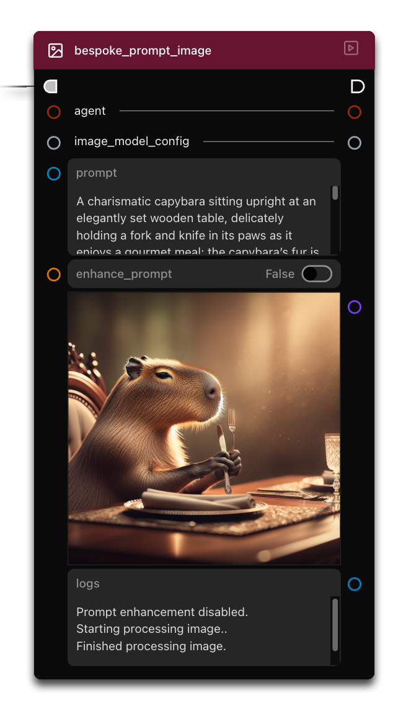

# 第 4 課：提示詞對比 {: #lesson-4-compare-prompts }

歡迎來到 Griptape Nodes 系列教學的第四課！在前幾課建立的多智慧體系統與圖像生成知識基礎之上，我們將深入探索令人興奮的提示詞工程 (Prompt Engineering) 領域。您將掌握如何運用現成的增強方案，並親自構建專屬的提示詞打磨工作流程，從而穩定獲得更高品質的視覺產出。此外，我們還將為您揭開 GenerateImage 節點中 "Enhance Prompt (增強提示詞)" 功能的神奇幕後機制！

## 本課涵蓋內容 {: #what-well-cover }

在本教學中，我們將：

- 對比 AI 圖像生成的三種不同提示詞構建方法
- 深入理解內建的 "Enhance Prompt (增強提示詞)" 機制
- 學習如何搭建自訂的智慧體提示詞增強流

## 返回首頁 {: #navigate-to-the-landing-page }

開始本教學前，請點擊介面左上角的 Griptape Nodes 圖示返回首頁。

## 開啟提示詞對比範例 {: #open-the-compare-prompts-example }

在首頁上，找到並點擊 **"Compare Prompts"** 卡片以開啟此範例工作流程。

  

## 理解工作流程架構 {: #understand-the-workflow-structure }

範例載入完成後，您將看到一個由多個節點組成的完整工作流程：

  

該工作流程包含：

- 兩個 TextInput 文字輸入節點：
    - **basic_prompt**（基礎提示詞）
    - **detail_prompt**（細節增強指令）
- 一個 MergeTexts 文字合併節點：**assemble_prompt**
- 三個 GenerateImage 圖像生成節點：
    - **basic_image**（基礎圖像生成）
    - **enhanced_prompt_image**（內建增強圖像生成）
    - **bespoke_prompt_image**（客製化智慧體增強圖像生成）
- 一個 Agent 智慧體節點：**bespoke_prompt**

我們將依序單獨運行工作流程的各個分支，以直觀對比不同提示詞策略帶來的實際效果差異。

## 對比不同提示詞方法 {: #comparing-different-prompting-methods }

### 方法 1：基礎提示詞 (Basic Prompt) {: #method-1-basic-prompt }

讓我們先從最直觀的基礎方式開始：

  

1. 找到包含簡單提示詞 "A capybara eating with utensils"（一隻使用餐具吃東西的水豚）的 TextInput 節點。
1. 順著連線找到第一個 GenerateImage 節點。
1. 請注意，該節點上的 **Enhance Prompt** 參數設定為 **False**（關閉增強）。
1. 點擊該節點右上角的 **Run Node** 按鈕單獨運行此節點。

仔細觀察生成的圖像。這呈現了 AI 模型對您直接給予的簡短描述所做出的原始詮釋。

  

### 方法 2：使用內建增強提示詞功能 {: #method-2-using-enhance-prompt-feature }

在第二種方法中，我們使用相同的簡短提示詞，但開啟 GenerateImage 節點內建的增強功能：

  

1. 找到接收相同簡短提示詞的第二個 GenerateImage 節點。
1. 注意該節點上的 **Enhance Prompt** 參數已切換為 **True**（開啟增強）。
1. 點擊該節點右上角的 **Run Node** 按鈕運行它。

將此結果與第一張圖片進行對比。您會發現一個細節更加豐富、極具藝術質感的畫面。差異非常顯著 — 儘管輸入的是完全相同的簡單提示詞，增強後的版本卻產生了層次更豐富且視覺衝擊力更強的成品。

  

### 方法 3：客製化智慧體增強提示詞 {: #method-3-bespoke-agent-enhanced-prompt }

第三種方法展示了我們如何親手打造專屬的自訂提示詞增強鏈：

  

1. 仔細觀察我們如何組合 MergeTexts 節點與 Agent 智慧體來精雕細琢提示詞：
    - 將詳盡的提示詞打磨規則輸入到 MergeTexts 節點的第一個輸入埠：

    

    
    

    - 將與其他範例相同的簡單提示詞連入 MergeTexts 節點的第二個輸入埠
    - "MergeTexts" 節點將這兩部分內容無縫拼接
    - 隨後由 Agent 節點消化該綜合指令，專門重寫並生成一段專為圖像生成而優化的高品質提示詞
1. 單獨運行該 Agent 節點。
1. 查看該智慧體的文字輸出（如果希望更直觀地閱讀，您可以添加一個 DisplayText 節點並將其連線！）。

    
  

您會發現智慧體產生了一段極具表現力的提示詞，精確涵蓋了所有攝影與構圖維度：

- 水豚獨特的毛髮與姿態細節
- 明確的光影氛圍（午後溫暖的斜陽金光）
- 景深與背景虛化控制
- 和諧統一的高階調色盤
- 專業單眼相機的構圖細節

1. 最後，運行第三個 GenerateImage 節點（其 **Enhance Prompt** 設定為 **False**）。該節點直接使用我們剛剛由智慧體精心打磨出的高級提示詞。

    
  

觀察這張圖片，相較於第一張基礎圖片，它包含極其具體而生動的藝術細節，其精緻程度與第二種方法不相上下，但更契合我們的特定指令要求。

## 洞悉幕後運作機制 {: #understanding-whats-happening-behind-the-scenes }

這裡的核心洞見在於：當您將 GenerateImage 節點的 **Enhance Prompt** 切換為 **True** 時，Griptape 在底層自動執行的正是我們在第三種客製化方法中手動搭建的邏輯！它在幕後：

1. 提取您的基礎提示詞，並與系統內建的提示詞優化範本結合
1. 傳遞給後台智慧體執行增強處理（指令邏輯與我們編寫的幾乎完全一致）
1. 將智慧體擴充後的優化提示詞作為實際參數提交給文生圖模型

而透過親手構建專屬的顯式增強流，我們獲得了對提示詞如何被豐富、風格如何被塑形的**全權主導控制力**。

## 實際應用與最佳實踐 {: #applications-and-best-practices }

結合本課所學，在您自己的專案中可參考以下選型策略：

- 對於快速探索、驗證概念的簡短文生圖，直接使用基礎提示詞（關閉 Enhance Prompt）
- 當希望以最低成本快速提升整體視覺質感時，直接開啟 "Enhance Prompt"
- 當您需要對特定藝術風格、品牌視覺規範、精確的光影與鏡頭語言進行高度定制控制時，構建基於 Agent 的客製化提示詞增強流

## 總結 {: #summary }

在本教學中，我們涵蓋了：

- 用於圖像生成的三種截然不同的提示詞構建方法
- 深入剖析了 "Enhance Prompt" 內建增強功能的底層原理
- 掌握了構建自訂智慧體提示詞增強流的高階技巧

這些技巧充分展現了提示詞工程的魅力 — 透過巧妙構思與精細雕琢輸入指令，引導 AI 系統精準輸出極具震撼力的高品質作品。

## 下一步 {: #next-up }

在下一節：[第 5 課：構建虛擬攝影團隊](../04_photography_team/index.md)中，我們將學習規則集 (Rulesets)、工具 (Tools) 以及如何將智慧體轉換為可呼叫工具，實現更加複雜強大的多智慧體深度協同！
