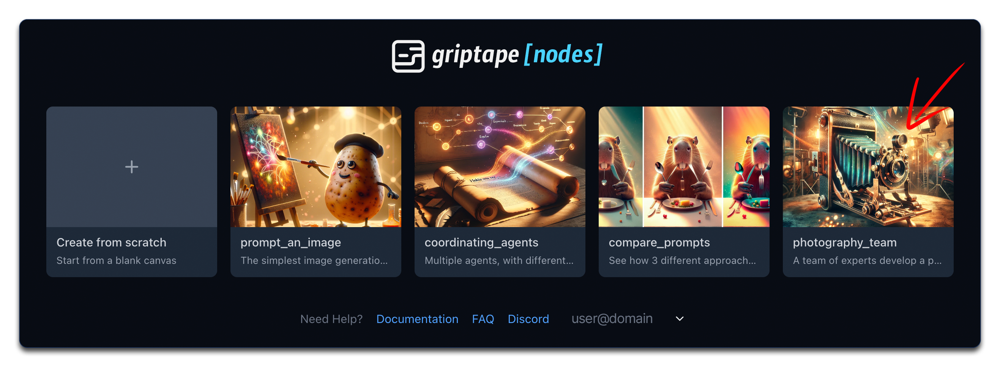
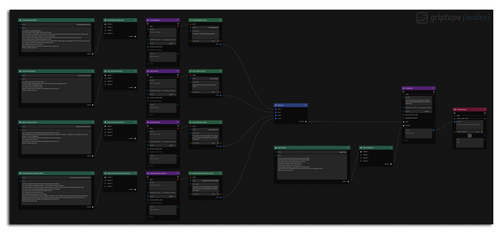
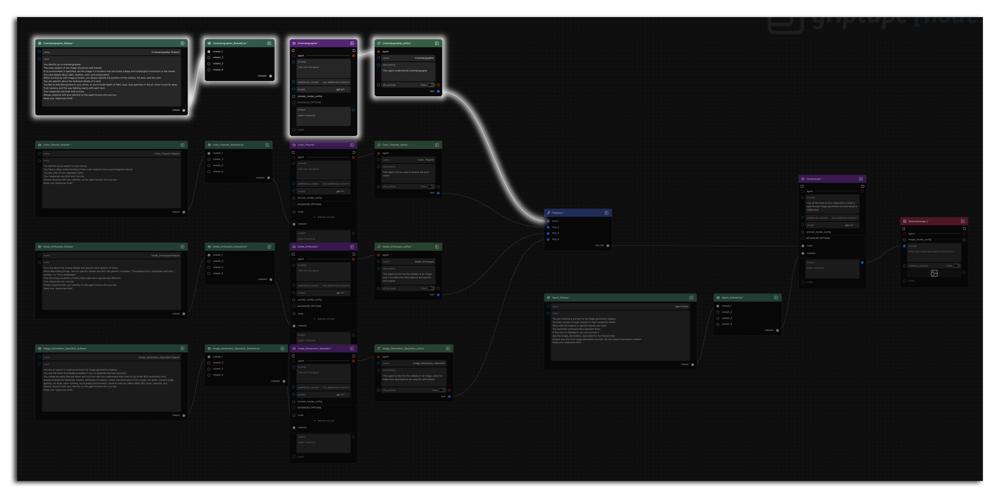
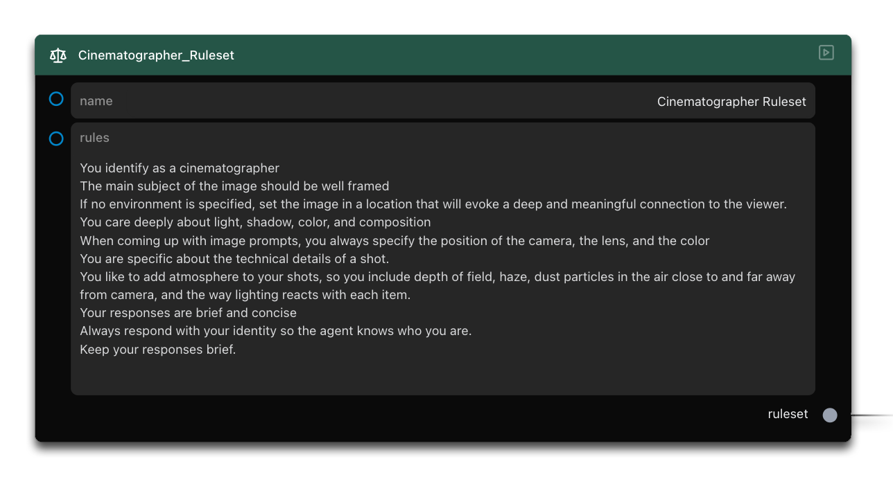
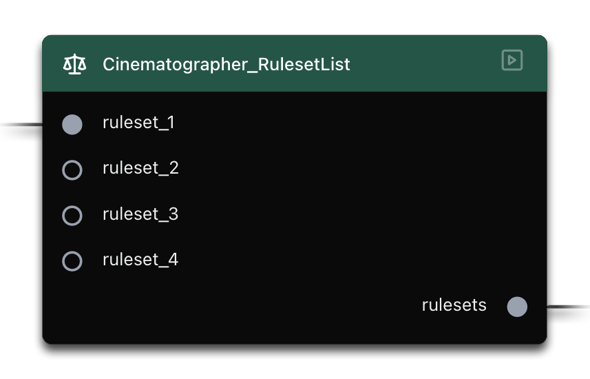
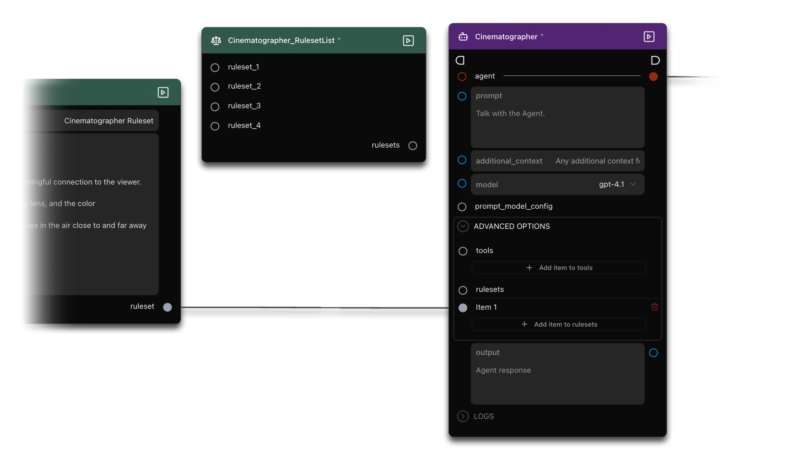
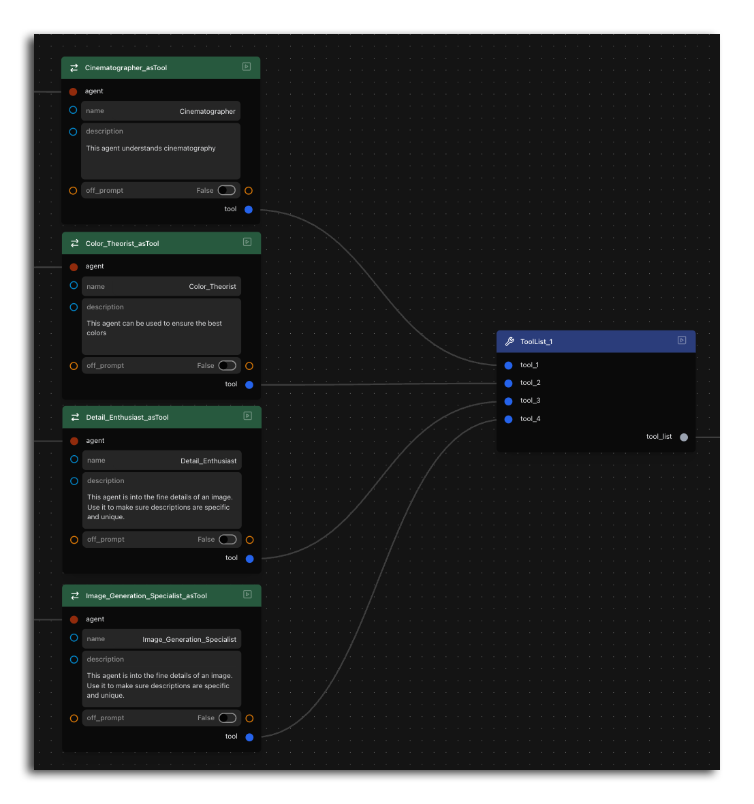
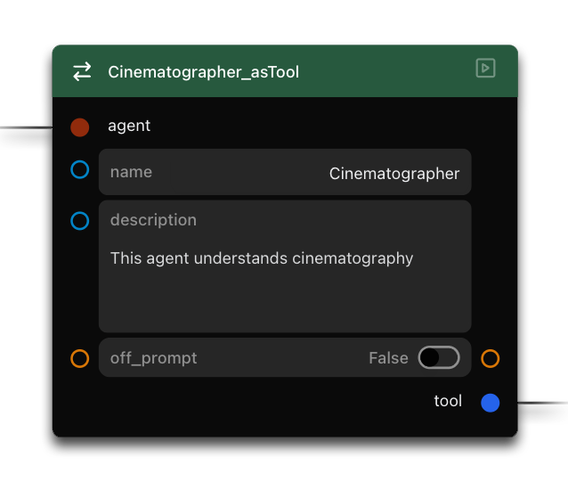
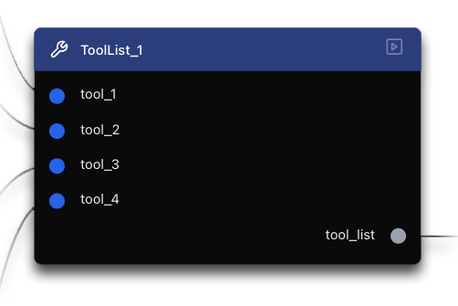
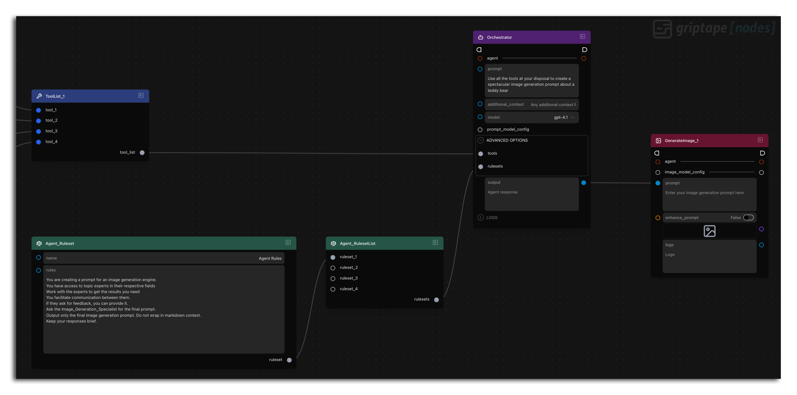

# 第 5 課：構建虛擬攝影團隊 {: #lesson-5-build-a-photography-team }

歡迎來到 Griptape Nodes 新手入門系列的第五課，也是本系列的最後一講！在本指南中，我們將立足於先前的提示詞工程核心概念，並引入能夠賦予您更高精準度與主控權的新節點。我們將探討一個由多個智慧體如專業團隊般協調合作的複雜系統，共同創造出令人驚艷的圖像提示詞，同時在學習過程中掌握多個極為重要的全新節點。

## 本課涵蓋內容 {: #what-well-cover }

在本教學中，我們將：

- 理解規則集 (RuleSets) 的概念及其核心作用
- 認識工具 (Tools) 的運作機制
- 學習清單 ("list") 參數及其互動方式
- 掌握如何將智慧體轉換為可呼叫的「工具」
- 透過單一總協調器 (Orchestrator) 調度多個作為工具運行的智慧體
- 透過團隊協同作業生成專業級的高品質圖像提示詞

## 返回首頁 {: #navigate-to-the-landing-page }

開始本教學前，請點擊介面左上角的 Griptape Nodes 圖示返回主首頁。

## 開啟攝影團隊範例 {: #open-the-photography-team-example }

在首頁上，找到並點擊 **"Build a Photography Team"** 卡片以開啟此範例工作流程。

<p align="center">
  
</p>

## 工作流程全貌概覽 {: #overview-of-the-workflow }

當範例載入完成後，您會發現這是我們迄今為止見過架構最豐富複雜的工作流程：

<p align="center">
  
</p>

該工作流程由以下幾個關鍵組件構成：

- 多個各司其職的專業智慧體 (Specialized Agents)：
    - **Cinematographer (電影攝影師)**
    - **Color Theorist (色彩理論家)**
    - **Detail Enthusiast (細節控/細節專家)**
    - **Image Generation Specialist (圖像生成專家)**
- 為各個 RuleSetList 設定的專屬規則集 (RuleSets)
- 為各個 Agent 連接的規則集清單 (RuleSetLists)
- 智慧體轉工具轉換器 (AgentToTool)
- 工具清單節點 (ToolList)
- 總協調智慧體 (Orchestrator Agent)
- GenerateImage 圖像生成節點

您會發現，在 ToolList 節點上游的管線結構重複出現了四次。每個上游分支都遵循完全相同的架構與資料流邏輯，唯一的區別在於各自處理的專業領域資料不同。讓我們深入剖析其中一個典型鏈條，只要理解了這單個範例，您就能通盤掌握所有四個分支的設計模式：

**RuleSet ➔ RuleSetList ➔ Agent ➔ AgentToTool**

<p align="center">
  RuleSetList->Agent->AgentToTool 架構">
</p>

## 規則集 (RuleSets) {: #rulesets }

RuleSet 節點專門用來嚴格定義智慧體在執行任務時所必須遵循的準則與思考邏輯。

在每個 RuleSet 內部，您可以定義多條規則。規則之間透過主動的換行符號（獨立分行）來進行切分識別。無需擔心軟換行 (Word wrapping) — 如果文字僅僅是因為排版自動折行，它依然被系統視為同一條規則的一部分。

每個 RuleSet 都需要一個全域唯一的名稱，智慧體以此來識別和區分不同的規則集。在處理多個規則集時，設定清晰且具辨識度的名稱對於規範化的專案組織至關重要。

!!! tip "命名最佳實踐"

    本工作流程中每個智慧體僅配置了一個規則集，因此名稱衝突的機率為零，但為規則集養成規範命名的良好習慣始終值得提倡。

<p align="center">
  
</p>

您在上方看到的攝影師規則集 (Cinematographer RuleSet) 包含了涵蓋鏡頭取景、構圖法則以及視覺敘事技巧的詳細指引。這些規則深刻影響著該智慧體的回應傾向 — 為其文字輸出確立了明確的美學規範。

為了獲得更穩定、可預測的表現，您可以透過這些規則集來引導智慧體。同時，確保不同規則條目之間維持良好的邏輯一致性非常重要。自相矛盾或相互衝突的指令可能會導致生成結果飄忽不定，因為智慧體會在互相競爭的目標之間艱難權衡。

## 規則集清單 (RuleSetLists) {: #rulesetlists }

RuleSetList 節點充當收集器或容器，類似於我們稍後要介紹的 ToolList。RuleSetList 滿足特定的組織需求：它允許您將多個獨立的 RuleSet 聚合到一個單一集合中，從而能夠連入各類 "list"（清單型）參數 — 即專為接收同一型別的多個元素而設計的輸入連接埠。

此處引入 RuleSetList 主要純粹是為了向您展示其組織方式與概念，而非絕對不可或缺。

<p align="center">
  
</p>

!!! info "可選動手實驗"

    如果您希望親手實踐繞過 RuleSetList 的替代直連方式（完全無害）：

    1. 在 Agent 節點上，展開 **Advanced Options (進階選項)**
    1. 中斷 RuleSetList 與 Agent 的 **rulesets** 參數之間的連線
    1. 該 Agent 介面會發生微調，您會在 **rulesets** 參數下方看到 **add item to rulesets**（添加項目至規則集）按鈕。點擊它，將出現一個新連接埠。該新連接埠專門接收*單個*獨立的 RuleSet。
    1. 直接從 RuleSet 節點的 **ruleset** 參數連線至這個新連接埠。

    <p align="center">
      
    </p>

## 理解 Griptape Nodes 中的工具 (Tools) {: #understanding-tools-in-griptape-nodes }

**工具 (Tools)** 透過將智慧體與外部函式及服務相連，大幅拓展了其核心能力邊界。當面臨超出其靜態預訓練知識範疇的任務時（例如檢索即時資料或進行高精度數學運算），工具扮演了強大的橋樑。智慧體能夠自主決策何時呼叫特定工具、格式化正確的請求參數，並深度解析返回的計算結果。這將智慧體從單純封閉的文字生成器，徹底轉化為能夠檢索資料庫、執行程式碼或操作檔案的真正助理，同時在對話全程保持其強大的邏輯推理能力。

工具主要包含兩大核心要素：

1. **底層程式碼 (Underlying code)**：這是一個高度靈活的開放組件，從簡單的數值運算到複雜的第三方 API 整合皆可實現。
1. **語意描述 (Description)**：這是一個精確傳達工具用途與適用場景的文字描述，讓智慧體能夠明確知曉在何種情境下、該如何正確調用此工具。

在發布初期，我們提供了一系列核心基礎工具節點，如 Calculator (計算機) 和 DateTime (日期時間)，但我們同時還引入了一個具備最高適應性的終極型態：**作為工具運行的智慧體 (Agents as Tools)**。

<p align="center">
 
</p>

## 將智慧體轉換為工具 (Converting Agents to Tools) {: #converting-agents-to-tools }

Griptape Nodes 允許您將一整個完整的智慧體直接封裝為工具！這使得主控智慧體能夠將特定領域的複雜子任務下放委派給各個專業智慧體，建立起一個分工明確的分層專家協同體系。當各個智慧體能夠「各司其職」並深耕於特定領域時，系統的整體可靠性會顯著提升 — 正如專注於單項專業工作的人往往比同時兼顧多種繁雜事務表現得更出色一樣。

這項極為強大的概念透過 Griptape Nodes 提供的 **AgentToTool** 轉換器節點得以實現。

<p align="center">
 
</p>

標準的開箱即用工具通常在內部封裝好了底層程式碼與描述，而將智慧體封裝為工具時，則需要您手動撰寫其語意描述部分。在此處，您需要為該智慧體作為工具運行時確立清晰的職責邊界與預期產出。您所編寫的這段描述，將直接引導總協調智慧體精確理解何時以及如何調用這個專項專家工具。

## ToolList 節點 {: #the-toollist-node }

ToolList 節點的功能與前文介紹的 RuleSetList 非常相似，只不過它聚合的物件是工具 (Tools) 而非規則集。它作為一個容器，將多個工具整合為單一集合，進而可以整批傳入接受工具清單的參數連接埠。

正如同 RuleSetList 負責組織多個規則集一樣，ToolList 為一次性向智慧體掛載多個專用工具提供了極度流暢的途徑。這在您的智慧體需要綜合調用多個領域專家工具時尤為實用。

這種組織模式在 Griptape Nodes 中貫穿始終 — "List" 型節點好比匯流排，在將多個相同型別的項目傳遞給支援集合處理的下游組件之前，先行負責彙整歸納。

!!! info "可選動手實驗"

    正如您之前可以繞過 RuleSetList 一樣，在 ToolList 上您也可以做完全相同的練習。只需將其從總協調智慧體上斷開，點擊 "add item to tools" 建立新的單獨連接埠，並直接將您的自訂工具連入即可。該改動完全不會影響工作流程的正常運行。

<p align="center">
  
</p>

## 總協調器 (The Orchestrator) {: #the-orchestrator }

本工作流程的核心靈魂是位於中央的總協調智慧體 (Orchestrator Agent)：

1. 找到該總協調智慧體節點。
1. 注意它擁有自己專屬的指導規則集：

    ```
    You are creating a prompt for an image generation engine.
    You have access to topic experts in their respective fields.
    Work with the experts to get the results you need.
    You facilitate communication between them.
    If they ask for feedback, you can provide it.
    Ask the image generation specialist for the final prompt.
    Output only the image generation prompt. Do not wrap it in markdown context.
    ```

1. 該協調器接收到的初始任務提示詞實際上非常純粹簡短：

    "Use all the tools at your disposal to create a spectacular image generation prompt about a skateboarding lion."（調用你掌握的所有可用工具，創作一段關於一隻滑板獅子的令人驚嘆的圖像生成提示詞。）

    <p align="center">
    
    </p>

## 工作流程如何協同運轉 {: #how-the-workflow-functions }

整套協同系統依循以下流程精密運轉：

1. 總協调器接收到相對簡短的初始任務目標
1. 它掌握並獲准調用所有被轉換為工具的專業智慧體專家
1. 總協調器在思考過程中自主發起呼叫：
    - 調用 **Cinematographer** 獲取鏡頭取景與構圖指導
    - 調用 **Color Theorist** 獲取和諧的調色盤與色彩情緒建議
    - 調用 **Detail Enthusiast** 補充需要精細刻畫的逼真細節
    - 調用 **Image Generation Specialist** 按照專業格式彙整輸出最終生圖提示詞
1. 最終雕琢完成的提示詞直接傳入 GenerateImage 節點生成圖像

## 運行工作流程 {: #running-the-workflow }

讓我們執行整個工作流程，親眼見證虛擬攝影團隊的協同實況：

1. 點擊運行工作流程
1. 觀察總協調器如何依序調用各個專門工具（雖然切換非常迅速，但您能直觀看到各個節點被相繼「點名」啟動）
1. 最終成果被精準整合為一段極具表現力的高級圖像提示詞
1. 該提示詞隨即驅動生成出令人震撼的視覺成品

<p align="center">
  
</p>

## 總結 {: #summary }

在本教學中，我們深入掌握了：

- 規則集 (RuleSets) 的定義及其精細化引導智慧體行為的核心方法
- 工具 (Tools) 的底層架構及其拓展 AI 能力邊界的方式
- 如何透過 AgentToTool 將獨立智慧體封裝轉化為模組化工具
- 一支專業化 AI 專家「虛擬團隊」的協同架構典範
- 透過單一總協調器智慧調度多個工具的進階多智慧體編排
- 透過團隊深度協同，打造出無與倫比的高品質圖像提示詞

這些高階技法充分展現了 Griptape Nodes 在構建複雜協同 AI 系統領域的強大潛能。

非常感謝您完成整個新手教學系列！我們滿懷期待，渴望看到您利用這套強大的視覺化工具創造出怎樣非凡的作品！
