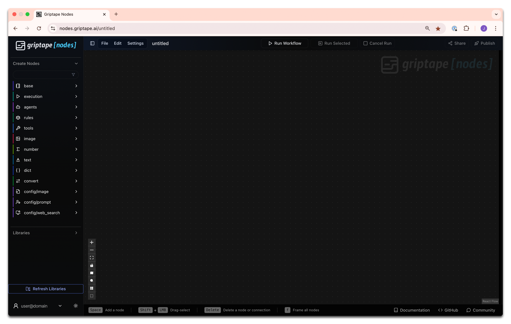

# 教學概述 (Tutorial Overview) {: #tutorial-overview }

歡迎開啟您的 Griptape Nodes 探索之旅！本學習路徑將引導您完成從基礎介面認識到建立由多個智慧體協同作業的複雜工作流程的全過程。

每個教學章節均奠定在前一節所學基礎之上，循序漸進地引入更進階的技巧與核心概念。

- # [第 1 課：新手快速入門](00_tour/index.md)

    

    在完成 Griptape Nodes Editor 的[安裝](../installation.md)之後，現在是時候啟動並親自體驗 Griptape Nodes 了。

    探索介面佈局，並瞭解如何將節點添加到您的工作區中。這篇簡潔卻至關重要的入門教學將為您後續建立各類工作流程打下堅實基礎。

- # [第 2 課：生成圖像提示詞](01_prompt_an_image/index.md)

    

    學習如何使用功能強大的 [GenerateImage (生成圖像)](../nodes/image/create_image.md) 節點，將文字描述轉化為生動逼真的視覺藝術創作。

    本教學將向您介紹 Griptape 生態系統中最受歡迎且功能多樣的代表性節點之一。

- # [第 3 課：多智慧體協調](02_coordinating_agents/index.md)

    

    探索如何協調多個智慧體執行連續的序列任務。

    透過一個跨語言內容翻譯的工作流程，深入學習智慧體之間的連接原理與執行鏈。本教學將為您建立多步驟工作流程的核心思維。

- # [第 4 課：提示詞對比](03_compare_prompts/index.md)

    

    探索幾種不同的提示詞編寫方法，將您的圖像生成水準提升到全新維度。

    對比基礎提示詞、GenerateImage 內建的「增強提示詞 (Enhanced Prompts)」以及自訂智慧體增強提示詞，觀察它們對生成結果的具體影響。學習如何編寫詳盡的指令以獲得更精準的創意控制。

- # [第 5 課：構建虛擬攝影團隊](04_photography_team/index.md)

    

    構建一個由專業化智慧體協同作業的高級系統，共同創作出驚艷的圖像提示詞。深入瞭解規則集 (Rule Sets) 和工具 (Tools)，並掌握如何將智慧體轉換為可重複使用的工具以擴展系統能力。

    這篇進階教學將串聯起您迄今為止所學到的所有關鍵技能。

## 你將學到什麼 {: #what-youll-learn }

完成本學習路徑後，您將熟練掌握：

- 設定與巡覽 Griptape Nodes 使用者介面
- 建立並連接不同類型的功能節點
- 運用 AI 進行圖像生成創作
- 為專業化智慧體實施規則集與工具擴展
- 將智慧體封裝轉化為可重複利用的模組化工具
- 在單一架構中精準協調多個智慧體

準備好踏上 Griptape Nodes 之旅了嗎？讓我們從 [第 1 課：新手快速入門](00_tour/index.md) 開始熟悉介面吧！
